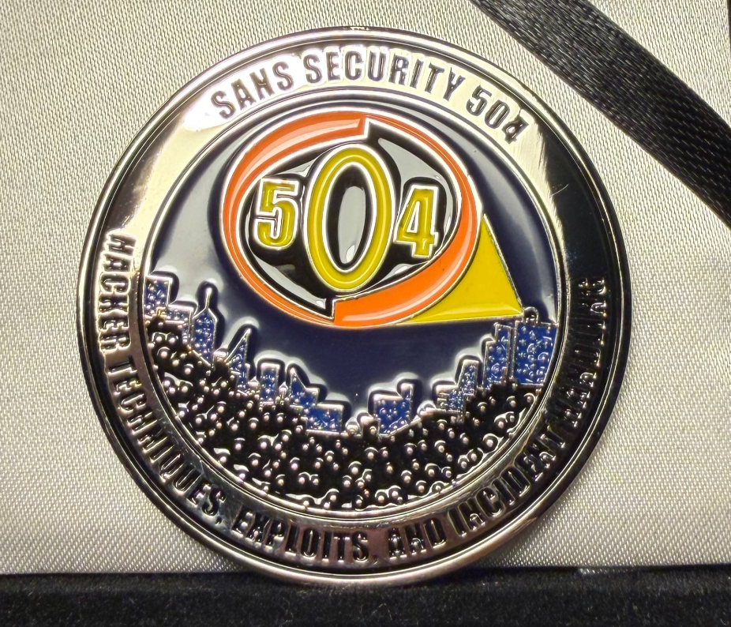
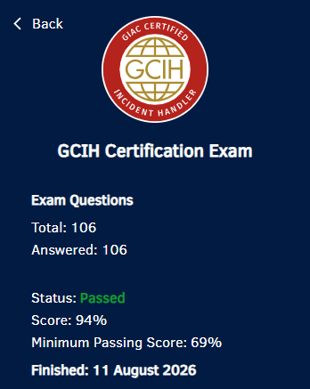

# GCIH Review

## TL;DR

This was my first SANS course, and I was honestly satisfied with the experience. Having Jon Gorenflo fly over to teach SEC504 was amazing. He conveyed the material in an engaging way, and his stories made the classes genuinely enjoyable.

For the exam, the practice tests and material are all you need. It was my first time getting actual books for a cybersecurity course, and learning to index with the Pancakes method was eye-opening. I have my opinions on MCQ exams, which I'll go into below.

I'd say this is more of a pre-OSCP course than an incident handling one. The labs and material teach you attacker tools and techniques really well, so you come out more ready for something like the OSCP than for an actual blue team job. 

I'd recommend GCIH to anyone new to cybersecurity, provided your company is sponsoring you. If you're paying for it yourself, skip it. It's extremely pricey for individuals, as this course makes OffSec look cheap. There are other ways to learn the same foundations for way cheaper, especially when AI is here to explain things better. 

## Background

I went into this course already having passed the **OSCP and OSCE3 (OSWE, OSEP, OSED)**, as well as having worked in various offensive security internships. This made the course feel relatively easy for me, since I wasn't learning these concepts for the first time. The real takeaway was seeing them from a defender's perspective, since that is something I never learned before.

## Introduction

GIAC Certified Incident Handler (GCIH) is the certification tied to the 6-day SEC504 course, "Hacker Tools, Techniques, and Incident Handling". It essentially teaches you the attacker's toolkit and mindset, but frames everything through the lens of an incident responder trying to contain the intrusion.

More about the SEC504 course and its syllabus can be found here:



One section was covered per day of the course. They are as follows:

1. Incident Response and Cyber Investigations
2. Scanning and Enumeration Attacks (`nmap`, SMB, Hayabusa)
3. Password Attacks and Exploit Frameworks (Password Cracking, Metasploit)
4. Web Application Attacks (IDOR, XSS, SQLi)
5. Post-Exploitation and AI Attacks (Pivoting, Persistence)
6. CTF Event

The course was refreshed to include lots of AI content, particularly on how AI can aid both defenders and attackers, and how AI systems themselves can be attacked.

Despite the incident handling name, most of the content is really about learning attacker tools and techniques. The defender framing is there, but I'd say the bulk of what you actually learn is offensive. If anything, this felt like a much better introduction to the attacker mindset than an actual defensive course.

## The Course

Having Jon Gorenflo fly over to teach the course in person made a huge difference. I found myself engaged throughout the days thanks to his real-world stories as a penetration tester. These stories were also extremely helpful during the exam, since I remembered them more than the concepts taught.

This was also my first time receiving actual printed books and an instructor for a course, a nice change of pace from the usual 800 page PDF thrown at you by OffSec. I was a bit overwhelmed with the books initially, since there were so wordy. It felt like I was back in Junior College studying for my GCSEs again. Thanks to my background, the content felt fine, and I was able to keep up with whatever was being taught in class. However, some of my coursemates felt that it was rather overwhelming as everything was new.

It was interesting to see how incident responders and defenders view the attacks gone through in class. Joshua Wright, who designed the course and labs, did a fantastic job in explaining every concept, along with giving their own opinions about tools. I cannot emphasise how good the labs were. Each exercise was useful in putting the concepts to practice, and they were effective in allowing me to practice the tools used. I still found myself learning more about the foundational concepts during the labs, particularly about PowerShell which is something I do not write often. 

The tools, methodologies and attacks covered in this course felt very 'pre-OSCP'. I recall my early days in InfoSec back in 2022, learning about `nmap` and SQL Injection for the first time. It took me weeks to understand these concepts and tools, and obviously there were gaps in my knowledge about them since I only learned enough to do HackTheBox in preparation for the OSCP. This course effectively covered all of that and more in 5 days, which is objectively overwhelming for most.

If I had taken this course before the OSCP, I think it would have saved me a lot of time and confusion. It genuinely feels like the ideal stepping stone into offensive security, not incident handling, mainly because the amazing instructor is able to teach these concepts a lot faster than self-studying can. 

The 5-day course wrapped up with a CTF on day 6, which pulled together everything covered across the week. My team ended up placing 1st and won the SEC504 coin, which was a nice way to close out the course.

## Exam Preparations

Throughout the course, I recorded all commands, concepts, and other notes covered in lectures and labs in a Markdown summary sheet of my own that I could refer to. I also wrote down all important points mentioned by Jon, and ended up with a 55 page PDF. **This was very helpful when revising, since I did not have to spend a lot of time re-doing the labs**. I used this summary sheet more than the books for my practice tests and exam, knowing where I wrote each concept quite well.

For indexing, I used the Pancakes method. To make it easier, I asked Claude to make an Excel sheet I could use to create the coloured index by feeding it the actual Pancakes method blog:



We were given 2 practice tests for this course. I read on Reddit that one should use these to gage how good your index was, as well as to get used to referring to the books. I took both tests, scoring 94% and 96% respectively. Each practice test showed me the gaps in my index and knowledge, which was helpful for the exam.

## The Exam

For the exam, I brought my summary sheet, index and books. The questions were at the exact same difficulty as the practice tests. Obviously I cannot disclose exam details, but I will say that if you did the practice tests and felt confident on those, then the exam will be no different.

I ended up scoring 94% on the exam, which felt great.

In all honesty, I dislike doing MCQ exams for cybersecurity, even if they have lab portions. Something about doing memory work or knowing where to find a specific definition or sentence in the many books given just does not sit well with me.

## Pricing

SEC504 is extremely pricey for an individual, to the point where it makes OffSec's pricing look cheap by comparison. If you're sponsoring yourself, I honestly think you're better off getting an HTB subscription, reading writeups, and asking AI whenever you get stuck. 

That said, if your company sponsors you the way mine did, it's a fantastic experience. The in-person instruction, materials, and CTF make it well worth attending when cost isn't coming out of your own pocket. It is also probably the most effective way for people with less technical experience to get up to speed quickly, since having an actual instructor to ask questions >> figuring everything out alone.

## Conclusion

I highly recommend this course to anyone new to cybersecurity that has a sponsor, since the material and instructor genuinely make it one of the best introductory courses out there, and honestly a great pre-OSCP course. But if you're paying for this yourself, I'd say skip it and put the money elsewhere. HTB, writeups and AI can get you through the same foundational concepts for a fraction of the price, it'll just take slightly longer. 