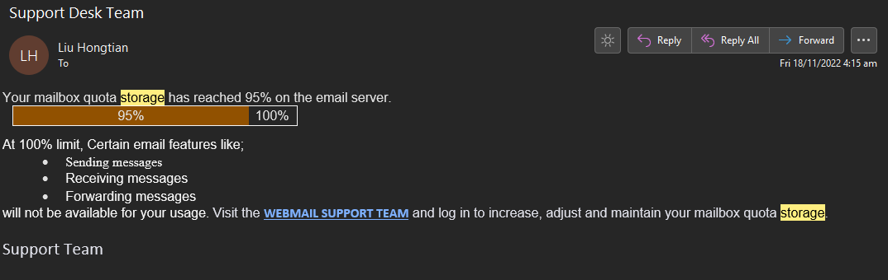
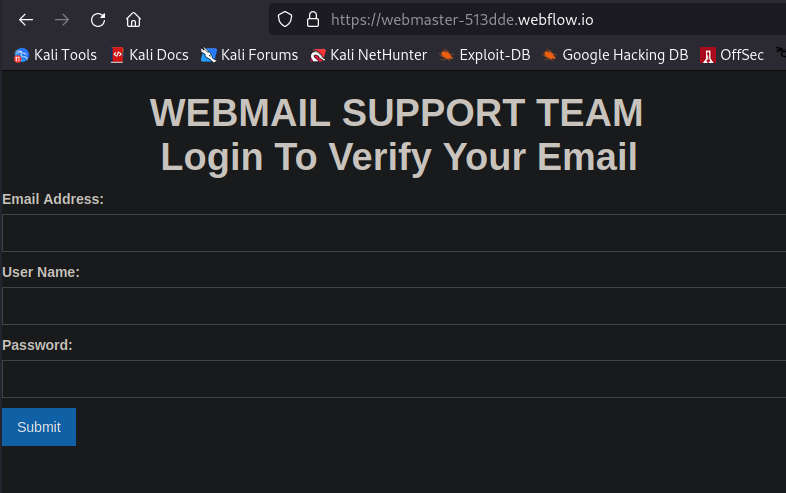
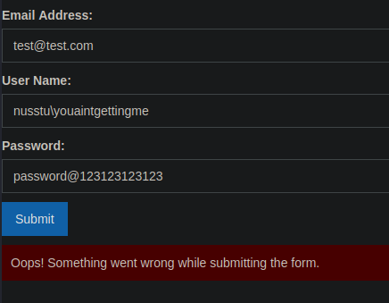
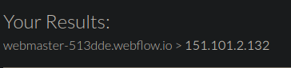
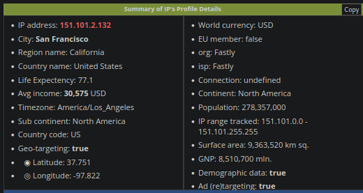

# Liu Hongtian

Here's another email I received.

First thing to ask, who is Liu Hongtian? Doing a search on him doesn't tell me anything regarding NUS mail admin. Also, what's with the weird bar graph and font differences in the email?

When visiting the website, all we see is this.

So this is another low-level scam from another credential harvesting website. When we key in some fake credentials, we get this:

Pretty much obvious that this would be receiving some kind of hit on a remote server and then probably fitting into a text file to be sold online.

We can take this a step further, and instead start to use DNS on it to see where the server's from.

Intriguing, but it looks like it was spoofed. I don't think we can host servers here, doesn't look right. Unless they have a huge boat or something, I dunno.

## Conclusion

Scam!
