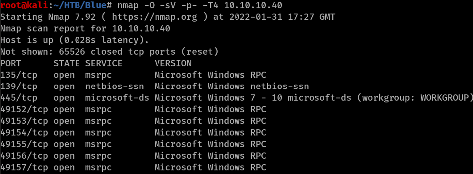
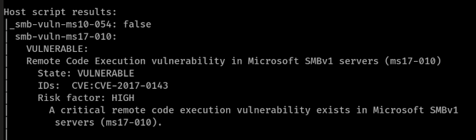

# Blue


I now write on [my blog](https://rouvin.dev/). My old CTF writeups and course reviews will stay here.


## Nmap Scan:

## EternalBlue

Nmap Vuln Scan:

We can use the Metasploit module for EternalBlue to exploit this to gain a root shell as the administrator.
