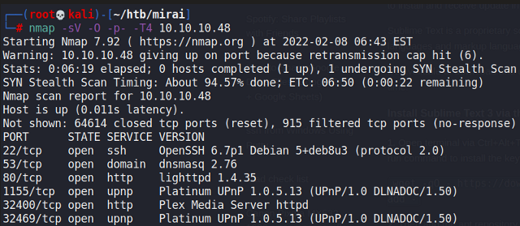
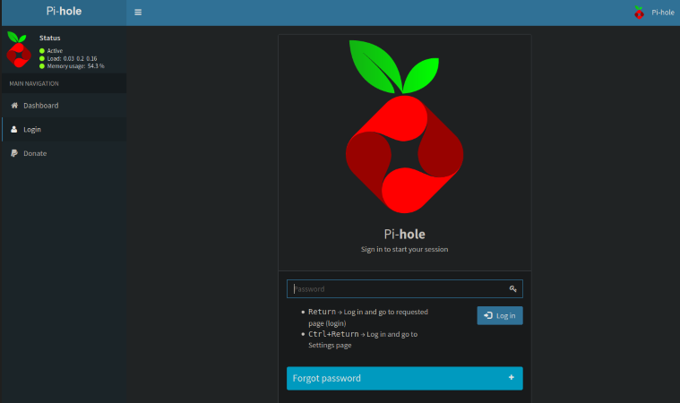
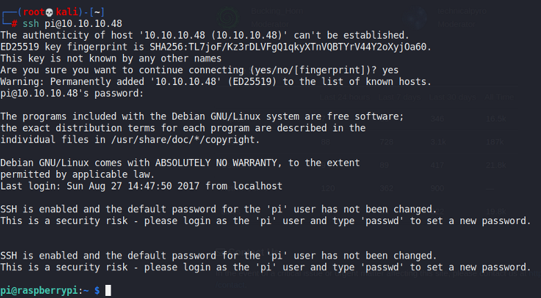
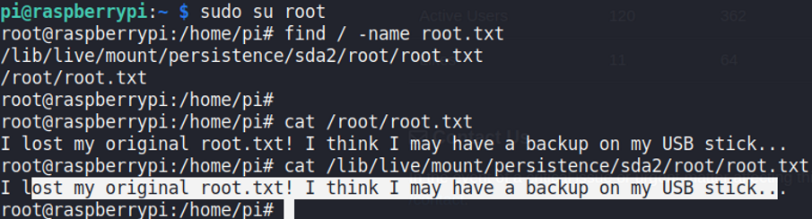

# Mirai

## Gaining Access

Nmap scan:



### SSH Default Credentials

Checking port 80 reveals a Pi-Hole dashboard:



There's a login function, and I managed to login with default credentials of `pi:raspberry`. I also tried to SSH in as `pi` using these credentials, and it worked for some reason:



## Privilege Escalation

### Flag Finding

I was able to run `sudo su` on this machine and search for `root.txt`:



Interesting, because the root flag is where on a USB stick. Now, the backup would probably be some file in a different format and compressed. We know that the flag is a string, so we can use `strings` to get it out. It is stored at `/dev/sdb`.

```bash
strings /dev/sdb
```

This would give us the flag once we search the input sufficiently.
